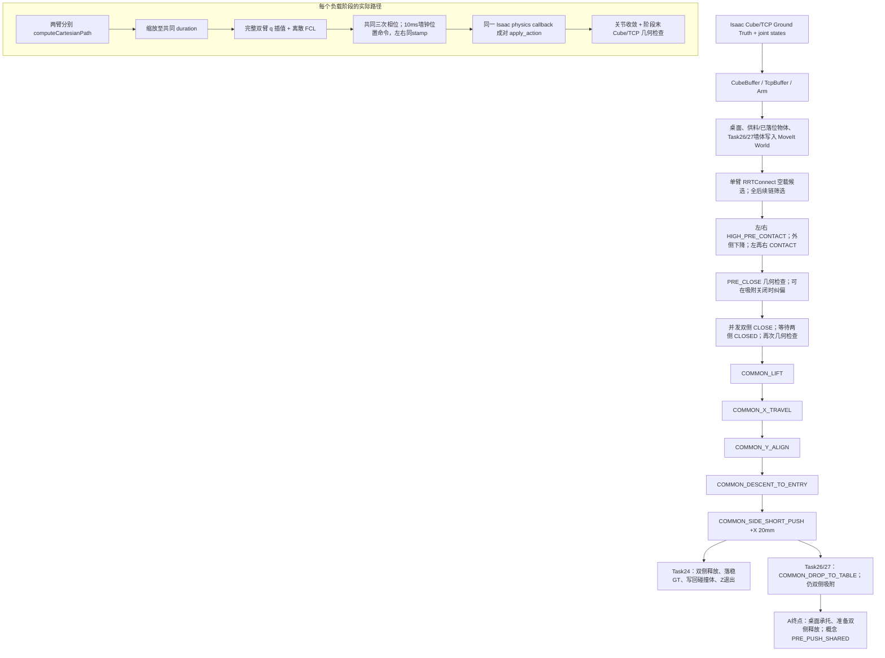
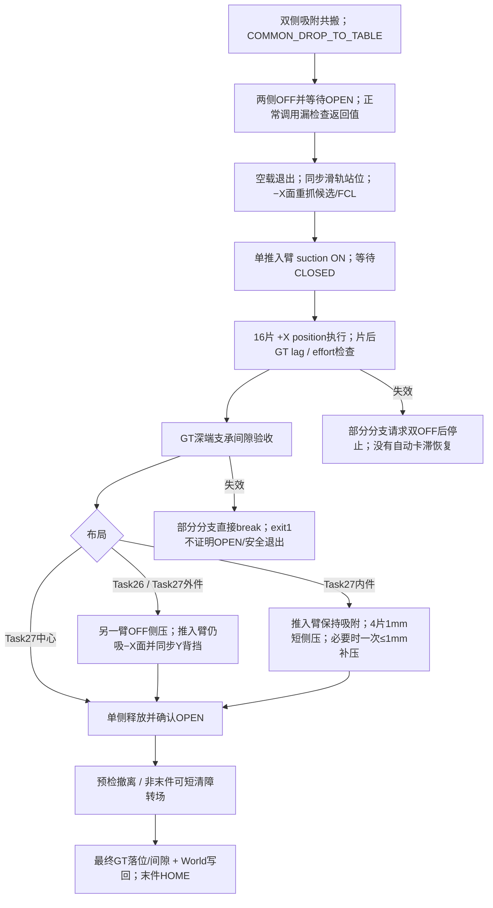

# Task28 G0-A｜双 FR3 侧吸搬运与推入的只读基线、接口及证据审计

审计日期：2026-10-25–26（Asia/Seoul）。结论：**`G1_CONDITIONALLY_READY`**。可在审阅批准后开展隔离的 P4-NR 几何/规划基线；在单件场景、完整闭链/持件碰撞校验及执行门禁冻结以前，**不具备直接进入 Isaac 实体验收的条件**。P5 速度级 QP 和 P2 内力反馈均不能直接接入当前控制器。本次停在 G0-A。

## 1. 范围、版本与判定方法

### 1.1 Git 基线与操作边界

| 项目 | 本次核查结果 |
|---|---|
| 仓库 | `dreamerToTOE/dual-arm-embodied-palletizing`；`origin=git@github.com:dreamerToTOE/dual-arm-embodied-palletizing.git` |
| 分支 | `side-suction-palletizing` |
| 远端/审计起点 SHA | `93faac79560a8918725f853d87ecd7f526f3825f`，克隆前 `git ls-remote` 与独立检出 `git rev-parse HEAD` 一致 |
| 代码变更背景 | `2973c9a`：9/29 动态中心与五件工艺；`d93f285`：9/30 最小清障转场；`631b1f6`：第五件推入臂选择；后两次 10/25 提交为 Task28 路线文档 |
| 路线依据 | 已读 [Task28 路线图](TASK28_PAPER_TO_MAIN_RESEARCH_ROADMAP.md)。当前路线是左右镜像 L 型 2×2 阵列侧吸；Task04–22 顶吸、Task23 二指夹爪为历史替代路线 |
| 原工作区 | `/home/ubuntu2004/lmy/dual-arm-embodied-palletizing`，位于 `task01-runtime-fixes`，HEAD=`d4b290c1f929428e7d3bd6776b6d55709ca34b0f`，存在未跟踪 artifacts/build/install/log 和依赖目录；没有切换、清理或覆盖它 |
| 审计检出 | 本任务 `work/g0a-audit/`，从目标远端分支独立克隆，起始工作树干净；目标仓库未发现 `AGENTS.md` |
| 允许的变更 | 只新增本文、在路线图增加文档链接；原始日志和本机依赖只读 |
| 实际检查 | Git 身份/历史/差异、文本和调用链检查、现有日志检索及 SHA-256、已安装包和 SDK 源码读取、文档一致性检查 |
| 明确未做 | 未启动/操作 Isaac Sim，未发送 ROS joint/suction/rail 命令，未调用规划或物理执行程序，未构建运行算法，未训练，未实现 NR/QP/P2/B1，未进入 G1 |

本文行号均对应上述审计 SHA。源码片段的存在只证明实现；进入 `main()` 的调用链证明连接；物理结论另列实验依据。文档和原始日志没有完整绑定源码/配置 hash 时，不把历史成功无条件转移给 HEAD。

### 1.2 分类与证据强度

| 分类 | 本文含义 |
|---|---|
| `VERIFIED` | 所述**限定事实**有直接证据；必须同时说明是静态调用事实、原始日志事实，还是文档记录事实，不能自动解释为物理验收 |
| `IMPLEMENTED_NOT_PHYSICALLY_VALIDATED` | 有实现，但没有该版本、该场景、该能力的物理验收支持 |
| `CONFIGURED_BUT_NOT_CONNECTED` | 存在配置/功能代码，正常成功路径没有消费该功能 |
| `PLANNED` | 设计建议，尚未实现或试验 |
| `UNKNOWN` | 缺少证据或信号语义/时序/标定尚不确定 |
| `BLOCKED` | 特定后续主张当前不能成立，必须先补所列前提；不表示整个项目无法继续 |

证据层次：**S**=静态源码/接口，**R**=本机实际读到的既有原始日志，**D**=Git 中历史验收报告，**I**=当前安装环境源码/包信息。`VERIFIED(S)` 不等于 `VERIFIED(R)`。没有找到原始日志的历史实验列为“D 报告 PASS；原始复核 UNKNOWN”，不新增成功次数。

### 1.3 环境版本与可复现边界

| 组件 | 只读证据与版本 | 局限 |
|---|---|---|
| Isaac Sim | 本机 `/home/ubuntu2004/isaacsim-4.5.0/VERSION`：`4.5.0-rc.36+release.19112.f59b3005.gl`；Task24/26/27 报告均写 Isaac Sim 4.5 | 当前安装版本，不是每次历史 run 的运行环境 manifest |
| ROS | `/opt/ros/humble`；`ros-humble-ros-base=0.10.0-1jammy.20260607.081808`；`rclcpp=16.0.19-1jammy.20260605.135013` | 当前包数据库，不证明历史启动时 overlay 和 DDS 配置 |
| MoveIt | `moveit-core=2.5.9-1jammy.20260616.094702`；planning-interface、OMPL planner、kinematics 均 2.5.9 | 未启动 MoveIt、未读取活节点参数 |
| OMPL/FCL | `ros-humble-ompl=1.7.0-4jammy.20260226.011457`；`libfcl-dev=0.7.0-3` | 没有历史二进制、链接库 hash 和运行时插件清单 |
| 机器人外部描述 | 原工作区 `ros_ws/src/franka_description/package.xml`：2.8.1；`franka_ros2/franka_fr3_moveit_config/package.xml`：2.7.1；安装目录链接这些源文件 | 为未随本仓库版本控制的外部依赖；新克隆不能独自锁定完整机器人模型 |
| 网络/时钟 | [Task24 报告](TASK24_SIDE_SUCTION_TIGHT_OFFLINE.md)、[Task26 报告](TASK26_TRUCK_BOX_PUSH_IN.md)要求 `ROS_LOCALHOST_ONLY=0` | 不能把 nominal 命令周期、仿真时间、PlaybackTick、物理步和墙钟等同 |

Task27 的 scene/bridge 包装脚本通过绝对路径 `exec()` 原工作区的 Task26 文件（`isaac/scripts/task27_five_cube_center_insert_scene.py:9–16`、`..._bridge.py:9–16`）。因此未来“从独立 checkout 运行”必须验证实际加载文件和构建/install 前缀，不能只记录 shell 所在分支。G0 未运行这些脚本。

## 2. 当前基线：历史结果与 HEAD 能力分开记账

### 2.1 验收与反例

| 场景/能力 | 已有支持 | 分类、限制及未完成事项 |
|---|---|---|
| Task24-H 单 Cube，120 mm / 0.8 kg，0.200 m 桌面，官方 HOME | [Task24 报告](TASK24_SIDE_SUCTION_TIGHT_OFFLINE.md):114–135 记两次独立物理运行，最终 Cube 中心 GT 位置误差 0.184 / 0.115 mm，第二次双侧 OPEN；目标 `(0.820,-0.075,0.260)` | 历史物理基线以 D 保留；报告内容 `VERIFIED(D)`。本次未找到能对应这两次读数的原始完整 run，原始复核 `UNKNOWN`；不能称 HEAD 单件复测通过 |
| Task24-M 八件静态供料 | 同报告:137–161 明确首件零命令预检失败，其他供料件阻塞侧面接近 | 失败记录 `VERIFIED(D)`；八件完整物理成功 **没有成立**。不能删除障碍物或放宽 ACM 来宣布成功 |
| Task26，628 mm 内宽，+Y 一排深/浅两件 | [Task26 报告](TASK26_TRUCK_BOX_PUSH_IN.md):56–92：首轮位置误差 1.018/0.591 mm，重复 1.101/0.462 mm；支撑/侧墙间隙分别 0.636/0.795、0.580/0.116 mm；重复 0.171/1.088、0.462/0.005 mm | D 记两件及独立重复 PASS；本次未定位完全匹配最终几何与读数的原始 run，原始复核 `UNKNOWN`。找到的较早 Task26 PASS 日志使用不同 X 布局，不拿来补证 |
| Task27，606 mm，9/29 动态中心，五件单进程连续 | [Task27 报告](TASK27_FIVE_CUBE_CENTER_INSERT.md):433–459；R1 原始日志五次 batch PASS，最后中心格位误差 0.525 mm、两侧间隙 1.569/1.310 mm | `VERIFIED(R+D)`，仅该历史运行。没有完整多 seed/重启统计；记录最终状态不等于记录连续力峰值 |
| Task27 较早同类复测失败 | R4：搬运对称性超 1 mm；R5：内件间隙 1.961 mm 超 1.5 mm；R6：预吸纠偏只得到单点轨迹后安全停机 | `VERIFIED(R+D)`；保留失败分母与版本差异，不能把阶段续跑与完整新场景成功相加 |
| Task27 9/30 最小清障 + 直达下一件 | R2 第一件落位、短退累计 26.1 mm 后左右转场 FCL 样本 546/446；下一件 PRE_CLOSE 的 X 误差 2.551 mm > 2.500 mm，吸附前停止 | 局部转场 `VERIFIED(R)`；最新流程完整两件/五件成功 `UNKNOWN`，整链为 `IMPLEMENTED_NOT_PHYSICALLY_VALIDATED` |
| HEAD 中心推入臂选择 | `task26_truck_box_push_in.cpp:2579–2589,3354–3363` 的 `center_pusher_arm` 默认 right | 实现 `VERIFIED(S)`；9/29 动态中心 `target_y<0`，旧 `cell.y<0` 选择 left。新默认不能自动继承旧五件成功；该版本独立对照支持不足 |

Task26 与 Task27 的几何及验收不能混合：Task26 内腔 Y 为 ±0.314 m，深/浅 X 为 1.100/0.980 m，首先验收 +Y 一排两件；Task27 为 ±0.303 m，五件同一深 X 层，顺序 `+Y外→−Y外→+Y内→−Y内→中心`。Task27 内件最终邻件间隙约束 `[-0.5,1.5] mm`（源码比较另有 `1e-7 m` 数值容差），中心件每侧 4 mm 上限；均不能替代 Task26 3 mm 支撑/墙缝门槛。

### 2.2 Task24 单件基线尚需恢复的精确信息

**不要给出“`max_cubes:=1 active_cube_count:=1` 即可复现历史单件”的命令。** HEAD `task24_side_suction_tight.cpp:163–174` 的首任务索引是 6（`Cube_07`）；`CubeBuffer::get()` 用 `.at(index)`，`main():1080–1083` 的参数检查却只比较数量，随后:1164–1166 读取索引 6。scene:83,352 创建的是 `SUPPLY_POSES[:ACTIVE_CUBE_COUNT]`。上述数量设为 1 将产生静态可判定的索引不一致，G0 没有运行它。

还存在版本差：历史报告目标 Y=−0.075 m，HEAD 首目标 Y=−0.120 m；报告说 TCP 命令 Z 偏置 +1 mm，而 HEAD `task24...cpp:69` 与 Task26:88 均为 0。`git log` 中 Task24 源文件首次进入当前可达历史已是 `d3efec6` 八件表，未找到独立冻结的历史单件源码提交。

因此 G1 首选**历史 Task24-H 的单 Cube、静止双基座、无车厢/滑轨、双侧固定抓取、直角搬运场景**，而不是八件静态供料或最新 Task27。先找回并冻结历史场景/表/bridge/阈值；找不回时，由研究者批准一个显式的新单件 fixture 和 ID 映射，并将它标作新基准，不能冒称原两次 PASS 的精确复现。此项是 G1 实体运行入口的首要门禁。

## 3. A 阶段：执行链与数据流

### 3.1 真正的程序入口

| 路线 | 执行入口及实际复用 | 连接事实 |
|---|---|---|
| Task24 | `ros_ws/src/fr3_dual_palletize/src/task24_side_suction_tight.cpp::main()`；`isaac/scripts/task24_side_suction_tight_scene.py` + `..._bridge.py` | 独立 standalone 实现；不是调用通用 `SharedObjectPlanner/Executor` |
| Task26 | `.../src/task26_truck_box_push_in.cpp::main()`；`isaac/scripts/task26_truck_box_scene.py` + `..._bridge.py` | 复用 Task24 工艺但代码独立；具有到料、滑轨及 B0 推入 |
| Task27 | `.../src/task27_five_cube_center_insert.cpp:4–5` 定义 `TASK27_FIVE_CUBE` 并 include Task26 CPP；两个 Isaac 包装脚本选择 `task27` | 不是独立新控制器，编译开关改变布局、预吸阈值、内件/中心验收及转场 |
| MoveIt | `ros_ws/src/fr3_dual_side_suction_description/launch/moveit_dual_side_suction.launch.py::generate_launch_description()` | 明确装载侧吸 URDF/SRDF、LMA 两单臂 IK、OMPL/RRTConnect、joint-state bridge 与桌面发布器 |

`PRE_PUSH_SHARED` 是研究路线的概念边界，当前 CPP 没有这个字面状态枚举。Task24 的目标是离线落位，不是 Task26 车厢预推状态。Task26/27 A 终点应以**最后双侧持件、已落桌、释放之前**定义，并同时记录实测 `T_WO`，避免只按名义 `pre_push` 打标签。

### 3.2 运动生成、同步与执行语义

1. `Arm::configure()/planPoseCandidates()` 使用 `RRTConnectkConfigDefault`；对空载单臂抽样候选，按关节行程排序，然后用双臂/后续链筛选。Task26 重抓另有最多三批候选。SRDF 有 `dual_arm` 组，不代表当前使用双臂闭链 OMPL。已有 MoveIt 日志 `moveit.log:142–158` 实际打印 `geometric::RRTConnect`。
2. 负载段使用每臂 `computeCartesianPath()`，`eef_step=0.002 m`、fraction≥0.999、jump threshold=0；Task26/27 再用 FK 检查目标直线偏离≤5 mm。关掉 jump 检查不代表不存在 IK 分支突变，5 mm 贴线检查也不等于旋转闭链残差检查。
3. 两条轨迹只缩放到共同总时长；`executeSync()` 以共同三次进度 `3u²−2u³` 插值位置，并按相同 ROS stamp 发布。这不对齐两条笛卡尔路径的弧长，也不求解闭链；两端速度为零不意味着加速度约束已验证。
4. `JointTrajectory` 的位置采样转换为 `sensor_msgs/JointState`，名称去侧名前缀后发到 `/left/joint_command`、`/right/joint_command`；实际只写 position，不走 `FollowJointTrajectory`/MoveIt execute 的低层控制器。MoveIt 规划的速度/加速度字段不能视作经过执行器逐点约束的命令。
5. bridge 要求双侧标记命令的 `(sec,nanosec)` **精确相等**，不等时丢弃较早一侧，配对后在同一 physics callback 写入两个 `ArticulationAction(joint_positions=...)`。这是成对位置目标同步，不能证明两个真实 TCP 同时达到、载荷分配相同或内力受控。
6. 阶段末关节收敛、Cube/TCP 对应几何和 CLOSED 状态提供物理反馈。没有持续全 SE(3) 闭链投影或全程力反馈；FCL 是规划参考轨迹的离散几何检查，不是物理实时接触监督。

Task26/27 `main():4516–4553` 先短推至 `pre_push.x`，随后 `COMMON_DROP_TO_TABLE` 的目标 X 为 `entry_x=pre_push.x−20 mm`、Z 同时降低 20 mm。该命名阶段的实际命令是后退并下降，不是纯 Z；应记录真实边界。Task27 候选预检也用 `candidate_entry_x`，两者并无 X 目标不一致。Task26 早期候选全链的 DROP 预检受 `TASK27_FIVE_CUBE` 条件包围，实际 DROP 仍会另经 `stage()` 规划/FCL，不能将早期“全链通过”理解为所有后续状态已被同一候选覆盖。

### 3.3 规划检查与执行检查的覆盖范围

| 约束/信号 | 规划中实际检查 | 执行中实际检查 | 缺口及分类 |
|---|---|---|---|
| 单臂可达、IK、RobotModel 限位 | MoveIt 规划/Cartesian | 位置执行、最终 q 收敛 | 速度/加速度及物理追踪约束没有统一执行门禁 |
| 双臂/工具与环境碰撞 | `validateSync()` 的完整双臂 RobotState，约 10 ms 参考时域插值后 `checkCollision()` | 预检后的轨迹下发；没有在线 measured-q 全场景 FCL 循环 | `VERIFIED(S)` 离散规划检查；不是连续碰撞保证 |
| 当前被抓 Cube | 从 World remove 后的快照用于负载检查；未挂为 attached body | Cube 真实刚体仍在 PhysX，与工具/环境碰撞 | **持件-环境/持件-机器人扫掠未由该负载 FCL 完整覆盖**；不能因未改 ACM 就声称完整 payload FCL |
| 双侧对应几何 | 目标由共同坐标常量导出 | `validateDualSideAttachment()` 检查 X/Z、世界Y两侧间隙/对称性、Cube 对世界单位姿态偏角 | 不是 `T_OL/T_OR` 全 SE(3) 保持；未利用两 TCP quaternion 做吸附朝向闭链误差 |
| 抓取保持 | 规划假定固定双侧 | CLOSED、阶段末几何、Cube GT | 无吸力余量、滑移率、D6 六维负载或逐杯状态 |
| Cube 姿态/落位 | 轴对齐名义目标 | 阶段末姿态与最终位置/墙缝 | 每阶段采样不能替代连续时间最大误差 |

关键源码：`task24_side_suction_tight.cpp::validateSync():900–975`、`main():1198–1200,1757`；`task26_truck_box_push_in.cpp::validateSync():1410–1485`、`main():3129–3131,3341`。当前 Cube 在 PhysX 中没有被删除；这里指出的是 **MoveIt 负载碰撞模型边界**。

## 4. 坐标、抓取变换与接口库存

### 4.1 坐标约定

统一记 `T_AB` 为把 B 坐标中的点映射到 A；长度 m、关节 rad、力 N、矩 N·m。ROS pose quaternion 顺序 `(x,y,z,w)`；Isaac/DC 四元数构造须按各 API 的字段读取，不能依赖裸数组猜顺序。

| frame / 数据 | 当前定义、来源与用途 | 限制 |
|---|---|---|
| `world` / Isaac `/World` | URDF world 根；地面 Z=0、桌顶 Z=0.200；Cube pose 和 TCP PoseStamped 发布 world | 不是相机测量，均仿真 Ground Truth |
| 左/右基座 | `dual_fr3_side_suction.urdf.xacro:29–35`，分别 `(0.65,-0.60,0)`、`(0.65,+0.60,0)`，rpy=0；scene 同构 | Task24 固定；Task26/27 实际沿 X 滑轨运动，URDF 没有轨道关节 |
| `left/right_fr3_link8` | Franka flange frame，来自外部 `franka_description`；Isaac rigid-body link8 是 SurfaceGripper parent | 不能当作吸盘 TCP |
| `left/right_fr3_side_suction` | 固定到 link8、零原点；L 支架及四杯 collision geometry | 四杯几何不等于四个独立可观测吸附约束 |
| `left/right_fr3_side_suction_tcp` | `dual_side_suction.xacro:65–75`：相对 link8 `(0,s·0.155,0.080)`，绕 local Z 为 `s·π/2`，left s=−1，right s=+1 | Isaac scene 同时创建 translate+RotateZ TCP；应比较完整 frame 标定 |
| 两侧抓取朝向 | `sidePose()`：TCP +X 指向 Cube 法向，+Z 世界向下；left quaternion `(√½,√½,0,0)`，right `(√½,−√½,0,0)` | 构造目标相对于世界坐标；没有从任意 Cube 姿态组合全抓取变换 |
| −X 面推入朝向 | `pushPose()` quaternion `(1,0,0,0)`，TCP +X 指向世界 +X；Cup 在 Cube 的−X 面 | “沿+X推”不是吸住+X面 |
| Cube object frame O | Ground Truth pose 的中心，120 mm Cube，默认轴对齐；`worldPose()` orientation.w=1 | 无专用可随物体运动的 MoveIt object DOF，也没有活动路径上的通用 SE(3) grasp contract |
| 轨道后的 planning world | `task26...cpp:202–211,2685`：`g_world_shift_x=mean(base_x)−0.650`；`sidePose()/pushPose()/墙体构造` 减该值，GT `worldPose()` 不减 | 只在两轨同步平移时等价；不是14+2 DOF 联合规划。不同步/读数未知会拒绝，不能把两种 world 混用 |

现有“抓取变换”主要是 world X/Z 对应、`cube_y±(0.060+0.001)` 和固定朝向常量。D6 会在捕获时保存两物理刚体间关系，但没有将此关系通过 ROS 作为 `T_OL,T_OR` 交给闭链规划器。G1 应在确认双侧稳定后的同一时刻定义 `T_OL=T_WO⁻¹T_WL`、`T_OR=T_WO⁻¹T_WR`，同时保存名义值、实测值、时间和 frame ID；不能把 1 mm 目标间隙当成实测闭链标定。

### 4.2 信号与命令表

下表的“实际量”只指仿真状态/求解器派生反馈，不暗示实体硬件传感器。P5/P2 更详细的语义和更新率见后文。

| 接口 | 类型 / 数值来源 | 正常路径消费者 | 已有支持与缺口 |
|---|---|---|---|
| `/left/joint_states`、`/right/joint_states` | `sensor_msgs/JointState`，Isaac ROS graph 的 q、可能含 qdot/effort | `Arm`、`DualJointStateBridge`、MoveIt | q 在历史执行中使用；各字段完整性/时间差须独立记录 |
| `/joint_states` | 合并的14关节，名称 `left_fr3_joint1..7,right_fr3_joint1..7` | MoveIt current state | `dual_joint_state_bridge.py:71–95` 缓存左右最新消息并以接收端 now 重打 stamp；没有两臂采样同步/年龄门禁。`Arm` 到位判断直接读取两侧原始 joint_states |
| `/left/joint_command`、`/right/joint_command` | `JointState.position`，命令量；内部 `fr3_joint1..7` | Isaac bridge `_apply_joint_command()` | position 可用；velocity/effort 字段不进入命令路径 |
| `/task24/cube_poses`、`/task26/cube_poses`、`/task27/cube_poses` | `geometry_msgs/PoseArray`，USD 世界中心/姿态 | `CubeBuffer`、抓取/跟随/落位验收 | array 索引是隐含 ID；不含质量、协方差、接触/滑移或 scene version |
| `/<task>/left/side_suction_tcp_pose`、右侧同名 | `PoseStamped`，USD TCP 世界 pose | `TcpBuffer`、几何纠偏/验收 | quaternion 已发布，但当前对应检查没有形成完整双TCP旋转闭链约束 |
| `/<task>/left/suction_command`、右侧同名 | `std_msgs/Bool`，请求量 | SurfaceGripper bridge | `<task>` 是 `task24/task26/task27`；Bool 本身无 stamp、事件ID/确认序号 |
| `/<task>/left/suction_state`、右侧同名 | `std_msgs/Bool`，`is_closed()` | `waitSuction()` / 抓取确认 | 不区分手动释放、断裂、捕获错误、逐杯密封失败 |
| `/<task>/left/measured_joint_forces`、右侧同名（Task26/27） | `JointState.effort`，优先 `get_measured_joint_efforts()`，fallback 语义见§7 | `ForceBuffer` 和可选 `WrenchEstimator` | topic 名称含 forces，实际字段是 effort；不是 D6 wrench，无来源/有效性标志 |
| `/<task>/left/rail_command`、`rail_state`（及右侧） | command Float64；state Float64MultiArray `[target,arrived,measured,x_min,x_max]` | `RailClient`、世界平移和到位互锁 | 来源为仿真基座 Xform 移动；不是有电机动力学的实体轨道反馈 |
| FCL collision / contacts | `CollisionRequest/Result`，规划 RobotState 与 World 几何计算 | `validateSync()` 等门禁 | collision bool、失败 contact pair 可用；几何距离/最近点 API 在库中存在，但成功路径不持续输出 `d_min` |
| 实际接触 wrench、D6 reaction、吸附内力 | 当前无 ROS 数据接口 | 无 | `UNKNOWN`/未连接；不能由 Cube 未掉落或 CLOSED 推出负载余量 |

## 5. P4-NR：最小接入架构与前置条件

### 5.1 可复用什么、不可直接接什么

**可复用的接口（`VERIFIED(S)`）**：14 关节双臂 `RobotModel/RobotState`、真实侧吸 TCP、LMA 单臂 IK、FK、独立 PlanningScene、当前同步 position-stream 输出格式，以及已知物体 GT。复合 `dual_arm` 组存在；模型本身并无随对象运动的虚拟 SE(3) 关节，也没有现成闭链 IK。新增物体层状态 `T_WO` 与固定抓取对，可以在保持现有机器人模型的情况下生成两 TCP 目标，但任意旋转/狭窄通道的双臂可达性仍待验证。

**通用 shared-object 库不是当前侧吸规划器**。`shared_object_planner.cpp::validateStage():554–734` 确有双 TCP/FK、payload pose 更新与更强的误差检查；但 `chooseDualGrasps():397–405` 要求顶面抓取，`link8TargetForGrasp():330–337` 使用顶吸偏置，`ArmContext:807–824` 固定 link8/compact_suction，局部 ACM 也使用 compact 名称。CMake:609–692 的 Task24/26/27 目标不链接它；它的实际调用者在 `task20_runtime_execute.cpp:383,707`、`task22_moveit_dispatch_gateway.cpp:483`、`task22_sequential_runtime_execute.cpp:541,564`。这些历史替代实现必须保留；不能直接导入其 frame、4 mm/.050 rad 门限或碰撞例外后称侧吸 P4 已接好。分类：对本路线 `CONFIGURED_BUT_NOT_CONNECTED`。

NR 方法来源可追到外部复现仓库 commit `79ad22c7fded963e0b8e9cc50caadb242bca8108` 的 [P4 方法卡](https://github.com/dreamerToTOE/dual-arm-coordinated-manipulation-reproduction/blob/79ad22c7fded963e0b8e9cc50caadb242bca8108/references/P4_closed_chain.md) 与 [TASK04_NR_PROJECTION](https://github.com/dreamerToTOE/dual-arm-coordinated-manipulation-reproduction/blob/79ad22c7fded963e0b8e9cc50caadb242bca8108/docs/tasks/TASK04_NR_PROJECTION.md)：采用 closure residual/Jacobian 的 Newton–Raphson 伪逆投影，基本形式 `q(k+1)=q(k)−Jc(q(k))† C(q(k))`，逐中间状态投影后接受边。该外部文件在本次只读检查，不能以其他仓库的数值 PASS 替代当前任务。原文符号、投影/局部连接参数、阻尼/步长是否为 adaptation，仍须在 G1 开始时冻结；不把现有空载 RRTConnect 改名为 NR。**PCS/RSS 延后，NR 独立验收前不开始比较。**

### 5.2 建议最小组件（全部 `PLANNED`，G0 未实现）

| 组件 / 建议接缝 | 输入→输出与职责 | 进入下一组件的硬条件 |
|---|---|---|
| `FrozenSideSuctionScenario` | 源码/依赖/场景 hash、物体ID和几何、完整 world、qL/qR、frame变换、同步GT、attach mode、seed/预算 | 单件索引正确；标定和物体/障碍物一致；初始状态有明确可行性证据 |
| `RigidGraspPair` | 固定 `T_OL,T_OR`；候选 `T_WO`→`T_WL*=T_WO T_OL`、右侧同理 | 校验 TCP 法向、左右工具镜像、同一对象、单位/时间；不每tick重估抓取变换来掩盖滑移 |
| `ClosedChainKinematics` | `q∈R14`→两个 FK、两份推导的物体姿态、6维 closure 残差；现有单臂 IK 提供种子，NR 投影闭链 | 关节 bounds、数值有限、残差收敛、旋转误差和分支连续性；奇异/迭代失败必须返回原因 |
| `CompletePayloadValidator` | 私有 PlanningScene 的完整双臂/工具、按候选对象姿态放置的 Cube、桌面/其他障碍；调用 FCL | 不再通过删除当前 payload 绕过负载碰撞；保留现有 ACM。预期工具接触的几何策略须显式评审，不能把整个含支架的 suction link 设为 touch-link 后忽略结构碰撞 |
| `ProjectedPlanner/EdgeValidator` | 对象 SE(3) 参考和闭链投影/局部连接→完整路径；中间插值重复 closure、bounds、payload FCL | 验证边和**实际 playback 插值**；只查树节点不够。采样步长和角度步长冻结，不能声称离散检查等于连续碰撞检测 |
| `PlanResult/TrajectoryAdapter` | typed 结果 + 双臂轨迹 + 同一时间律；首先接到新隔离 executable/namespace | 规划结果已通过独立 validator；双臂按实际执行插值再次校验；现有 suction/命令实现不就地改写 |
| `ExecutionObserver` | q、Cube/TCP、attach有效性、时钟、计划ID→独立执行结果 | 不将“已发完命令”当成功；阶段/执行失效原因单独记录；不承担 P5/P2 未实现能力 |

闭链误差可由 `T_WO^L=FK_L(qL) T_OL⁻¹`、`T_WO^R=FK_R(qR) T_OR⁻¹` 的相对 SE(3) 定义；同时记录对象跟踪误差。平移与旋转分别以 m/rad 报告、明确权重/尺度，避免把两个量纲的范数直接解释成毫米。NR 求闭链与“末端都追同一个对象轨迹”是两个相关但不同的验收项；保持闭链不保证到达目标，目标可达也不保证整条边闭链。

最小扰动接点是**新建侧吸规划 adapter，替换隔离试验中负载阶段 `planAndCheckCommon()` 所提供的候选路径**，保留已验收 approach、抓取和释放工艺作对照。尚未建议将旧 `SharedObjectPlanner` 整体改造并直接接回主流程，也不要求为 G1 同时更换底层控制器。

### 5.3 失败必须分层

| 层级 | 建议结果码 | 科学解释 |
|---|---|---|
| 输入/状态 | `INPUT_INVALID/FRAME_MISMATCH/STALE_STATE/ATTACH_MISMATCH` | 数据/模式不合法，不计作规划器找不到路径 |
| NR/规划 | `IK_UNREACHABLE/PROJECTION_DIVERGED/MAX_ITER/SINGULAR/NO_PATH/TIMEOUT` | 在冻结预算下的算法失败；保留所有种子和尝试 |
| 独立约束复核 | `JOINT_LIMIT/CLOSURE_VIOLATION/PAYLOAD_COLLISION/EDGE_INVALID` | 候选无效；即使 planner 返回 success 也拒绝执行 |
| 执行 | `COMMAND_TIMEOUT/TRACKING/GRASP_LOST/POSE_ERROR/RELEASE_UNCONFIRMED` | 物理/接口失败，不能重写成纯规划失败 |
| 成功 | `PLAN_VALID` 与 `EXECUTION_PASS` 分字段 | 前者不升级为后者；需要独立日志/GT验收 |

现有 monolithic `bool/break/exit1` 只提供部分文本原因，没有上述完整 typed contract。新增结果结构应属于 G1 隔离实现，而非 G0 修改现有程序。

## 6. P5：集中式约束 QP 的真实接口边界

### 6.1 观测、命令与更新率

| 数量 | 类型/来源 | 当前语义与率 | 能否直接作为 QP 输入/输出 |
|---|---|---|---|
| q | 仿真状态反馈，`/joint_states.position` | ROS graph OnPlaybackTick 发布，再合并；实际频率/左右时差未测 | 已用于规划/settle；须新增年龄、有效性和同步快照门禁 |
| qdot | 状态反馈字段若有完整7/14维则合并 | bridge只在左右都完整时保留；当前控制路径无高频实测 qdot 约束验收 | 不能假设始终可用/正确；需确认字段、单位、时间基准 |
| qddot | 当前无直接观测接口 | 可由带时间戳 qdot 差分估计，须另记滤波/延迟/噪声 | `PLANNED` 数值估计，不是已测加速度 |
| joint effort | Isaac求解器派生值，Task26/27 独立topic | `_publish()` 约每0.05仿真秒；数值语义/回退见§7 | 不直接当 TCP wrench；不能混成测得外力矩 |
| position command | `Arm::publishAt()`→JointState.position→bridge | `kDualCommandPeriod=10ms`，nominal 100Hz墙钟；末端200次hold约2s；到位另等待 | 当前唯一已连接的机器人命令路径 |
| velocity/effort command | `JointState.velocity/effort` 或 Isaac native action | ROS bridge只取 position；没有速度/扭矩 command topic 或 mode切换 | **当前 `BLOCKED`**：发 velocity 字段不会控制机器人 |
| physics application | 同一 physics callback 应用左右 action | nominal命令频率≠physics频率；场景未固定 physics dt，实际率/RTF 未记录 | 不能宣称100Hz硬实时速度闭环 |
| Cube/TCP/state | `_publish()` 的仿真时钟节流 | nominal约20Hz；真实墙钟频率取决于仿真速度 | 不足以无条件证明每个10ms输出都经过最新GT闭链门禁 |

`isaac/scripts/task24_side_suction_tight_bridge.py::_joint_command/_apply_joint_command/_step` 与 Task26 对应函数构成 position-only sink。已安装 Isaac `ArticulationAction` 支持速度字段属于**库能力**，不证明当前 ROS bridge 已接通、安全驱动模式已配置或负载执行通过。上述实测率、延迟、丢包、抖动、暂停恢复行为均为 `UNKNOWN`；G0 不运行探针来补证。

### 6.2 限位与碰撞接口

外部 `franka_description/robots/fr3/joint_limits.yaml` 经 `common/franka_arm.xacro:15,56–148` 写入当前 URDF。核查到的静态限值如下（rad / rad·s⁻¹ / N·m）：

| 关节 | q下限 | q上限 | v上限 | effort上限 |
|---|---:|---:|---:|---:|
| J1 | −2.9007 | 2.9007 | 2.62 | 87 |
| J2 | −1.8361 | 1.8361 | 2.62 | 87 |
| J3 | −2.9007 | 2.9007 | 2.62 | 87 |
| J4 | −3.0770 | −0.1169 | 2.62 | 87 |
| J5 | −2.8763 | 2.8763 | 5.26 | 12 |
| J6 | 0.4398 | 4.6216 | 4.18 | 12 |
| J7 | −3.0508 | 3.0508 | 5.26 | 12 |

这些是**配置常量**，不是本次测得的动态极限。Task26/27 scene `FR3_OFFICIAL_JOINT_LIMITS_RAD` 与 `_apply_official_joint_limits():335–366` 显式将 USD 位置范围对齐；Task24 未做相同对齐。Task26 还有 `_apply_diag_overrides():369–410` 读取外部 `task26_diag.json` 改腕部 maxForce/stiffness/damping 的诊断通道，Task27 在函数入口禁止继承它。本次仅看到 `.json.off`，不能据此断言历史每轮正式配置都没有覆盖；未来需记录有效 USD 属性和外部文件清单。

MoveIt `Arm::configure()` 设置 v/a scaling=0.12，但当前 launch 未显式加载自定义 `joint_limits.yaml` 加速度覆盖；直接发布 position 后也没有 ros2_control `JointLimitsInterface` 在中间逐点执行限幅。轨迹自带 timing、共同时间缩放与最后的三次进度都需重新计算实际 qdot/qddot；仅调 `execution_time_scale` 不构成严格限速/限加速度证明。Task26/27 的全局80 N·m分段门限也不是逐关节87/12 N·m限制器。

**FCL现成能力与正常路径要区分**：当前 `validateSync()` 调 `PlanningScene::checkCollision()` 返回 bool/contact；未请求成功状态下的距离或梯度。已安装头文件提供 `collision_detection_fcl/collision_env_fcl.h:85–89` 的 `distanceSelf()/distanceRobot()`，`collision_common.h:157–244` 有 signed-distance、nearest points、normal 选项；`RobotState::getJacobian()` 在 `robot_state.h:1151–1190` 可读。它们证明 I 级 API 存在，**不证明当前已实现关节空间距离梯度、实时全场景安全约束或满足QP周期**。FCL normal 是几何最近点方向，不是自动得到 `∂d/∂q`；需要点Jacobian、坐标/符号校核及接近退化边界的负对照。自碰、臂间、工具/环境、payload/环境都要覆盖；当前payload缺口不能被SVM臂间边界替代。

### 6.3 可行的后续接入方案与停机策略（`PLANNED`）

集中式 QP 可位于 P4 参考与唯一双臂命令出口之间，输入对象参考、同一时刻 q/qdot、固定抓取对、碰撞数据，输出14维受约束 qdot。无需更换任务排序、空载接近和 B0，但必须先解决下面二选一的 actuator contract：

- 新增/验证真正速度模式 bridge，确认驱动模式、双臂原子应用、单位、sample-and-hold、watchdog与限幅，再批准实体运行。
- 把 QP 速度按明确dt积分为小步位置目标，复用position sink；这是需明示的适配，必须验证servo带宽、累计误差、暂停/恢复和边间碰撞，不能宣称已拥有原生速度接口。

QP 内可表达预测下一步 q bounds、qdot bounds、与上次有效命令/实测量定义一致的离散加速度界，以及双臂闭链速度等式；碰撞线性化需独立外部复核。solver输出必须检查状态、非有限值、残差、超时、界限和下一步几何有效性。不可行/过期/unsafe时不发布未过滤结果，不默默放宽安全/闭链约束；先同步保持最后验证的安全position参考，再按桌面支承和抓取模式决定受控停止/释放，禁止把“零速度字段”发给position-only sink当停机，也禁止负载悬空时无条件双侧脱开。

优先补测：无负载单臂→双臂同步的命令语义/率/延迟/冻结恢复，再带既有Cube场景。每一项均是未来最小实验建议，G0未运行。**P5结论：约束建模可设计；当前低层接口和动态安全证据不足，直接速度QP集成为 `BLOCKED`。不训练 SVM。**

## 7. P2：有限吸附、反力观测与内力控制

### 7.1 当前吸附实现的精确边界

| 项目 | 已连接实现 / 参数 | 结论和限制 |
|---|---|---|
| 工具几何与约束数 | scene/URDF 四杯 collider；bridge 每侧只创建一个 `Surface_Gripper()` | `VERIFIED(S)` **每侧一个聚合 D6**，并非四杯独立密封/负载/失效模型 |
| parent / anchor | `/World/{side}_fr3/fr3_link8`；local `(0,s·0.155,0.080)`，quaternion z=`s·√½`, w=`√½`，沿 offset local+X raycast | 与规划TCP相同的安装几何；实际抓住的body ID没有发布/白名单 |
| D6 名称 | Task24 `.../task24_side_surface_gripper_joint`；Task26/27 `.../task26_side_surface_gripper_joint` | Task27沿用Task26内部名，ROS namespace仍隔离；名称本身不构成可读 USD wrench 传感器 |
| capture distance | `gripThreshold=0.003 m` | 抓取建立阈值，非最大滑移/安全距离 |
| break force / torque | `forceLimit=1e6`、`torqueLimit=1e6` | **破断阈值**，不是控制器把实际力钳到该值；不能说真实吸盘无限吸力 |
| joint / bend | `bendAngle=0.0` | 已安装 gripper 源码走 fixed/all6axis、zero-limit 分支；不能把它理解成每杯柔性接触模型 |
| stiffness / damping | 左右均 `1e4 / 1e3`；backend同时赋给 limitStiffness/limitDamping | 有限配置值已赋值；fixed后端实际等效柔顺性/单位响应**未标定**，不能仅据字段宣称精确阻抗 |
| gravity | `disableGravity=False` | 没有为附着物禁用重力；不等于吸附负载已经测得 |
| close/retry | `retryClose=True`；desired ON 时每physics step `update()`，未CLOSED时约每0.05仿真秒再close | 持续捕获/自动重试；有限吸附实验中可能掩盖断裂后短时再吸附 |
| 正常释放 | Bool desired=false→下一physics callback `.open()`→销毁D6/清closed；控制器等OPEN | 只在确认与失败分支都正确消费时才构成严格互锁 |
| break | backend `getD6JointConstraintIsBroken()`→open | 当前ROS只有低频Bool，无独立断裂时间/原因/计数/锁存；短暂break+重抓可能遗漏 |

连接位置：`isaac/scripts/task24_side_suction_tight_bridge.py::__init__:92,_build_gripper():154–200,_physics_step():269–293`；Task26 `_build_gripper():307–347,_physics_step_inner():720–745`，Task27 包装复用。对应安装源码：`isaacsim.robot.surface_gripper/include/SurfaceGripper.h:147–160,191–276,299–333`；DynamicControl `DynamicControlTypes.h:232–253` 明示 breaking force/torque。

raycast 抓到首个非 parent 刚体，保存相对 anchor；任务 bridge 没有强制目标 Cube ID。现有 GT 对应几何能降低误吸风险，但 CLOSED 本身不能证明吸住的是预期对象。G1/P2 应记录实际 attached body 与两个 anchor；当前属于 `UNKNOWN` 观测能力。

### 7.2 哪些力可读、哪些仍未知

| 力量/力矩 | 本次证据 | 分类 |
|---|---|---|
| D6真实约束reaction wrench | 当前bridge完全没有读取/发布。已安装 SurfaceGripper D6 handle为private；DynamicControl D6接口可create/destroy/get/set properties/check broken，未见该接口的reaction getter | 当前路线**不可观测/未连接**；可否通过别的PhysX约束接口可靠取得该外部D6反力 `UNKNOWN`。不能据此扩大成“Isaac全局不支持反力” |
| `get_measured_joint_efforts()` | 当前Task26/27优先调用；已安装 `single_articulation.py:598–631`、`articulation.py:1279–1345` 使用DOF投影的求解器关节力 | 仿真派生量；不是硬件F/T，也未证明是已扣除动力学/重力的外力矩 |
| `get_measured_joint_forces()` | 安装接口为 `(num_joint+1,6)` incoming joint wrench，row0为base，前三力/后三矩；关节行需metadata index+1 | 可作为未来候选观测，**不是**自动等于独立外部D6的reaction |
| 当前effort fallback | Task26 bridge:747–763 异常后改读上述六维量，二维时取 `array[:,0]`，:814–822 又标成 `fr3_joint1..N` effort | **静态语义缺陷**：可能把base及一维力分量当转动关节矩。没有API来源标记，不能确认历史是否走fallback，也不能当有效外力标定 |
| FCL contact depth/pair | 规划几何碰撞结果 | 几何计算，不是PhysX接触反力 |
| Cube GT lag / TCP偏差 | 仿真pose反馈 | 可识别几何偏离，不能唯一确定内力/吸力 |
| 单臂/双臂internal wrench | 无双侧六维wrench与grasp-map分解 | 当前闭环 `BLOCKED`；最大关节effort或左右同步position不足以求内力 |

需要区分“真实测量”与仿真读数：此系统没有接入实体力传感器；q、Cube/TCP和求解器反力候选都是仿真派生。`forceLimit/stiffness` 是配置；`JointTrajectory` 是命令/计划；由q/qdot差分、`Jᵀ`逆解或静态bias得到的是估计。上述各类必须在日志中分字段，不能统一命名 `measured_force`。

### 7.3 WrenchEstimator 仅诊断，不能直接复用为P2反馈

`task26_truck_box_push_in.cpp::WrenchEstimator:1827–2001` 只在 `wrench_probe` 非空分支:2692–2775 实例化；随后记录CSV并 `break`，不会进入正常推入。已有 `t26_wrench_probe5.log:8–13` 及 R7 CSV 299行数据支持“收到信号并静止减bias后力约0”；20 ms计算循环可以重复同一个20Hz缓存，299个计算样本不是299个独立物理读数。探针按设计可能exit1，不把它算任务失败率或任务成功。该能力为诊断路径 `VERIFIED(R+S)`；动态力校准 `UNKNOWN`。

估计器用0.5s静止均值bias、手写6×7 Jacobian，求 `(Jᵀ)⁺(tau−bias)` 后只取前三维力、沿首任务 `pre_push→cell` 的方向投影并用15Hz LPF。它没有构型相关动力学/重力/摩擦/tool质量补偿，没有q/effort时间配对与奇异值/残差门禁；首任务位移含Y目标时该投影轴也不一定等于实际+X推入方向。

还有可静态定位的 frame 问题：CPP:1922–1938 用 **parent link** 的世界Z轴和原点当第j关节轴/原点，未应用FR3 joint origin变换。外部 `franka_arm.xacro:66–72` 与 `robots/fr3/kinematics.yaml:10–26` 的J2 roll=−π/2、J3平移/roll=+π/2说明两者不等价。因此**不能把这个Jacobian当经验证的P4/P5/P2数学接口**。最小未来核查是用MoveIt `getJacobian()` 与FK有限差分独立对照；G0没有执行数值试验。

### 7.4 有限吸附基线的最小科学设计（`PLANNED`）

1. 冻结当前高破断阈值方案为“理想聚合附着对照”，保留原始配置与全部历史记录，不改Task24/26/27。
2. 首先补事件观测：对象ID、desired/actual attach mode、anchors、break/手动release/再捕获的时间与原因、锁存失败和重试状态；固定明确的break后处理策略。否则20Hz Bool加自动close会污染失效率。
3. 验证可信wrench：优先有frame/符号/单位明确的D6 reaction；若不可得，使用经标定的incoming-wrench或动力学observer，并明确不确定度/可观测子空间。静态已知重力、已知偏心力矩、单/双侧作用反作用、动态工况分别核查；“API有数值”不等于校准。
4. 用固定抓取几何和一致frame的grasp map区分净物体wrench与internal wrench；闭链pose残差、物体跟踪、内部载荷、吸附承载余量分开记录。先确认可执行的低层控制权，再研究内力目标。
5. 容量依据须独立于任务成功选取：真空压差/有效面积、真实工具或可追溯规格、密封/剪切/法向/扭矩和偏载数据。只有聚合D6标量阈值时，明确叫**合成有限附着代理**，不伪装真实四杯真空模型。阈值来源和不确定区间预注册，不能从成功轨迹反选有利阈值。
6. 预先定义多档有限容量、重复次数和所有失败准则；包含偏心、加减速、转弯、抬升、单侧失效/逐杯代理、故障释放。物体/几何/ACM/控制预算相同，披露全部滑移/断裂/再吸附与峰值统计，不更改成功标准来获得PASS。

**P2结论：当前D6为高阈值聚合附着基线；可信内力观测、有限承载映射和低层安全控制均未建立，内力闭环 `BLOCKED`。这是必做后续门禁，不是可用同步位置命令跳过的研究部分；也不要求把P2同时塞进G1。**

## 8. B阶段：B0现有工艺与B1未来模式

### 8.1 B0的实际状态转换

这是现有代码控制流，不是已经实现的接触驱动混合自动机。Task26文中旧注释仍有“先右释放后左释放”等描述，实际以 `COMMON_DROP_TO_TABLE` 及:4560并发OFF为准。

| 动作 | 正常路径的实际连接证据（`task26_truck_box_push_in.cpp`，Task27宏复用） | 限制 |
|---|---|---|
| 双侧释放 | `openBothAndConfirm():2651–2667`；正常调用:4560 | 等OPEN 6s；该调用忽略bool结果，不能称严格互锁已完整实现 |
| 换位与新吸附 | `PREPLANNED_COMMON_RETREAT:4562–4603`、rail/replan:4754–4777、drift gate:4779–4798、pusher ON:4800–4808 | 重新在−X面吸附，是**新grasp mode**，非无附着接触建立；其后Cube重量由桌面承担 |
| 分段+X推入 | `executePushWithSupervision():2508–2564`，调用:4813–4822 | 16段position；用**命令轨迹端点FK**预测Cube X，并与最新GT比；不是测得TCP力或速度导纳 |
| 支撑验收 | `validDeepWallSeat():2429–2437`，调用:4826–4833 | 深件以+X墙，浅件以同排深件作支撑；abs gap≤3mm，另查Z；非接触力判据 |
| 内件短侧压 | :4835–4949，4片固定1mm；必要时按GT一次≤1mm补压，候选及退出先做IK/FCL | GT反馈位置修正；当前9/29完整成功轮未触发extra trim，其他历史partial run有触发 |
| 外件侧压/背挡 | `planSideCompaction():3924–4080`、helper OFF:5189–5194、执行:5241–5268 | helper无吸附，原−X面pusher继续吸附并Y跟随。不能将整个Cube动作标成unbonded |
| 最终释放、撤离、验收 | :5133–5187、5270–5333、`validCellPlacement():2442–2504` | Task27有最新短退转场覆盖局限；最终GT并非连续力峰值证据 |

### 8.2 哪些监督确实连接，哪些只是配置

| 功能 | 实际状态 | 证据/限制 |
|---|---|---|
| +X Cube lag | `VERIFIED(S+历史R)`，硬编码20mm阈值 | CPP:353–359,2532–2552；取 `cubes.get()`，片后未强制`waitNew`；它是较宽的跟随失效门限，不是最终3mm间隙验收 |
| +X effort guard | `VERIFIED(S+历史R)`，两臂最新消息各关节abs最大值，再取max，与80N·m比 | CPP:2542,2554–2559；`ForceBuffer:1782–1815` 不维护段内峰值、stamp/年龄和完整性，`ready()`没进入执行门禁；缺数据初值0。不得称连续时间峰值 |
| 内件trim guard | `VERIFIED(S)`；每片查80N·m、邻件gap≥−0.5mm | CPP:4849–4932；仍存在缓存时效限制 |
| 外件长SIDE_PRESS的力/矩监督 | `UNKNOWN`物理接触受力；源码没有同样的effort gate | CPP:5241–5268只同步执行与关节settle；不能把+X门限泛化到所有B动作 |
| 规划碰撞 | `VERIFIED(S)`离散双臂检查 | `planSideCompaction():3938–3985`接近时加回当前Cube，:3990–4001侧压前移除，:4065–4068使用`world_after_remove`。未扩大ACM不代表所有阶段都检查当前接触Cube |
| station advance | `VERIFIED(S)`正常路径读取 | `loadPushControlConfig():1698–1758`，main:2689–2690只消费 `push_base_advance_m=0.100` |
| force sensing probe | `VERIFIED(S+静止R)`，独立只读诊断分支 | `wrench_probe`为非空才运行；不参与正常B0，见§7 |
| 接触阈值/目标力/力ramp | `CONFIGURED_BUT_NOT_CONNECTED`正常路径 | YAML `contact_force_n=1.5, contact_hold_sec=.08, target_force_n=4, force_ramp_sec=.4` 仅载入/打印，没有接触驱动的模式切换 |
| 导纳/侧向顺应 | `CONFIGURED_BUT_NOT_CONNECTED` / `PLANNED` | YAML `M=2, B=250, K=0, max_push_speed=.016, max_retreat_speed=.008` 未进入控制律；注释里Fy/Mz顺应更不能视为实现 |
| 力+位移卡滞、恢复 | `CONFIGURED_BUT_NOT_CONNECTED` | YAML jam=12N、hold=.2s、window=.3s、progress=1mm、retry=2、retract=8mm，没有在正常B0使用。实际是lag/effort超限停止，不是该策略 |

YAML来源为 `ros_ws/src/fr3_dual_palletize/config/task26_push_control.yaml:18–45`，结构/加载在CPP:1674–1758。不能以“Loaded F_target=4N”日志或文件头“已实现1–4”的注释替代正常路径调用证明。

### 8.3 失败后的物理状态与B1前置条件

`executePushWithSupervision`失败后:4815–4822请求双OFF并中止，但无自动retract/recovery；深端GT或seat失败:4828–4833、helper OPEN失败:5189–5194、外件接近/侧压失败:5256–5267等直接`break`。`main():5434–5443`只结束ROS executor并退出，`Arm`无统一析构释放。独立Isaac bridge的`_command():618–620`保留desired，physics:720–739继续update/retry；只有该bridge自身shutdown/reload才另行open。因此 **exit1≠双侧OPEN≠安全撤离**。这是静态风险，不声称已有事故；G0不修控制器。

**B1是 `PLANNED`，且直接研究接触闭环目前 `BLOCKED`**：先严格双释放确认→确保该mode禁用pusher ON/自动重抓→无附着接触建立→经校准的接触wrench及位姿确认→推送/对齐→卡滞/侧偏检测与受控恢复→可选另一臂侧压→退出。需要带迟滞/去抖/超时的状态、唯一命令权、attach/contact互锁、数据有效性和有限恢复次数，以及统一保载停止策略。B0保留为对照；部分helper确有无吸附侧压，并不能证明整条B1已验证。

## 9. 后续统一记录合同（建议，尚未接入）

| 记录组 | 最小字段与单位 | 科学用途 / 当前缺失 |
|---|---|---|
| 身份 | task、stage、mode(BOTH/LEFT/RIGHT/NONE、B0/B1)、run/plan/object ID、seed、源码SHA、场景/URDF/SRDF/配置/依赖hash、实际entry路径、启动命令 | 防止把不同车宽、工具、中心推入臂、版本或续跑合并 |
| 时间 | simulation_time、ROS_source_stamp、receive_monotonic_time、physics_step/dt、command_sequence/applied_sequence、两侧采样差与age、RTF | 当前多个buffer丢stamp，merged重打时间；nominal频率不足以解释误差 |
| 几何状态 | `T_WO,T_WL,T_WR,T_OL,T_OR`、planning-world变换、q_actual/q_ref、qdot_actual/qdot_ref | 分别标sim-derived、commanded或estimated；缺字段显式null+valid=false |
| 闭链/跟踪 | 左右object-to-TCP平移/角度误差、两臂推导对象间closure平移/角度残差、对象跟踪误差；m/rad | 分离位姿任务和闭链；不要只记录世界Y间隙或末端点 |
| 关节约束 | q/v/a/effort上下限的来源、qdot/qddot数值估计方法/窗口、实际与命令超限次数 | 加速度估计不能叫实测；现有0.12 scaling不是执行安全统计 |
| 碰撞 | detector名称/版本、world版本、ACM hash、payload是否包含、样本间隔、pair、signed/min distance有效性、tracking uncertainty margin | 没有query时 `d_min=null`；不得用“collision=false”填成正无穷clearance |
| 吸附/力 | desired/actual、对象body/anchors、break/release/recapture事件、wrench API/shape/frame/单位、bias/filter/标定版本、原始/估计/内力分解 | 当前Bool及peak-effort不足以形成P2结果 |
| 结果 | plan_valid、execution_pass、failure_layer/code、planner time、validation time、wall/sim execution time、path length、max error、最终GT/支撑/两侧间隙、全部日志索引 | 拒绝/失败不删除；失败分母、预算和条件要可追踪 |

现有 `CubeBuffer::waitNew()` 可以证明收到了新array，但不是完整时间同步。`TcpBuffer` 只保留pose/ready，`Arm` 和 `ForceBuffer` 没有充分的源时间有效性保证。`ForceBuffer` 段后“peak”实际是最新消息中跨关节最大值，日志应保留原名但另加语义说明，不能后处理冒充段内/连续峰值。

## 10. 能力、缺口与风险优先级

### 10.1 已有与缺失能力矩阵

| 能力 | 分类 | 支持 / 主要前提 |
|---|---|---|
| 侧吸双FR3几何、空载RRTConnect、双侧物理聚合吸附、position同步运输 | 历史物理基线 D；Task27部分为 `VERIFIED(R)`；代码连接 `VERIFIED(S)` | 不能由单件/一轮推广连续批次可靠率 |
| 共同时间与同physics callback写入两臂目标 | `VERIFIED(S)` | 命令同步；不等于实测闭链或内力 |
| 完整机器人+已有world的离散碰撞检查 | `VERIFIED(S)` | 不含当前被持/被压Cube的全部碰撞，非连续安全保证 |
| 对象层任意SE(3)路径、固定双抓取变换、NR投影 | `PLANNED` | 现有模型可支持adapter；尚无本路线算法实现/物理验收 |
| 一体化payload FCL和全SE(3)闭链逐边复核 | `PLANNED` | G1必须补齐；旧顶吸库不能直接充当侧吸基线 |
| 路径最小距离/最近点/几何梯度 | I级API存在；本路线 `CONFIGURED_BUT_NOT_CONNECTED` | 验证API、frame、梯度与几何覆盖后才可用于QP |
| 直接velocity/torque控制、集中式QP | 当前直接接入 `BLOCKED`；方案 `PLANNED` | 现有position sink忽略velocity/effort命令；需要low-level contract及验证 |
| 可信reaction、外力估计和双臂internal wrench | `UNKNOWN` / 闭环 `BLOCKED` | API映射、Jacobian/dynamics校准、时效、frame和grasp-map不足 |
| 科学有限吸附失效基线 | `PLANNED` | 高阈值D6和自动recapture不能直接作为真实吸盘容量实验 |
| B0吸附辅助推入/位置侧压 | 历史D，Task27选定run `VERIFIED(R)` | 部分最新转场/默认推臂变化未完成整链验证 |
| B1无附着contact-aware hybrid状态机 | `PLANNED`；直接力闭环 `BLOCKED` | 接触测量、互锁、去抖、恢复和停止语义待建立 |
| PCS/RSS、SVM、RL比较 | `PLANNED`且延后 | 不属于G0/G1，不假定RL优越，不选RL算法 |

### 10.2 优先风险及处理归属

| 优先级 | 风险与影响 | 本次状态 / 最小后续工作 |
|---|---|---|
| P0 / G1入口 | 历史Task24单件fixture缺源码/日志绑定，HEAD首索引6；缩数量不等于恢复单件 | `UNKNOWN`原始复核；先恢复或批准新fixture，不在G0改任务表 |
| P0 / G1有效性 | 当前payload缺失、闭链只查阶段末部分几何，不能做NR科学对照 | G1先做完整对象/edge validator及独立负例，再考虑执行 |
| P0 / 执行门禁 | 不确认release仍继续、多处break不统一保载/停止；bridge会保留desired/target | `VERIFIED(S)`风险；G1实体adapter要明确所有失败状态及互锁；G0不修旧流程 |
| P0 / P5、P2、B1 | 仅位置命令；state/effort无充分freshness；fallback force列冒充torque | 速度/内力直接闭环 `BLOCKED`，补测量contract和停机authority；不能用文件头注释代替验证 |
| P1 / P2 | 手写Jacobian忽略joint origin、静态bias不能隔离动态外力；D6 reaction无已验证接口 | 独立运动学/已知负载校准；不可接成内力反馈 |
| P1 / 科学失效统计 | 每侧一个高阈值D6、自动重吸附、20Hz Bool可能漏break | 锁存事件、capacity来源、多档预注册、全失败披露；不是挑阈值 |
| P1 / 版本归因 | Task27车宽、动态中心、转场、推入臂及外部diag/absolute path不同 | 每run实际源/二进制/asset/config hash；单轮PASS不算当前HEAD可靠率 |
| P1 / 安全数值 | FCL离散采样、没有持续距离、机器人与PhysX碰撞几何/动态追踪不完全一致 | 冻结采样/误差预算；记录backend/最小间距；不能宣称连续避碰 |
| P2 / 扩展 | Task26仅+Y一排两件、Task27仅第一层；15cm墙高与高层前臂净空冲突 | 单独新场景验收；不由现有PASS外推多层、五通道批间稳定性 |

这里的P0/P1/P2仅为工程风险优先级，最后一列的P2论文名仍指内力研究，不要混为同一编号体系。上述风险不触发本次控制器修复；它们进入后续评审和实验前置条件。

## 11. 建议的G1小步拆分、进入条件与停止条件

### 11.1 小步交付

以下均为**提案**，不是已批准/已执行工单；每步独立提交、独立验收，失败不自动进入下一步。

| 子任务 | 范围与最小交付 | 验收/证据；允许继续的条件 |
|---|---|---|
| G1-0 基准与方法冻结 | 恢复Task24-H单件快照或明确批准新单件fixture；固定ID映射、模型/asset、world、HOME、目标、抓取朝向、全部阈值和NR来源/预算 | 同一个Cube出现在Isaac/ROS/MoveIt，索引一致；冻结manifest。恢复不了历史配置就停止“原基线复现”主张，不能静默替换 |
| G1-1 只读运动学/状态validator | 新隔离模块：完整 `T_OL/T_OR`、FK/Jacobian约定、joint bounds、闭链/目标误差；无joint/suction publisher | 正例与不可达/错误法向/attach不一致负例有独立oracle；失效分层，不用只返回bool |
| G1-2 完整payload与边校验 | 新私有scene，Cube随对象/闭链状态更新；robot/tool/object/world碰撞和距离；精确playback插值复核 | 故意payload碰撞、狭窄通道和边中间碰撞均拒绝；保留现有ACM与成功门槛。检测器、分辨率/最小距离有效性入日志 |
| G1-3 NR离线独立基线 | 仅NR投影+局部连接/规划，冻结seed/预算；对象SE(3)和双臂路径，typed result | same-scene当前分段Cartesian对照；报告全部成功/失败、投影残差/次数、时间、路径长度、最小间距；先证明验证器能拒绝负例；不含PCS/RSS、QP、P2或SVM |
| G1-4 执行适配器评审 | 用新可选入口接现有position sink，显式双侧模式、闭链/帧/新鲜度门禁、统一失败处理与保载停止 | 计划/执行分字段；所有错误出口有明确物理状态；确认实际加载的是冻结源文件；此步本身不授权启动Isaac |
| G1-5 单件物理配对验证（另行批准） | 先冻结旧分段参考和NR预算/轨迹，以相同单件场景做新场景配对；先小规模pilot，预登记seed/重启次数 | 首轮两者均按既有几何/吸附/落位标准通过，再按预登记重复；至少含不可达、狭窄通道、反向抓取和attach不一致的安全负例。pilot不是统计可靠率；全量日志/失败公开 |

### 11.2 显式进入条件

**进入隔离离线G1-0～3**：研究者审阅批准G0-A；确认当前研发路线、基准/NR来源及scope；新实现与Task24/26/27历史源和配置隔离；已有工作区不覆盖；定义所有typed failures、日志schema、model/world/ACM hash与预算。NR原文/适配的关键差异有明确记录，不能把数值工程试验写成原法完整迁移。

**进入G1实体运行还必须同时满足**：单件fixture可复现、ID/索引正确；真实TCP完整标定；所有候选及实际播放边通过闭链/完整payload检查；joint command格式/时间/有效性清晰；所有release失败、partner缺失、planner/执行中止都定义了同步停止和保载处理；实际加载源/依赖/asset/diag已核实；既有基线未放宽；实验命令、数据记录和小规模预算另获批准。

P5原生速度接口和P2内力标定不是编写隔离几何NR的前提；G1仍须保留“高阈值聚合附着、position执行”的边界。它们在后续G2/G3必做，不能因NR通过而跳过。

### 11.3 候选数值标准及审阅项

| 指标 | 建议供审阅的标准 | 依据 / 限制 |
|---|---|---|
| 模型闭链 | 可先拟平移≤0.5mm、旋转≤0.5°，在所有顶点、边中间点及实际插值上检查 | **未验证的新提案**；投影epsilon、平移/旋转缩放、数值条件数和步长须先冻结，不能称现有系统已达到 |
| collision | 所有不允许接触pair无碰撞；payload必须包含；成功/失败均输出距离有效性和最小值 | 安全正间距由标定/跟踪误差预算确定，G0不给出缺乏依据的统一2mm clearance；不能用当前删除payload的路径作完整oracle |
| 现有物理grasp门限 | Task24/26 X/Z≤2.5mm、gap∈[−1,2]mm、两侧差≤1mm、Cube对世界姿态角≤3°；Task27 gap上界2.5mm，预吸差0.3mm、搬运差1mm | 原代码已有，G0不改。它们不是新的全SE(3) grasp误差标准 |
| 最终Task24放置 | Cube中心GT误差≤10mm | 现有标准保留；历史0.184/0.115mm为结果，不是擅自改成更紧成功阈值 |
| 新完整GT闭链/对象姿态 | 在工具标定和时序误差确定后预注册门限 | 约2.1mm静态模型/仿真标定差已有源码记载，不能把模型0.5mm直接套给物理GT；需解释误差预算 |
| seed/样本数 | 先冻结固定seed列表、每seed预算和fresh-reset重复计划；pilot可从一组成对运行开始，扩展计划审阅后执行 | 不把RRT随机候选数量当独立物理重复，也不将不同几何版本混为统计样本 |

### 11.4 停止条件

- 场景/工具/源hash不符，单件索引或对象数量不一致，抓错body，左右frame/法向不匹配，或无法恢复/批准单件基准。
- 任意输入缺失、过期、非有限、双臂状态时间不一致，attach与当前mode不符；不能以重打stamp掩盖旧数据。
- NR不收敛/奇异/超预算、IK不可达、joint bounds/完整闭链/碰撞/边复核失败；禁止默默放宽门限、ACM、payload或投影精度来继续。
- 执行追踪或抓取失效、release未确认、partner/命令生产者消失、停止策略不能保证当前负载模式；先进入事先定义的受控状态，不自动重抓/重试掩盖失败。
- 需要改变物体/场景/限位/吸附参数/成功标准，或者引入QP、有限吸附、PCS/RSS、SVM、B1、RL训练才“救活”NR；停止并把所需变更单独提审。
- 对同一工程阻塞的建议预算为一次诊断、一次有证据的修改、一次有界复核；仍不满足该步最低科学证据即报告阻塞和低成本替代方案，不无限迭代探针。

### 11.5 推荐

**`G1_CONDITIONALLY_READY`**：模型、侧吸TCP、单臂IK/FK、position同步链及离散碰撞门禁足以支撑小型隔离NR工作。条件是先解决单件基准可复现性，并建立完整SE(3)/payload/边validator与明确的执行生命周期。**不是 `G1_READY`**，因为最新HEAD尚不能直接复现已报道Task24单件，最新Task27也未完成整轮物理验收；**不是整个G1 `G1_BLOCKED`**，因为上述缺口可以在先离线、逐步评审的G1-0～3中独立处理。速度QP、内力闭环、B1各有自己的阻塞，不能被包装成已验收能力。

## 12. 证据索引与可追溯性

### 12.1 源码定位表

表内路径是完整仓库相对路径，本文简称 `task24...cpp`、`task26...cpp` 均指对应行。超链接指向基线文件；行号是阅读定位信息而非物理验收证明。

| 证据项 | 完整路径 / 符号与行号 |
|---|---|
| S24 执行器 | [`ros_ws/src/fr3_dual_palletize/src/task24_side_suction_tight.cpp`](../../ros_ws/src/fr3_dual_palletize/src/task24_side_suction_tight.cpp)：`CubeBuffer:356–409`、`validateDualSideAttachment:462–496`、`Arm:500–811`、`executeSync:814–869`、`synchronize:871–897`、`validateSync:900–975`、`planAndCheckCommon:1034–1051`、`main:1067–1797` |
| S26/S27 主执行单元 | [`ros_ws/src/fr3_dual_palletize/src/task26_truck_box_push_in.cpp`](../../ros_ws/src/fr3_dual_palletize/src/task26_truck_box_push_in.cpp)：frames:202–264、`CubeBuffer:612–666`、`validateDualSideAttachment:785–830`、`Arm:833–1320`、`executeSync:1324–1378`、`validateSync:1410–1485`、`planCommonCartesian:1530–1624`、`ForceBuffer:1782–1815`、`WrenchEstimator:1827–2001`、`RailClient:2009–2150`、`executePushWithSupervision:2508–2564`、`main:2569–5444` |
| S27 编译入口 | [`ros_ws/src/fr3_dual_palletize/src/task27_five_cube_center_insert.cpp`](../../ros_ws/src/fr3_dual_palletize/src/task27_five_cube_center_insert.cpp):1–5；[CMakeLists.txt](../../ros_ws/src/fr3_dual_palletize/CMakeLists.txt):609–692 |
| B24 物理桥 | [`isaac/scripts/task24_side_suction_tight_bridge.py`](../../isaac/scripts/task24_side_suction_tight_bridge.py)：topics:116–130、`_build_gripper:154–200`、stamp/position执行:207–267、`_physics_step:269–293`、`_publish:312–327` |
| B26 物理桥 | [`isaac/scripts/task26_truck_box_bridge.py`](../../isaac/scripts/task26_truck_box_bridge.py)：topics:228–261、`_build_gripper:307–347`、`_command:618–620`、joint应用:623–680、physics:684–745、`_measured_joint_efforts:747–763`、`_publish:782–822`、`shutdown:824–839` |
| B27 入口 | [`isaac/scripts/task27_five_cube_center_insert_bridge.py`](../../isaac/scripts/task27_five_cube_center_insert_bridge.py):9–19；[`..._scene.py`](../../isaac/scripts/task27_five_cube_center_insert_scene.py):9–18 |
| Scene24 | [`isaac/scripts/task24_side_suction_tight_scene.py`](../../isaac/scripts/task24_side_suction_tight_scene.py)：geometry/start:38–108、supplies:135–144、TCP:325–333、objects:336–367、ROS/physics:370–427 |
| Scene26/27 | [`isaac/scripts/task26_truck_box_scene.py`](../../isaac/scripts/task26_truck_box_scene.py)：limits:335–366、diag:369–411、objects/metadata:561–655、ROS graph:686–726、startup:761–766 |
| 侧吸URDF | [`ros_ws/src/fr3_dual_side_suction_description/urdf/dual_fr3_side_suction.urdf.xacro`](../../ros_ws/src/fr3_dual_side_suction_description/urdf/dual_fr3_side_suction.urdf.xacro):4–39；[`dual_side_suction.xacro`](../../ros_ws/src/fr3_dual_side_suction_description/urdf/dual_side_suction.xacro):11–76 |
| SRDF/IK/launch | [`ros_ws/src/fr3_dual_side_suction_description/srdf/dual_fr3_side_suction.srdf.xacro`](../../ros_ws/src/fr3_dual_side_suction_description/srdf/dual_fr3_side_suction.srdf.xacro):7–16,39–69；[`config/kinematics.yaml`](../../ros_ws/src/fr3_dual_side_suction_description/config/kinematics.yaml):1–9；[`launch/moveit_dual_side_suction.launch.py`](../../ros_ws/src/fr3_dual_side_suction_description/launch/moveit_dual_side_suction.launch.py):39–58,67–99 |
| 合并joint state | [`ros_ws/src/fr3_dual_compact_suction_description/scripts/dual_joint_state_bridge.py`](../../ros_ws/src/fr3_dual_compact_suction_description/scripts/dual_joint_state_bridge.py):39–95 |
| 推入候选参数 | [`ros_ws/src/fr3_dual_palletize/config/task26_push_control.yaml`](../../ros_ws/src/fr3_dual_palletize/config/task26_push_control.yaml):18–45；CPP `PushControlConfig/loadPushControlConfig:1674–1758`、正常读用:2689–2690、probe分支:2692–2775 |
| 历史顶吸共享库 | [`ros_ws/src/fr3_dual_palletize/src/shared_object_planner.cpp`](../../ros_ws/src/fr3_dual_palletize/src/shared_object_planner.cpp)：top grasp:330–337,397–405、`validateStage:554–734`、ArmContext:807–824；[`shared_object_planner.hpp`](../../ros_ws/src/fr3_dual_palletize/include/fr3_dual_palletize/shared_object_planner.hpp):20–70；[`shared_object_executor.cpp`](../../ros_ws/src/fr3_dual_palletize/src/shared_object_executor.cpp):444–485 |

私有碰撞检查通过MoveIt `PlanningScene::checkCollision()`，项目日志称FCL；函数未显式选择检测器，也未记录 `getActiveCollisionDetectorName()`。已安装FCL API与默认MoveIt路径支持复用，但未来run应记录实际backend，G0不从打印字符串独自推断加载版本、完整几何覆盖或实时性能。

### 12.2 外部安装源码定位

以下为本机读取位置，不是仓库跟踪文件；未来迁移必须归档版本/hash，不能依赖另一台机器同路径存在。

- `/home/ubuntu2004/isaacsim-4.5.0/exts/isaacsim.robot.surface_gripper/include/SurfaceGripper.h`：broken:147–160，ray/anchor/全轴及fixed属性:191–276，open/private handle:299–333。
- `/home/ubuntu2004/isaacsim-4.5.0/extsDeprecated/omni.isaac.dynamic_control/include/DynamicControlTypes.h:232–253`、`DynamicControl.h:396–425`：D6属性/破断/API。
- `/home/ubuntu2004/isaacsim-4.5.0/exts/isaacsim.core.prims/isaacsim/core/prims/impl/single_articulation.py:598–631,667–731`；同目录 `articulation.py:1279–1345,1440–1455`：DOF投影effort与六维incoming wrench区别。
- `/home/ubuntu2004/lmy/dual-arm-embodied-palletizing/ros_ws/src/franka_description/robots/common/franka_arm.xacro:15–19,51–148`、`robots/fr3/joint_limits.yaml:1–71`、`robots/fr3/kinematics.yaml:10–26`：当前外部FR3模型、joint origin和静态限位来源。
- `/opt/ros/humble/include/moveit/robot_state/robot_state.h:952–1047,1151–1190,1511–1545`；`collision_detection_fcl/collision_env_fcl.h:67–89`；`collision_detection/collision_common.h:157–289`：IK/Jacobian/bounds/distance声明。

### 12.3 原始证据清单与散列

R1～R6 的绝对目录统一为 `/home/ubuntu2004/lmy/dual-arm-embodied-palletizing/artifacts/task27_repeat_20260926/`；R7 为 `/home/ubuntu2004/WorkBuddy/2026-09-21-10-05-14/`。它们均是**本机未提交证据**，新克隆和Git远端不自动具备这些原始文件；散列只用于下次核对相同文件，不证明运行源码/环境或因果归属。本次没有复制或改写原始日志。

| ID / 文件 | 关键行、读取结论 | 字节数 / SHA-256 |
|---|---|---|
| R1 `full_run_dynamic_center_20260929.log` | batch PASS:743/1468/2120/2759/3261；:2762动态中心；:3246中心误差/间隙 | 404141 / `c6c7243c0c7f35f464baa05aa8b711f693693a0c4d915316333d6df2b338ae69` |
| R1p `planning_full_dynamic_center_20260929.log` | 2126行，相关零命令预检；不作为物理pass | 248218 / `91cec28f66e1fb3815f465114b4baef1fdd7cf09673485408c5b9627311291e7` |
| R2 `short_handoff_v4_physical_20260930.log` | :672–677转场/第一批；:958–961第二件吸附前失败、进程exit1 | 118207 / `5252332290783b289b0c7e8803b7949fdb55d20f6c29d22f147c6eb5a02eb29f` |
| R3 `short_handoff_v4_preflight_20260930.log` | 949行，两件预检；不能作为两件物理PASS | 110205 / `808065fa3ba53f0b03291c77a9591f571e2a2bd0ef415b889db69b1a1856dabd` |
| R4 `full_run_606_optimized_repeat2.log` | 前四件后中心搬运对称性失败，:2891进程exit1；对应Task27报告:369–381 | 350454 / `ca9e74445f571d10cf67da617574439041d8c26015b2a5e17f7ed15b46568e82` |
| R5 `full_run_606_strict_center_preclose.log` | Cube03间隙1.961mm失败，:1915进程exit1；对应报告:383–396 | 231667 / `23057a956260e79e6b10a1e006a72af83ca3a615e18a962f569f6b3092c3cbfc` |
| R6 `full_run_min_step_20260929.log` | 前三件后预吸单点纠偏失败，:2335不启吸盘、:2336进程exit1 | 284971 / `fb35958502bb5c6a08c297a981a0707b34bd443d3c9adeb59b0e0b28aa4f2ef8` |
| R7 `t26_wrench_right.csv` | header+299数据行；静止bias后估计力为0，peak effort约27.8269；只读诊断 | 9614 / `34cf456c5b8347f7e1c5dfa63fd85d05a37c82e3cf4821d9c3ce61202e64b52c` |

另读到旧布局 `t26_correct2.log`、`t26_clearance_run.log` 两件PASS，目标X=1.150/1.030m、Y=0.060m，误差分别4.493/0.713与3.724/0.523mm；与Task26最终报告1.100/0.980m及侧压结果不匹配。`t26_physical_b1*.log`、`t26_baseline*.log` 含失败；其中文件名b1不是本路线图的“B1研究模式”。这些文件不能仅按名字或PASS字符串补充最终基线的正证据。

Task24两次单件及Task26最终/独立重复的精确原始run，本次在目标仓库tracked文件、原工作区artifacts与相关WorkBuddy日志中未找到；来源绑定、命令、完整seed和有效USD参数仍为 `UNKNOWN`。最低补证优先找回原始记录及源码/config hash；找不回才单独提请受控基线复验，**不在G0启动实验填空**。

## 13. 本次交付与停止点

交付仅本文和路线图中的链接；文档审阅、路径/行号核对与Git差异检查属于G0。提交时只暂存这两个Markdown文件，安全快进推送目标分支后单独核对远端SHA，并在最终交付消息报告该提交；报告的审计基线仍固定为§1的SHA，避免循环写入本文件自身提交hash。

G0-A完成不代表G1获准。本次未改Task24/26/27源码或配置，未改ACM、joint limits、吸附参数或成功标准，未删除历史工具实现；未启动仿真/训练/算法实现。**停在G0-A，等待审阅和对G1的明确批准。**
