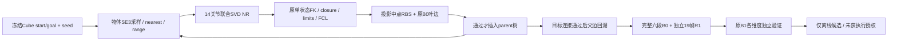
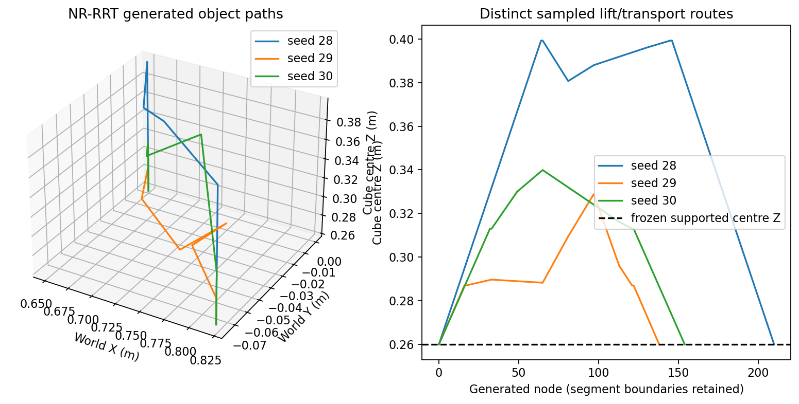

# Task28 G1-P4-NR-0｜最小离线闭链规划基线

日期：2026-10-26。仓库 `dreamerToTOE/dual-arm-embodied-palletizing`，分支 `side-suction-palletizing`；起点 `5417da1a76a2a496f2e14993cc765a45f2133aff`。

## 1. 判定与范围

**G1_P4_NR_0_PASS**：真实、有界的 P4-inspired NR-RRT 在冻结单 Cube 场景的三个固定seed上，均生成通过本次定义的全部离线sampled门禁的候选。不是仅检查端点，也没有重放原A-stage预计算路径。最终全部候选仍为 **OFFLINE_CANDIDATE_UNCERTIFIED**，`execution_authorized=false`。

原G1-2B-1的PARTIAL事实保持原样：连续关节限位获证；运动段完整闭链和全碰撞证书仍未决。PASS不表示continuous safety、Isaac/ROS/MoveIt运行、吸附建立、真实负载支撑或物理成功。未执行这些系统，未实现PCS/RSS、QP、force control、RL或多Cube。

所有新代码仅在 [offline/task28_p4_nr_0](../../offline/task28_p4_nr_0/README.md)；本报告是唯一新增旧目录外文件。原fixture、G1-1/R1/B0/B1、Task24/26/27及原路线图报告逐字节保留。原有395项测试通过；最终 **466 passed（395旧＋71新）**。

## 2. P4 的精确对应关系

实现前先保存 [ALGORITHM_SPEC.md](../../offline/task28_p4_nr_0/ALGORITHM_SPEC.md) 和 [P4来源审计](../../offline/task28_p4_nr_0/evidence/p4_correspondence.json)。后者记录11项作者源码、已合格复现代码/报告的实际路径、行号、SHA256；没有把旧ABB成功移植成FR3证据，也不声称完成论文逐行数值复现。

| 来源层次 | 已核实内容 | 本次关系 |
|---|---|---|
| 作者 `kdl_class.cpp:68–139` | `GD` 实际调用 KDL pinv/`ChainIkSolverPos_NR(10000,1e-5)`，两臂全关节变化 | NR是Newton–Raphson，不能凭函数名当梯度下降 |
| 合格复现 `physical_nr.py:109–136,171–212` / C++对应源 | 物理全链SE(3)残差、SO(3) log Jacobian、SVD Moore–Penrose更新，relative cutoff1e-12 | 本次继承显式全坐标Jacobian/SVD NR核心，非调用旧least_squares IK |
| 作者 `RRT_NR.cpp:146–212` | goal bias、nearest、range截步、NR投影、连接通过后插入parent树 | 本次保留该控制顺序；候选从已接受父边回溯 |
| 作者 `StateValidityCheckerNR.cpp:149–175` | 关节算术中点投影与碰撞检查、递归两半（RBS） | 本次对物体中点作联合NR，关节种子仍取端点平均，然后原B0检查叶边 |

合格P4复现标为 `RECONSTRUCTED_PHYSICAL_FULL_NR_CPP`，不等于原KDL数值轨迹；其较早 `baselines/p4_closed_chain` 被P4自身审计列为REFERENCE_ONLY，未拿它替代真实方法来源。本次名称为 **P4-inspired object-conditioned NR-RRT**，不能缩写成“原作者算法已经逐位复现”。

明确属于本次工程适配：ABB12关节→FR3共14关节；rod/flip→固定Cube双侧TCP抓取；原ambient joint采样→物体SE(3)采样；米制/旋转log与冻结门限；goal bias .35（作者.05）；局部连接预算/阈值；joint-step global cap/backtracking；支持域与lift/place原语及原验证层。作者原碰撞模型、限位、停止门和PCS分支均未迁入本fixture。

## 3. 数学、状态与真实搜索

约定列向量主动变换，`T_A_B`将B表达映射至A；world/metre/radian，quat xyzw。状态为 `(X=T_WO,qL∈R7,qR∈R7,phase)`。Cube唯一为`Cube_01/index0`，目标由冻结manifest直接读入：start `[.65,0,.26]`、goal `[.82,-.075,.26]`，两端物体旋转identity。

使用原G1-1 nominal grasp，`G_L.t=[0,-.061,0]`、`G_R.t=[0,.061,0]` 和原完整镜像旋转；没有移动抓点。两臂目标为 `T_i*=X G_i`。

旧自由闭链通常有6个约束，双FR3的14维关节空间留下8维。给定采样X后，本次使用12行对象条件残差，通常留下2维关节冗余：

```text
r_i(q_i;X) = [p(FK_i(q_i)) − p(XG_i);
              Log(R(FK_i(q_i)) R(XG_i)^T)]
r_X(q14) = stack(r_L,r_R),       J_X ∈ R^(12×14)
J_i = [Jv_i ; J_left_inverse(phi_i) Jomega_i]
J_X = block_diag(J_L,J_R)
J_X = U diag(s) V^T
Δq = −V diag(1/s_j if s_j > 1e-12*s_max else 0) U^T r_X
q_next = q + α Δq
```

同一X与两个固定grasp实现物理闭链耦合；固定X时Jacobian是两个6×7块。它不是原6行relative-closure投影映射。最小范数更新和邻近seed保持一个局部分支，不显式搜索2维冗余纤维，不声称概率完备或找到全部IK分支。未对米/弧度残差做行权重归一，单位改变会改变条件数/投影轨迹；该限制保留，独立接受门不随之放宽。

采用解析几何Jacobian及SO(3)逆左Jacobian；principal-log接近π时明确拒绝。全局L2步长上限 `.2 rad`，α再最多8次减半；只有原hard limits内且残差范数严格下降的提案可接受。不clip关节、不加阻尼或QP，不把rank deficiency一律拒绝。每call至多60次Newton更新；成功仍需每臂translation≤1e-6m、rotation≤1e-5rad，以及原关节限位。之后再次走原完整门禁，不以NR自己的success替代。

独立数学测试以USD joint local0/local1和手写Rodrigues/log路径核验：与独立USD有限差分Jacobian最大元素差约1.493e-8；同URDF中心差分约9.61e-11。满行秩时的最小范数更新另与`J^T (JJ^T)^−1 r`对照。没有以函数对自身作为唯一核验。

搜索过程为：

1. 从冻结HOME、限位中点、固定rng的uniform seeds产生start/goal锚点；每锚最多8次。两端固定的是fixture物体位姿，fixture没有提供合作抓取的唯一14关节目标；NR选择的实际start/goal q全部记录，未把HOME当成有效抓取姿态。
2. 采样lift高度，构造垂直supply lift原语并经NR/RBS/B0拒绝或接受；这不是读取旧`.4m` A-stage路径。
3. 在物体SE(3)工作空间goal-biased采样，nearest/range steer，联合NR重构q，再检查原单点门禁。通过投影中点RBS及每叶完整B0后，才能插入树并记录parent。
4. 到达搜索选定高度的target上方时，尝试垂直place原语；从真实父边回溯transport，再检查整个候选的全部B0、独立R1及B1。
5. sampled/R1失败或B1有确定`CONTINUOUSLY_REJECTED`就记录并拒绝；未知连续证书可以仅作为离线研究候选保留。没有先生成完整答案再命名规划结果。

垂直lift/place及target上方的进入姿态是公开的工艺原语适配，transport仍是采样树搜索；它限制了路径族，不能称无约束通用SE(3)规划器。采样、冗余种子和树分支均由登记seed决定。

## 4. 精确预算与验证架构

完整 [experiment_manifest.json](../../offline/task28_p4_nr_0/evidence/experiment_manifest.json) 在正式实验前冻结6项实现SHA、规格SHA、seed、工作空间、预算、900s OS wall上限及唯一输出目录。formal命令设置`OPENBLAS_NUM_THREADS=1 OMP_NUM_THREADS=1`，没有GPU。

| 参数 | 值 |
|---|---|
| 主实验seeds | 28 / 29 / 30，每seed一次注册运行 |
| 负控seeds | 128 unreachable；129 wrong-grasp；130 payload collision |
| lift trials / 高度 | 最多3；Cube中心Z uniform[.28,.42]m |
| 树扩展 | 每lift最多64，总最多192；accepted nodes全run最多80 |
| 联合NR调用 | 每主run最多1600；每call60更新、.2rad cap、最多8次backtrack |
| object sampler box | x[.58,.89]、y[-.15,.10]、z[.274,.44]m |
| sampler rotation vector | x/y±.02、z±.03rad，指数映射完整SO(3) |
| nearest / steer | `distance=translation_norm+.1*rotation_angle`；每次range .04m-equivalent |
| projected RBS | depth≤8；叶条件translation≤.0025m、rotation≤.005rad、单joint差≤.025rad |
| 原B0 | 不变：.05s/.02rad/.001m/.01rad，最多10001 samples |
| 原B1 | 一次max_depth=0，每候选六段分别运行；不无限细化 |

单点复用G1-1/接触层的完整FK/限位/SE(3)闭链与原FCL；B0每有效sample另做20个USD-vs-URDF link/TCP FK对照。双臂、两工具、Cube和table均保留，414 shape pairs、原40 ACM shape skips；原48 link-pair SRDF及所有局部吸盘/支撑门限未改。只在原微米级支撑合同成立时授予state-local支撑例外；几何分离阶段仍为transitioning，无table豁免。

密集NR/RBS节点送B0/B1，不用于R1帧计数。独立R1会话固定19张明确的合成边界/静止输入，含3帧initial、3帧attach、BEGIN_LIFT、3帧lift-end、transport两端、BEGIN_PLACE、3帧strict target support、3帧release。其20ms合成时钟只是排序合同，不是速度/执行时长或传感器帧率；attachment feedback也是独立标记的合成控制，不证明实际D6/吸盘。加密路径不增加R1观察数量，两个相关负控测试已锁定。

B0 trajectories本身不启用R1重放；候选接受是“六段B0 AND独立19帧R1”。B1仍自己重跑原B0，不信外部pass证据，所有连续维度原样保存；独立R1结论不伪装成B1内部的连续接触证明。



## 5. 全部正式结果

三个主run均只产生一个完整start-goal候选，三个均通过六段sampled及独立R1。搜索中所有object samples、NR迭代/谱/回溯、成功及失败gate、叶边、parent插入和全候选保存在各seed的`search_events.jsonl.gz`；完整路径、每sample和B1区间保存于`result.json.gz`。没有删选失败seed。

| seed | sampled nodes | accepted tree nodes | 联合NR尝试/失败 | connection calls / 叶B0 | lift中心Z(m) | 物体平移路径长(m) | 路径节点 | planning wall(s) |
|---|---:|---:|---:|---:|---:|---:|---:|---:|
| 28 | 7 | 7 | 226/0 | 440 / 224 | 0.399256751 | 0.472028130 | 209 | 87.333071 |
| 29 | 12 | 12 | 194/0 | 371 / 192 | 0.287006576 | 0.302033828 | 137 | 58.911033 |
| 30 | 14 | 14 | 266/0 | 513 / 264 | 0.313011833 | 0.319608867 | 153 | 69.779446 |

`sampled_nodes`含lift端点提案和随机/goal-biased对象提案，不含每个RBS中点；所有这些中点另计NR调用。connection calls含递归，不仅是顶层树边；叶B0包含最终路径之外的已探索分支，因此不与最终waypoint数相等。树节点插入与结果回溯有独立mock bookkeeping负控，mock结果未计入上述3个真实模型实验。

| seed | 最大sampled闭链平移(m) | 最大sampled旋转(rad) | 最小joint margin(rad) | 物体累计旋转(rad) | 关节路径L2累计(rad) |
|---|---:|---:|---:|---:|---:|
| 28 | 4.63466537e-06 | 5.877241848e-06 | 0.263211426 | 0.024151800 | 2.472981367 |
| 29 | 5.519578015e-06 | 1.340347983e-05 | 0.269222715 | 0.028978201 | 1.700727905 |
| 30 | 6.437022048e-06 | 7.29139673e-06 | 0.267831508 | 0.020485335 | 1.783487772 |

平移路径长是相邻Cube中心距离之和；旋转长度是相邻SO(3)最短角之和，未混成无单位“SE3长度”。所有候选最大sampled闭链误差小于冻结1e-4m/1e-3rad；不是物理跟踪误差。三主run搜索阶段collision/closure/joint-limit rejection counts均为0，NR失败均为0；不能据3次样本推断无失败或规划完备。负控计数另列，不能混进主run或用静态控制冒充规划失败路径。



| seed | grasp / attach / lift / transport / place+hold / release 的B0 sample数 |
|---|---|
| 28 | 5 / 7 / 265 / 323 / 265 / 7 |
| 29 | 5 / 7 / 41 / 403 / 41 / 7 |
| 30 | 5 / 7 / 73 / 339 / 73 / 7 |

所有18个segment的B0结果为`sampled_edge_valid`；3个独立R1会话均19/19输入有效且结束于`RELEASED_SUPPORTED_CONFIRMED`。dense/interpolated points用于R1计数均为0。

### 连续状态独立报告

3个seed在6个segment上的模式一致：

| 段 | 连续joint limits | 连续closed-chain | 连续collision | combined |
|---|---|---|---|---|
| grasp boundary | VERIFIED | VERIFIED（未激活部分不适用） | INCONCLUSIVE | INCONCLUSIVE |
| attach confirmation | VERIFIED | VERIFIED | INCONCLUSIVE | INCONCLUSIVE |
| lift | VERIFIED | INCONCLUSIVE | INCONCLUSIVE | INCONCLUSIVE |
| transport | VERIFIED | INCONCLUSIVE | INCONCLUSIVE | INCONCLUSIVE |
| place+support hold | VERIFIED | INCONCLUSIVE | INCONCLUSIVE | INCONCLUSIVE |
| release boundary | VERIFIED | VERIFIED（只针对激活闭链部分） | INCONCLUSIVE | INCONCLUSIVE |

表中缩写对应原`CONTINUOUSLY_VERIFIED`与`CONTINUOUS_VERIFICATION_INCONCLUSIVE`。没有连续确证拒绝，也没有任何segment获得全维度证书。所有proof intervals、pair目录、未决pair及局部接触缺口原样压缩保存。未增加深度追求PASS；没有将SAMPLED_EDGE_VALID写成CONTINUOUSLY_VERIFIED。全部路径标签为OFFLINE_CANDIDATE_UNCERTIFIED、无执行授权。

## 6. 负控、失败原因与证据范围

| control | 范围与实测拒绝 | 不作的解释 |
|---|---|---|
| seed128，goal x=100m | 真Planner query；必要reach sphere预拒绝，`GOAL_OUTSIDE_NECESSARY_REACH_BOUND`；0 sampled/NR/connection，未返回路径 | 不是仅局部求解失败就宣称数学不可达 |
| seed129，错误共享物体/抓取姿态 | 真NR从HOME求airborne基准q，然后保持q而将输入Cube yaw改变.2rad；左右相对object误差约.2rad；同时真实FCL检出4对tool/Cube碰撞 | 单状态门禁负控，不伪称完整planner负路径，亦不称closure-only |
| seed130，payload/table穿透 | 从HOME真实NR重构Cube z=.24m；闭链约3.096e-11m/8.140e-11rad，joint margin .362083403rad；FCL唯一unexpected pair为Cube/table，4 contacts、depth .020000000000000018m，拒绝 | 不省略payload；不把未连接的单点伪装可执行下沉轨迹 |

完整控制数据和NR receipts在`negative_controls.json.gz`；[control_receipts.json](../../offline/task28_p4_nr_0/evidence/control_receipts.json)分别保留原search stats和额外单状态gate拒绝分类。两个point controls的path length/continuous status明确为不适用，缺失指标为null；其gate rejection不能改写原Planner内部未调用reject的0计数。

另有71项新增数学/合同/负控测试，涵盖错误budget/非有限/错shape、NR joint-limit拒绝、reach-bound、独立Jacobian与最小范数、RBS预算、失败叶边不得插入、真实父边回溯排除dead branch、B1确证拒绝不得保留、未决不可授权、R1三帧和densification不改变帧数。此类mock合同测试与上面真实模型实验分开计数。

## 7. 环境、回归与复现

离线CPU Python3.10.12、NumPy1.24.4、SciPy1.8.0、系统FCL0.7.0，沿用原G1-1独立C++ helper。只读URDF/FK不等于启动MoveIt；编译或运行该纯FCL helper不发ROS/机器人消息。无依赖下载/安装，fixture仍为NEW_BASELINE_NOT_YET_PHYSICALLY_VALIDATED。

正式运行入口：

```bash
PYTHONDONTWRITEBYTECODE=1 OPENBLAS_NUM_THREADS=1 OMP_NUM_THREADS=1 \
  timeout --signal=TERM --kill-after=10s 900s \
  python3 -u offline/task28_p4_nr_0/run_experiments.py --output NEW_UNIQUE_DIRECTORY
```

入口核对执行前manifest的实现hash；拒绝覆盖旧目录。已执行输出是`offline/task28_p4_nr_0/evidence/experiments_v1`。运行所有seed是唯一正式批次，无隐藏重试/参数调优；开发单点数学控制和单元测试不算正式规划成功率。修改算法/预算必须另存revision与证据，不能覆盖该清单。

回归：

```bash
PYTHONDONTWRITEBYTECODE=1 PYTEST_DISABLE_PLUGIN_AUTOLOAD=1 \
PYTHONPATH=offline/task28_g1_1:offline/task28_g1_2a:offline/task28_g1_2b_0:offline/task28_g1_2b_1 \
python3 -m pytest offline/task28_g1_1/tests offline/task28_g1_2a/tests \
  offline/task28_g1_2b_0/tests offline/task28_g1_2b_1/tests \
  offline/task28_p4_nr_0/tests -q -p no:cacheprovider
```

原395 tests单独78.79s、exit0；最终466 tests一起83.25s、exit0。新增测试初次集合完成68项时的日志保留，最终另3个合同测试已包含在466内，不把重复运行相加。数学与协议检查分别记录参与者的代码责任，未把参与实现的审阅者假称完全独立人员审计。

正式三seed+负控+压缩记录总CPU wall **228.383145s**，在900s OS上限内；主进程peak RSS **254,392KiB**。每seed planning wall包括搜索、所有门禁、原B1与candidate事件序列化，不含随后result归档；总wall包含归档。不是机器人执行时长或硬实时上界。实际进程wait=0，见`experiments_v1_exit.json`。

完整原始证据采用deterministic gzip无损保存，未删去B1未决项。每条路径另外导出完整14关节、物体位置/旋转矩阵CSV和首尾q14；[artifact_manifest.json](../../offline/task28_p4_nr_0/evidence/artifact_manifest.json)记录字节数/SHA256，保护清单覆盖起点全部tracked文件，不仅fixture。绘图只从已保存结果读取，不产生新规划解。

## 8. 局限、建议与停止点

本次只证明原冻结静态模型下，这个P4-inspired对象条件NR搜索可找到通过定义sampled门禁的候选。只有3个seed、单Cube、同一无新增障碍场景；不能推断成功概率、最优性、通用可达性或branch coverage。零primary rejection并不说明原保守几何没有难例；下一步应在独立授权后做**范围明确的冗余分支/窄通道负控比较**，同时保留当前方案作固定基线，不直接扩展PCS/RSS、QP或多Cube。

连续碰撞的outer-box重叠、局部支撑/吸盘接触规则、非恒定Cube旋转、运动闭链区间界仍未解决；更密sample不是证明。后续若研究特定proof瓶颈，应单独定义预算与接受门，不无限优化本verifier，不签发Isaac/真实执行许可。有限吸附力、接触载荷、噪声/延迟、动态限制、真实D6状态、物理模型与PhysX一致性仍未经验证。

**到G1-P4-NR-0停止，等待审查。没有自动开始下一阶段。**
