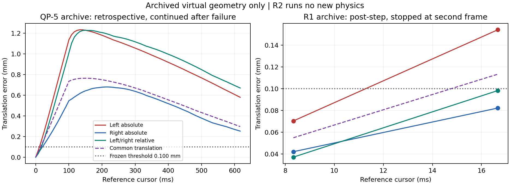

# Task28 G2-P5-QP-5-R2：双臂 torque 跟踪可行性与控制器诊断

**结论：`G2_P5_QP_5_R2_DIAGNOSTIC_PASS_ONLY`。** 本任务完成 CPU 归档诊断和控制方案评估，没有新增 Isaac 运行、移动控制器或派生轨迹。原始 0.1 s 参考的移动跟踪仍被拒绝。静态保持、NR/QP 运动学通过和移动 torque 跟踪是三个不同结论，历史状态均保留。

直接证据支持：进入运动时，参考速度从静止突然跳变，现有 gravity+PD 产生有限的反馈力矩；实际双臂没有同时跟上共同物体参考，且产生了双臂差分误差。在第二个 post-step 状态，左臂绝对抓取误差首先超限。未发现饱和、rate clipping、参考本身的采样闭链错误或足以解释该超限的 FK/仿真 TCP 差异。缺少该移动状态的 M/c 和可微 qdd 参考，故不能进一步分配“惯性、阻尼、模型误差、离散积分”各自的因果百分比，也不能给出某个新控制器必然通过的结论。

## 1. 来源与边界

起点本地 HEAD 和 `git ls-remote origin refs/heads/side-suction-palletizing` 均核对为 `d3ca0caee39d10546cf7bf190dc6ac3f0fb98e5a`，分支 `side-suction-palletizing`。起始工作树干净；续作时只有 R2 新增文件。受保护源码、全部历史实验数据、fixture/ACM 和 G1 阈值不变。

原参考身份仍为 **`task28_qp3_seed28_transport40_5step`**：它是 NR-0 seed28 的 transport[40] 节点出发的局部 QP-2 五步数值参考，不是完整 NR 路径的 actuator time parameterization。`derived_reference_identity=null`。

核查了 [QP-4 reference](../../offline/task28_p5_qp_4/reference.py)、[QP-5 controller](../../offline/task28_p5_qp_5/controller.py)、两版 collector、[R1 runtime gate](../../offline/task28_p5_qp_5_r1/runtime_gate.py)、[R3 collector](../../offline/task28_p2_4_r3/collector.py)、四份报告、预注册和真实归档。锁定文件和 SHA-256 见 [source_binding.json](../../offline/task28_p5_qp_5_r2/source_binding.json)，哈希取自起点 Git blob 并与磁盘逐一比对，QP-4 原来源检查和 fixture 哈希检查继续使用。

本任务的 [preregistration.json](../../offline/task28_p5_qp_5_r2/preregistration.json) 是**已知历史结果后的诊断协议**，不冒称盲测预注册。Phase 3 决定不启动可选 Phase 4。未修改增益、原 q/qdot、时长、模型、命令桥或验收阈值。

## 2. 全帧重算与独立性

主证据：[audit_v1/diagnostics.json](../../offline/task28_p5_qp_5_r2/evidence/audit_v1/diagnostics.json)。重算覆盖原 QP-5 的 **75 帧**（含停止参考后的保持）和 R1 的 **2 帧**；旧版失败之后继续采集的帧仅作事后诊断，不能当成 fail-closed 运行。

每帧保存源/physics 时刻、物理步号、recorded 与 matched reference、完整双侧 q/dq、逐关节误差、pre-state、实际 TCP、URDF FK TCP、虚拟物体参考、全九维 raw/commanded/applied effort、P/D 分量、gravity 字段、限幅裕度和逐步 effort 增量。arm 的 effort 单位是 N·m，finger 是 N；没有把两种单位混成一个硬件力矩指标。commanded/applied readback 只证明命令读取一致，不是标定的关节力矩传感器。

- [calculations.py](../../offline/task28_p5_qp_5_r2/calculations.py) 直接读取原 QP-3 区间，以 Euler 等式重建 q，用旋转指数形式重建物体插值；不调用 QP-5 sampler，不重新求解 QP/IK。
- 直接按冻结 grasp 的旋转和 ±0.061 m 偏移计算隐含物体位姿，以 skew/trace 的 `atan2` 独立算旋转角，再和原 G1 `evaluate_closure` 比较。原门保持 0.100 mm / 0.001 rad。
- “actual TCP”是归档的仿真 link7 位姿乘冻结固定偏移；虚拟物体是独立来源参考。没有真实 Cube 观测、接触、吸附或 wrench。
- R1 command 用 pre-step `t`，验收用 post-step `t+dt`；原 QP-5 的 q reference 是 `max(0,t-dt)`，物体 reference 是 `t`，状态是 pre-step。两种语义分别保留，原结果没有被追认。

## 3. 共同误差与差分误差

约定 `T_WO` 将物体系坐标映射到世界系，固定 `G_i=T_O_TCP_i`。两侧隐含物体为 `X_i=T_WTCP_i G_i^{-1}`。世界系平移误差定义：

```text
e_L = p(X_L) - p_ref     e_R = p(X_R) - p_ref
c = (e_L + e_R)/2        d = e_L - e_R
e_L = c + d/2           e_R = c - d/2
||e_L||² + ||e_R||² = 2||c||² + ||d||²/2
```

这是精确的平移分解。旋转另记录完整 G1 相对旋转残差，并记录 `Log(R_ref^T R_i)` 的平均/差值作为小误差诊断；后者不是全局 SE(3) 平均或新的验收门。

| R1 post-step 时间 | 左绝对平移 mm | 右绝对平移 mm | 双臂相对 mm | 共同平移 mm | 原运行结果 |
|---|---:|---:|---:|---:|---|
| 0.008333333768 s | 0.0703580 | 0.0421272 | 0.0371444 | 0.0549322 | 通过 |
| 0.016666667536 s | **0.1540634** | 0.0821965 | 0.0982531 | **0.1132805** | `LEFT_ABSOLUTE_TRANSLATION`，physics step 244 停止 |

在第二帧，`c=[-0.0937676,0.0532523,-0.0347030] mm`。共同误差和差分误差都存在，绝对门先于相对门失败；只修相对闭链不能保证物体跟踪通过。沿参考平移方向投影的 lag-equivalent 分别为 8.90955/18.36845 ms，仅是空间误差投影的等效量，**不是测得的控制延迟**。

最大关节位置/速度误差为 `0.000350398537 rad` / `0.0232254339 rad/s`；它们低于原宽松 joint tracking 门，但不能替代严格 grasp 门。R1 第一/第二帧左臂旋转误差为约 0.00010079/0.00015509 rad，右臂约 0.00012262/0.00020626 rad；相对最大 0.000106775 rad，均未触发 0.001 rad 门。

R1 的 model TCP 与归档 TCP 最大平移差仅 `4.59528e-7 m`。用关节 FK 独立重建，第二帧左绝对误差仍为 **0.1536917 mm**，所以不能把 0.154 mm 失败简单归因于 TCP 读取/坐标舍入。参考自身全部选定采样仍通过 G1；全旧轨迹匹配时刻参考最大平移残差 `5.87851e-7 m`。



## 4. 力矩分量及归档缺陷

原控制律不变：`tau_raw=g(q_pre)+Kp(q_ref-q_pre)+Kd(dq_ref-dq_pre)`。分别重算 P、D、clip 与 rate clip，匹配保存命令；全部 77 帧没有 saturation/rate-limit activity。R1 commanded/applied 最大 arm 差约 `8.95e-7 N·m`，没有命令限幅证据。

| pre-step 游标 | 左 P 最大 N·m | 左 D 最大 N·m | 右 P 最大 N·m | 右 D 最大 N·m |
|---|---:|---:|---:|---:|
| 0 s | 1.1330e-7 | 0.01834294 | 2.4535e-7 | 0.02240005 |
| 0.008333333768 s | 0.00053024 | 0.01592794 | 0.00071593 | 0.02153351 |

起步 q 几乎正确，因此 P 项几乎为零，有限 D 力矩承担加速。实际速度尚未跟上参考。以上证明实际输入和误差演变，**不证明缺失力矩应当是多少，也不支持直接提高增益**。

新增发现：R1 collector 的 `gravity_pre` 是从 raw 减反馈重构，减 P 时将 pre-state 两个 finger q 换成目标 q，因此这两个字段实际为 `g_finger + P_finger`。七个 arm 分量没有该问题。第二帧左/右 finger 字段分别含约 `6.88434e-7 N` / `2.40207e-6 N` 的 P 项。新证据保留原字段，另存 `raw-P-D` 的**代数推断值**，不冒称重新读取了 Isaac gravity。没有修改历史日志。它不解释本次七关节抓取超限，但影响后续完整九维动力学记录可信性。

## 5. 原五段参考的时间可行性

每段 `q_next=q_initial+0.02*qdot_k`，最大 Euler 重构差 `1.80465e-16 rad`。区间内部 q 线性，速度分段常值；零保持与运动之间及运动与末端保持之间均有跳变。

| 边界 s | 最大速度跳变 rad/s |
|---:|---:|
| 0，零保持→第 1 段 | 0.0366858922 |
| 0.02 | 0.0000209784 |
| 0.04 | 0.0000209729 |
| 0.06 | 0.0000209679 |
| 0.08 | 0.0000209634 |
| 0.10，第 5 段→零保持 | 0.0366842936 |

首段每个 `1/120 s` 物理步最大关节参考增量为 `0.000305715768 rad`；物体平移增量为 `[0.0416667,-0.025,0.0166667] mm`，范数 **0.0513701 mm**；物体旋转增量约 `0.000190941 rad`。两步物体参考已走约 0.10274 mm，严格 0.100 mm grasp 门对起步速度滞后敏感。

若**人为假设**把起步速度跳变摊到 20 ms，数值比值约为 `1.83429 rad/s²`；内部边界最大约 `0.00104892 rad/s²`。代码明确保存为假设性的 `jump/20ms` 指标。实际分段线性参考的边界导数不存在，有限惯量和有限力矩不能精确产生瞬时速度跃迁；这不等同于证明带容差跟踪绝对不可行。原 `acceleration_rad_s2=null` 保持不变，没有认证加速度、修改时长或隐式减速。

## 6. 动力学信息与候选架构

安装版 Isaac articulation 源码中，`get_mass_matrices`（3901 起）、`get_coriolis_and_centrifugal_forces`（3952 起）、`get_generalized_gravity_forces`（4029 起）分别返回状态相关质量矩阵、抵消 Coriolis/centrifugal 所需广义力和重力补偿。它们要求已初始化有效 physics view，不能仅凭离线 USD 路径取得相同状态的这些值。源码路径/哈希与 USD 哈希已记录于 source binding；本次仅读源码，没有调用仿真接口。

QP-5/R1 双臂运动日志缺 M/c；R3 保存完整九维 M/c/g，但其静态姿态与本次左右初态的最小无穷范数距离分别约 **0.69093 / 1.46068 rad**。不能把另一姿态的质量矩阵静默当作本次矩阵。也没有为取得缺失数据而启动未预注册的新物理采集。由此，移动参考的逆动力学 effort 需求标记 **NOT_ESTIMATED**，不是零，也不是已证明超限。

| 方案 | 分析与保守决定 |
|---|---|
| A：独立 gravity+joint PD | 固定历史基线。静态时 `dq≈qdd≈0`，重力抵消足以解释保持；运动时还需惯性、速度耦合和离散实现项。原代码没有加速度 feedforward，也没有基于实际双侧误差的协调项。R1 已证实此配置在原参考上失败。 |
| B：动力学跟踪 | 理想形式可写为 `tau=M(q)qdd_d+c(q,dq)+g(q)+P+D`，但成立需同状态、相同 full 9-DOF 次序、符号、手指耦合和有效可微参考。现有参考的边界 qdd 不存在，且移动 M/c 未记录；本任务不能据此构造可信的候选命令。未来新 time law 必须有新身份、独立几何检查和独立动力学检查。 |
| C：双臂几何协调 | 可分别针对共同物体误差与左右相对误差设计虚拟任务反馈，并用正确实际 TCP Jacobian/参考点做映射；需先验证误差微分、坐标、符号、相对与共同任务的相容性及动力学/离散稳定性。现有证据支持诊断接口，尚不支持执行控制器。虚拟 `J^T` 几何反馈不是观测到的 contact wrench，关节运动学 null space 也不是 `G w_int=0` 的 grasp-wrench null space。 |

优先缺口是**完整可微且几何有效的派生参考 + 状态一致的动力学数据 + 完整 pre-command 拒绝门**，不是再做一轮无依据 Kp/Kd 扫描。即使未来派生轨迹通过，也不能改称原 0.1 s 参考通过。配置中的 60 N·m、100 N·m/step、R3 的 150 rad/s² 均为研究参数；实际硬件 torque、rate、acceleration bounds 未认证。

## 7. Phase 5 与停机边界

本次在 Phase 3 选择 diagnostic-only，因此没有新的 `set_joint_efforts` 路径，也没有声称已部署 pre-command gate。R1 原 post-step fail-closed 行为和首个失败完整 pre-state/command/post-state 保留，正式归档只有 2 个 moving steps，后续 moving/final hold 未执行。

源审计明确：R1 当前在 `step_once` 取得状态、计算并发送两侧 effort，之后 `world.step` 再调用 `validate_post`；它没有完整的发送前检查。**未来任何新 collector 都必须先完成**以下合同，不能直接复用此顺序声称完整安全：

1. 两侧 articulation identity、9-DOF 名称/顺序与 q/dq/命令 finite、源 hash 和参考身份；
2. 同一 clock domain、单调 source/physics 时间、左右同步和前后游标一致；不能用合成时钟认证真实 freshness；
3. 原关节/速度/配置 effort/rate 门、当前几何有效，前一 post-gate 已接受；
4. 所有 pre 检查通过后才允许两侧送命令；任何一侧失败均锁存，禁止另一侧单独推进；
5. advance 后先验证实际几何，再允许下一条命令；保存首次失败及未执行尾部。

新诊断的七项 fault injection 会拒绝坏来源、NaN、DOF 顺序、时间偏移和坏 q/object reference；它们是 **CPU 诊断输入检查**，不是 actuator runtime gate 的实测证明。停止仿真循环也不是实体机器人安全停机认证。

## 8. 回归、复现与未完成科学问题

全部 required suites：**789 历史 + 53 QP-4 + 5 QP-5 + 6 R1 + 22 R2 = 875 passed**。日志和独立退出码位于 R2 `evidence/regression_*`。最初 historical 启动被会话中断，未取得退出码，保留不计入通过；完整重跑目录为 `regression_historical_v2`。

新测试包含独立解析共同/差分平移控制、旋转/世界帧不变性、0.1 s 左右导数不连续、全帧覆盖、原首次拒绝、P/D 和限幅重构、finger gravity 记录缺陷、七项故障注入、缺失/篡改 source 拒绝和动力学可用性边界。主证据独立输出目录重放后科学 JSON 要求逐字节相同；用时另记，不与科学结果混合。参见 [summary.json](../../offline/task28_p5_qp_5_r2/evidence/summary.json)。

从仓库根目录执行，输出目录须不存在：

```bash
PYTHONDONTWRITEBYTECODE=1 PYTHONPATH=.:offline python3 -m offline.task28_p5_qp_5_r2.generate_evidence --output /tmp/task28-r2-audit-new
python3 -m offline.task28_p5_qp_5_r2.run_checks --suite historical --output /tmp/task28-r2-historical-new
python3 -m offline.task28_p5_qp_5_r2.run_checks --suite qp4 --output /tmp/task28-r2-qp4-new
python3 -m offline.task28_p5_qp_5_r2.run_checks --suite qp5 --output /tmp/task28-r2-qp5-new
python3 -m offline.task28_p5_qp_5_r2.run_checks --suite r1 --output /tmp/task28-r2-r1-new
python3 -m offline.task28_p5_qp_5_r2.run_checks --suite r2 --output /tmp/task28-r2-focused-new
```

剩余科学问题：原参考容差下的动力学跟踪可行性、经过独立验证的平滑派生 time law、移动全九维 M/c/g/实际应用时刻、模型/积分误差归因、协调反馈稳定性、真实双臂反馈 freshness 和硬件界限均未解决。本任务没有 collision avoidance、连续闭链/碰撞安全、实际 Cube/吸附/内力或真实机器人结论。fixture 仍为 `NEW_BASELINE_NOT_YET_PHYSICALLY_VALIDATED`。

到此停止 R2，等待独立评审。没有自动开始新的控制器、Isaac、ROS、NR-1、QP 优化、SVM 或 RL 任务。
