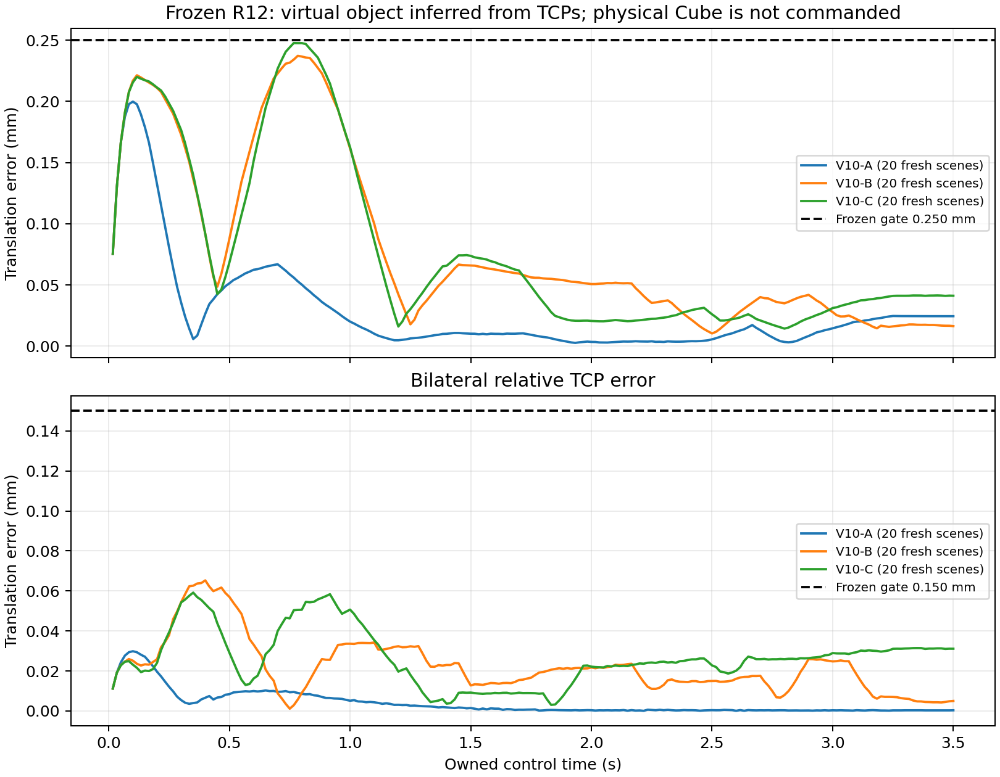

# TASK28 G2-P5-QP-6 R13：联合跟踪鲁棒性与连续安全验证

## 结论与证据修正

基线为 R12 `52d07e6a9c4ac482db4887483cbf8ab0cbf510d1`。本次冻结 common/relative feedback gain scale `0.75`、启动速度捕获 `τ=0.10 s`、虚拟对象跟踪峰值 `0.250 mm`、相对 TCP 平移峰值 `0.150 mm` 以及全部原有 QP、安全、速度和力矩条件。

真实独立 Isaac 场景已完成 **60/60** 次，状态为 `PASS_20_FRESH_SCENES_PER_CASE`。每次重新启动进程、创建场景、取得初始状态、逐步重算 QP 并执行冻结 R12 的模拟双臂控制；没有把重复统计一个归档计作重复运行。三工况结果的最终性由 `isaac_repetitions/summary.json::complete` 决定。

扰动鲁棒性仍为 **NOT_ESTABLISHED**：近似闭环模型的同时间 TCP 轨迹偏差大于 C 的剩余裕量，不能据此判定真实 Isaac 在扰动下通过或失败。原始 Cube 接近路径仍为 **CONTINUOUS_SAFETY_NOT_ESTABLISHED**。V10-D、FORMAL 及真实执行均未启动。

已推送版本 `c186290d5afed20ed0f9e1f085be1828d2a86d55` 的方法有误，本修正版明确撤回：重复读取同一归档不证明独立回放；按周期/质量缩放已有 q 路径不构成动力学试验；其扰动峰值及通过/失败归因无效。旧连续审计误用腾空吸附状态，其闭链拒绝理由亦撤回。旧文件及报告保留在 `superseded_c186290/` 和 `evidence/invalidation/`，哈希见 `methodology_correction.json`，没有覆盖历史 R10/R12 证据。

## 独立回放方法与统计

`isaac_repetitions.py` 使用未修改的 `offline.task28_p5_qp_6_r12.runtime_virtual`，只将输出写入 R13 路径。执行前保存冻结计划和源哈希，A/B/C 交错运行，各计划 20 次。每次保留原始 frames、command journal、result、独立 child lifecycle、缓存隔离/清理及 source-at-launch 快照；独立审计重新计算每帧几何误差，并校验所有原始哈希、源绑定和进程身份。

误差按冻结 R12 口径：每帧取左右 TCP 推断的虚拟对象对目标平移误差的较大值；它不是物理 Cube 运动。下表均值和 P95 对全部受控帧汇总，P95 使用线性插值；每次运行的峰值分布另存机器证据，不与逐帧 P95 混合。

| 工况 | 独立次数 | 对象峰值 mm | 对象均值 mm | 对象 P95 mm | 相对峰值 mm | 对象超限帧 | 相对超限帧 | 任意冻结门失败次数 |
|---|---|---|---|---|---|---|---|---|
| V10-A | 20 | 0.199777268 | 0.027793925 | 0.129862285 | 0.029872166 | 0 | 0 | 0 |
| V10-B | 20 | 0.237183209 | 0.080405680 | 0.222850599 | 0.065286436 | 0 | 0 | 0 |
| V10-C | 20 | 0.247616573 | 0.077749720 | 0.228768437 | 0.059172790 | 0 | 0 | 0 |

| 工况 | 求解器状态/次数 | 速度盒或位置前视激活帧 | 硬相对残差峰值 | 不同数值轨迹数 | 运行峰值范围 mm |
|---|---|---|---|---|---|
| V10-A | {'QP_OPTIMAL': 4200} | 0 | 1.127e-10 | 1 | 0.000000000 |
| V10-B | {'QP_OPTIMAL': 4200} | 0 | 1.127e-10 | 1 | 0.000000000 |
| V10-C | {'QP_OPTIMAL': 4200} | 0 | 1.127e-10 | 1 | 0.000000000 |

激活状态使用前一步实际 q、原速度盒和原位置前视边界逐帧重算，未硬编码“无激活”。硬相对等式始终存在，残差按原条件复核。每次重新检查状态源、驱动/手指条件、原始关节限位、所有 QP 有限值、首条和后续努力速率、每关节努力上限、时间周期、碰撞及所有既有精度门。

这里的周期是模拟 physics 时间戳，不能等同于实时调度周期或求解时限保证。每次进程与求解耗时保存在原始证据中，数值轨迹哈希明确排除墙钟耗时；本次不建立实时控制算时或调度抖动包络。

| 工况 | QP qdot峰值 rad/s | native dq峰值 rad/s | 最大努力 Nm | 计算均值 ms | 计算P95 ms | 计算峰值 ms | 计算耗时超过16.667ms帧数 |
|---|---|---|---|---|---|---|---|
| V10-A | 0.000844653 | 0.007861838 | 28.008895 | 27.682 | 44.562 | 72.810 | 4040 |
| V10-B | 0.004396418 | 0.007861838 | 28.016757 | 27.416 | 44.146 | 61.566 | 4009 |
| V10-C | 0.004494106 | 0.007861838 | 28.017862 | 27.754 | 44.349 | 85.475 | 4078 |

计算耗时来自宿主环境的每帧 `calculation_time_s` 观测，不是硬实时界，也未被添加为新的历史验收门。每关节努力/速率峰值（包含首条命令相对 ownership buffer）另存原始汇总，按各关节原限值复核，不能只比较全局最大努力与单一上限。

模拟受控阶段 Cube 最大平移变化为 `0.000000000 mm`；Cube、吸盘、D6 和 ROS 控制命令均为零。原场景启动稳定阶段相对 ownership 状态存在至多 `0.000484241 mm` 的数值沉降，单独记录，不能声称从建场景第一帧起绝对静止。一次 C 运行在上层生命周期完成前被会话中断，原始输出保留在 `interrupted_fresh_run_01_V10-C/`，不计入 60 次，已按同一计划重跑。

## R12 对比与 C 的裕量

R12 原始对象峰值 A/B/C 为 `0.199777268 / 0.237183209 / 0.247616573 mm`，相对峰值为 `0.029872166 / 0.065286436 / 0.059172790 mm`。重复场景与基线的逐帧数值比较由轨迹哈希及原始误差记录支持；完整统计见上表及每次 receipt。C 剩余裕量仅 `0.002383427 mm`。同一模拟配置的确定性复现可以确认该结果可重现，不能把这个窄裕量解释为对未量化初始状态、反馈延迟或模型误差的保证。

## 闭环敏感性试验与适用边界

CPU 模型每步调用冻结 R12 QP、反馈与努力计算，独立更新近似 plant；不使用 q 路径缩放。共 `78` 个 episode、`16380` 次实际 QP 重算，其中每工况 20 次 nominal reset（共 60 次），每工况另做六个单变量有符号敏感性 episode（共 18 次）。nominal 使用固定初始 M0，M 敏感性使用 M0±ΔM，并复用归档 g/c 时序。命令中的归档重力和 plant 中的同一重力精确抵消，近似方程为 `Mplant*qdd=P+D−c_archive`，不构成独立或随当前状态变化的重力验证。模型缺少完整 PhysX 约束/驱动模型；与归档 TCP 的比较是使用归档输出的模型一致性检查，不是独立 plant 验证。

预先记录的模型一致性筛选条件要求同一时刻 TCP 预测差不超过 C 的裕量；这是本研究的资格筛选，不是普适必要性定理，即使通过也不足以证明硬件准确性。本次三组均未满足：

| 工况 | 模型 nominal 对象峰值 mm | 同时间 TCP 最大偏差 mm | 相对 C 裕量倍数 | 模型资格 |
|---|---|---|---|---|
| V10-A | 0.202643033 | 0.032244236 | 13.53 | MODEL_NOT_QUALIFIED_FOR_MARGIN |
| V10-B | 0.231312322 | 0.046320709 | 19.43 | MODEL_NOT_QUALIFIED_FOR_MARGIN |
| V10-C | 0.246598484 | 0.040303618 | 16.91 | MODEL_NOT_QUALIFIED_FOR_MARGIN |

扰动幅度依据如下，未将其扩展为未测得的物理误差包络：初始 q 取相邻 float32 表示值的正负一个 ULP，最大 `2.384185791e-7 rad`，是在 ownership 后保留捕获 q_hold/frame 的数值状态敏感性，不是新场景 ownership 重建试验；周期取 R12 实测时间戳相对 `1/60 s` 的最大偏差正负 `8.692344032e-10 s`，保留原 `1e-8 s` 时间门；M 取归档中最大谱范数姿态变化的正负矩阵差，相对谱范数幅度 `0.1446044–0.1489436%`，并核验正定性。M 姿态变化不是模型标定误差界，ULP 也不是初始定位误差界；因此覆盖的只是数值/已观察姿态敏感性。

| 工况 | 单变量试验 | 模型峰值 mm | 均值 mm | P95 mm | 相对最大 mm | 模型对象超限帧 | QP optimal | 速度盒/位置前视激活帧 |
|---|---|---|---|---|---|---|---|---|
| V10-A | initial_ulp_minus | 0.202555320 | 0.027329103 | 0.124237548 | 0.031582434 | 0 | 210 | 0 |
| V10-A | initial_ulp_plus | 0.202730756 | 0.027332410 | 0.124405480 | 0.031682782 | 0 | 210 | 0 |
| V10-A | measured_dt_minus | 0.202643039 | 0.027330753 | 0.124321517 | 0.031632580 | 0 | 210 | 0 |
| V10-A | measured_dt_plus | 0.202643026 | 0.027330756 | 0.124321495 | 0.031632578 | 0 | 210 | 0 |
| V10-A | observed_mass_delta_minus | 0.202619135 | 0.027342325 | 0.124298613 | 0.031994030 | 0 | 210 | 0 |
| V10-A | observed_mass_delta_plus | 0.202666707 | 0.027321096 | 0.124344606 | 0.031272236 | 0 | 210 | 0 |
| V10-B | initial_ulp_minus | 0.231267259 | 0.067777713 | 0.221399776 | 0.059775514 | 0 | 210 | 0 |
| V10-B | initial_ulp_plus | 0.231357388 | 0.067816195 | 0.221582722 | 0.059853441 | 0 | 210 | 0 |
| V10-B | measured_dt_minus | 0.231312307 | 0.067796952 | 0.221491257 | 0.059814480 | 0 | 210 | 0 |
| V10-B | measured_dt_plus | 0.231312338 | 0.067796949 | 0.221491239 | 0.059814473 | 0 | 210 | 0 |
| V10-B | observed_mass_delta_minus | 0.232016849 | 0.067805465 | 0.221449290 | 0.059002488 | 0 | 210 | 0 |
| V10-B | observed_mass_delta_plus | 0.230602776 | 0.067794793 | 0.221030938 | 0.060625798 | 0 | 210 | 0 |
| V10-C | initial_ulp_minus | 0.246539520 | 0.068286420 | 0.225647546 | 0.055576758 | 0 | 210 | 0 |
| V10-C | initial_ulp_plus | 0.246657452 | 0.068326258 | 0.225751919 | 0.055646163 | 0 | 210 | 0 |
| V10-C | measured_dt_minus | 0.246598472 | 0.068306338 | 0.225699719 | 0.055611462 | 0 | 210 | 0 |
| V10-C | measured_dt_plus | 0.246598496 | 0.068306335 | 0.225699742 | 0.055611457 | 0 | 210 | 0 |
| V10-C | observed_mass_delta_minus | 0.247018624 | 0.068312095 | 0.226090378 | 0.055123786 | 0 | 210 | 0 |
| V10-C | observed_mass_delta_plus | 0.246173558 | 0.068301277 | 0.225619845 | 0.056098666 | 0 | 210 | 0 |

上述模型门通过或失败均只描述该近似模型，不推广到 Isaac 或机器人。逐时刻状态、QP、努力、残差和失败记录保存于 `closed_loop_traces/`。所有试验仍使用原约束；没有解除约束后用于执行。

反馈时序另做离线 gate 元数据故障注入：复制 ownership 状态，把 step/time 时标回退一个样本，并改变 `fresh_copy` 声明；没有回放真实更早的 q/dq。显式标为 stale 的输入被原门以 `STALE_OR_ALIASED_STATE` 拒绝；超出周期门以 `PHYSICS_DT` 拒绝；但左右一致、自报 fresh 的回退时标输入会通过 pair gate。后续 post-step cursor 不能证明 pre-command 已拒绝这种情况。该诊断没有施加命令，未修改 frozen gate，也没有建立真实反馈延迟的闭环敏感性或鲁棒性。

## 原始接近路径连续安全

复用 R10 已保存的 joint-linear staged 路径，SHA-256 `40529575d19946f9257d4044f309fd942c4c94b28fe1ceba477bc73d417781b3`；不重新选择 IK。接近阶段为未吸附且 Cube 受桌面支撑，使用单一 latched request 身份。Cube/table 支撑几何采用局部规则检查，不改 ACM，不代表力、稳定性或实际接触的证明。

有限样本共 159 个（含边界/侧向请求），全部有效。区间方法使用冻结 URDF/STL 的 articulated FK 保守包络、向外界及 414 个非 ACM 形状对；40 个原 ACM 排除保持不变。深度 `0/1/2/4` 的未解析区间数为 `7/10/16/52`，不能将包络重叠判作真实碰撞，也不能将有限采样无碰撞判作全程安全。

| 轨迹段 | 分类 | 整段已分离形状对 | 仍未解析形状对 | 认证不安全 witness |
|---|---|---|---|---|
| FREE_HOME_TO_HIGH_OUTER | UNABLE_TO_PROVE_SAFE | 389 | 25 | 0 |
| HIGH_OUTER_TO_OUTER_CONTACT | UNABLE_TO_PROVE_SAFE | 366 | 48 | 0 |
| OUTER_CONTACT_TO_PRE_CONTACT_READY | UNABLE_TO_PROVE_SAFE | 378 | 36 | 0 |

三条完整 staged 段均无法证明安全，已证明整段安全列表为空，已确认不安全的 staged 段列表也为空；部分形状对的包络证明不升级为整段证书。原 R3 直接 HOME→名义抓取路径是另一路径，其归档 `u=0.92` 点存在工具 `/3`、`/5` 与 Cube 碰撞，单独保留为已确认不安全负例，不转嫁为 staged 路径碰撞证据。

闭链检查保留整个接近过程相对于名义抓取的 SE(3) 残差和区间界；未接触阶段不强制吸附闭链，较大的 prospective 残差不构成吸附违约。有限样本的名义相对平移/旋转残差最大为 `0.945217939 m / 0.071456319 rad`，左右推断对象相对名义 Cube 的平移残差最大为 `0.688190872 / 0.535122534 m`。终点相对平移残差约 `1.356e-11 m` 仅说明名义对齐；吸附后的提升/运输连续闭链及动态跟踪包络仍未建立。最终状态保持 `CONTINUOUS_SAFETY_NOT_ESTABLISHED`。

## V10-D / FORMAL 准入审查

| 阶段 | 原注册条件证据 | 本次启动授权 | 可启动 | 状态 |
|---|---|---|---|---|
| V10-D | True | False | False | NOT_RUN_R13_SCOPE |
| FORMAL | True | False | False | NOT_RUN_R13_SCOPE |

原 V10-D 注册要求 A/B/C 全部既有门通过。FORMAL 另要求两次独立且 eligible 的诊断；原文未明确要求相同配置，也未将 V10-D 列为必要前置。审查记录了这一解释及不同进程身份，不能凭此扩张授权。R13 重复性、扰动鲁棒性和物理接近连续安全作为本次审查项单列，没有伪造为历史 no-contact 注册门。用户明确本次不启动任一后续阶段，冻结注册的 execute 也为 false。

物理接近/接触路径另受连续安全及执行授权限制，继续阻断。本次未运行真实机器人或实际接触，未输出 Cube 运动、吸盘、D6 或 ROS 控制命令；模拟启动沉降与受控阶段的差别已单列记录。

## 未完成事项与建议

1. C 的确定性裕量很小；缺少经过标定的初始状态、时间/反馈延迟、动力学不确定性边界及相应合格 plant，扰动鲁棒性未建立。后续先补这些依据，再在授权的虚拟环境中做相同冻结门的动态试验。
2. pair gate 依赖调用方的 fresh 声明，需另行评审如何绑定外部当前 cursor；本次只记录缺口，未改安全接口。
3. 对 staged 路径未解析的非 ACM 对采用更紧且验证过的连续窄相位/自适应包络，保留 raw witness 和支持规则；仍需把实际跟踪误差包络纳入连续证明。
4. 吸附后的闭链/提升及真实执行仍超出当前证据范围。任何下一阶段均需满足已定义条件并单独授权。

## 回归、保全与交付

回归状态 `PASS`：截至 R9 的完整历史集合 `1051`，R10 `16`，R11 `19`，R12 `19`，R13 `47`；总计 **1152 passed**。旧总数遗漏的 R10/R11 已纳入本次实际运行，日志和哈希位于 `evidence/regressions/`。

冻结源与 R12 Git 对象比对通过。相对 R12 的变更仅限 R13 模块和本报告；QP、安全约束、速度/力矩限制、fixture、ACM、场景及历史证据保持原样。`artifact_hashes.json` 绑定交付文件，`final_status.json` 记录证据状态；最终提交 SHA、远端同步和干净工作树在提交推送后由 Git 实际验证并随交付消息报告，文档不写入无法自引用的未来提交 SHA。

关键机器证据：`isaac_repetitions/summary.json`、各 trial 的 `receipt.json` 及原始日志、`closed_loop_manifest.json`、`closed_loop_model_validation.json`、`closed_loop_results.json`、`continuous_safety_audit.json`、压缩 raw intervals/samples、`phase_admission_review.json`、`methodology_correction.json`。
