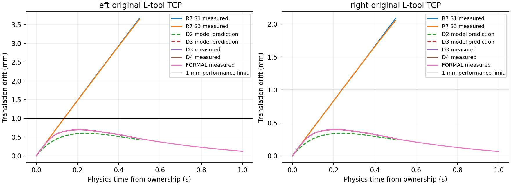
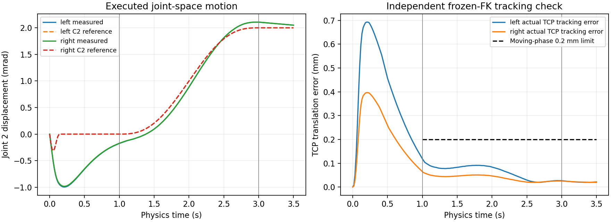

实际 TCP 漂移已下降并达到 1.0 mm 诊断门槛：独立进程 D3/D4 的左、右峰值分别为 0.692523 mm 和 0.396352 mm，原 R7 S3 为 3.642622 mm 和 2.052197 mm。唯一一次 60 步正式静态保持通过；一次 210 步短程关节阻抗跟踪也实际运行并通过。仍被阻塞的是适用逆动力学模型资格和物体中心抓取闭合，因此 computed torque 与实际协同 QP/HQP 没有运行，Cube 吸附、D6、搬运、ROS 控制和硬件均未测试。R8 在此停止。

# Task28 G2-P5-QP-6-R8 — 原始 L 形吸盘场景力矩稳定恢复

- 仓库：`dreamerToTOE/dual-arm-embodied-palletizing`；分支：`side-suction-palletizing`。
- 起始 HEAD 与执行前核实的远端 HEAD：`fc6d7ca75988d69d2d9409cfc5bb2fcc4cbf71e8`。
- 日期：2026-10-29，Asia/Seoul。
- 唯一场景入口：`fixtures/task28_g1_0_new_single_cube_v0/scene/task28_single_cube_scene.py::build_scene()`。
- 本文配套目录：`offline/task28_p5_qp_6_r8/`。除本文外，新增源码、原始轨迹、失败记录及审计均在该目录。

## 分项状态

| 键 | 结果 |
|---|---|
| `COMPUTED_TORQUE_STATUS` | `SKIPPED_APPLICABLE_MODEL_NOT_INDEPENDENTLY_QUALIFIED` |
| `COOPERATIVE_QP_STATUS` | `OFFLINE_READINESS_EVALUATED_NOT_READY` |
| `CUBE_D6_UNTESTED` | `True` |
| `DYNAMICS_MODEL_SCOPE` | `FROZEN_MEASURED_M_GAIN_METRIC_NOT_CERTIFIED_INVERSE_DYNAMICS` |
| `FEEDBACK_DIAGNOSTIC_STABILIZATION_STATUS` | `PASS_D3_D4_INDEPENDENT_REPEAT` |
| `FORMAL_STATIC_HOLD_STATUS` | `PASS_ONE_60_STEP_RUN` |
| `INITIAL_STATE_AND_OWNERSHIP_STATUS` | `SOURCE_VALID_NONZERO_NATIVE_DQ_C2_TRANSITION` |
| `ISAAC_PROCESS_ISOLATION_VERIFIED` | `PASS_RECOVERED_D3_D4_FORMAL_MOVING` |
| `ORIGINAL_SCENE_PRESERVED` | `PASS` |
| `R7_DRIFT_CAUSE_STATUS` | `WEAK_GAIN_AND_INHERITED_VELOCITY_SUPPORTED_COMBINED_RECOVERY` |
| `SHORT_TRACKING_STATUS` | `PASS_ONE_210_STEP_IMPEDANCE_RUN` |

## 保护范围与来源

原始双 FR3、镜像 L 工具及每臂四杯、link8→side_suction_tcp、Cube_01、桌面、质量、碰撞几何、原生手指驱动和 mimic 均未修改。没有持久化 controller setting，没有修改 USD、fixture、G1/FCL/ACM 或 R6/R7 历史文件。`evidence/frozen_preservation_verification.json` 对 206 个冻结来源文件逐一复核 SHA256，全部一致。原 FR3 USD SHA256 仍为 `3feceb47747b49f908f9719299132deb9759f2d5edb390d14f0f3ed62c63255f`。

每次运行创建匿名原场景；builder 为构造 ROSGraph 而加载 ROS extension，随后在 timeline play 前停用该 graph 与 extension，并检查无竞争 position bridge。没有 ROS 发布/控制流程。物理保持 CPU/NumPy、60 Hz TGS、原始 external-force-every-iteration 设置。为解决无显示实验的初始化等待，仅改变进程缓存与视口更新；没有切换 GPU 物理后端，没有修改原场景，也没有对失败 cell 进行 GPU 重试。

源审查见 `literature_and_source_review.md`。核查了 [Franka joint impedance / FR3 Duo](https://frankarobotics.github.io/docs/doc/franka_ros2_jazzy/franka_example_controllers/doc/index.html)、[libfranka](https://frankarobotics.github.io/docs/doc/libfranka/docs/overview.html)、[Pinocchio CRBA/RNEA/ABA](https://gepettoweb.laas.fr/doc/stack-of-tasks/pinocchio/devel/doxygen-html/md_doc_a-features_g-dynamic.html)、[TSID](https://github.com/stack-of-tasks/tsid)、[PhysX TGS](https://nvidia-omniverse.github.io/PhysX/physx/5.4.1/docs/RigidBodyDynamics.html)。Franka 硬件内部补偿重力的语义不能复制为 Isaac 的零 effort；R8 只显式加入一次 Isaac g(q)。请求给出的 Isaac 4.5 在线 API URL 返回 404，实际调用以已安装 `articulation.py`、`simulation_app.py`、`simulation_context.py` 和 viewport API 为准。

## R7 漂移复算与因果范围

`analyze_r7.py` 只读取原始 S1/S3 frames 和注册 command，逐间隔重算 q/dq、P/D、g、TCP 和 Jacobian。S1 是重力加小阻尼，S3 才是重力加 PD；不沿用 R7 报告后文“两次 PD”的错误表述。S2 的 SIGSEGV/SIGABRT 始终保留为启动失败，不能加入控制效果比较。

| 原 R7 cell | 左 TCP 末帧 / 峰值 mm | 右 TCP 末帧 / 峰值 mm | 最大反馈修正（左 / 右）N·m |
|---|---:|---:|---:|
| S1，阻尼 | 3.666769520 | 2.082460854 | 0.001930475 / 0.001905348 |
| S3，PD | 3.642622154 | 2.052196511 | 0.007437 / 0.007345 |

接管均在 physics step 182；接管前后不推进物理、不传送状态，首个命令作用于 182→183 区间。native drives 遗留速度明显非零：左 qdot₂=`-0.010724863037467003`、qdot₄=`0.005007283296436071` rad/s；右为 `-0.010585268028080463`、`0.0051315100863575935` rad/s。S3 在 0.5 s 内的 joint-2 位移分别为 `-0.0049877166748046875`、`-0.004924774169921875` rad。gravity joint-4 约 28.000233 / 27.804775 N·m，而原反馈只能产生毫牛米量级修正。

使用耦合 7×7 arm mass block 解 `Kp φ = ω² M φ`，左臂原 PD 的 ω 范围约 0.6486–5.7795 rad/s，右臂 0.6541–5.8113 rad/s；最低模态投影阻尼比约 0.0535 / 0.0539。完整阻尼状态矩阵极点与非对角模态阻尼均存档，不能把投影阻尼比误称为完全解耦的实际模态。原 PD 的离散预测谱半径约 0.99942；在 0.5 s 窗口内衰减很弱。耦合模型预测 S3 TCP 末程约 3.64630 / 2.05586 mm，与原始记录接近。

TGS native dq 仍作为反馈输入。S3 中 whole-step Δq/Δt 与 post-step dq 的逐关节最大差异约达 2.26e-4 / 2.28e-4 rad/s；它们被分别记录，没有用有限差分替换 dq。冻结 TCP Jacobian 对 S3 位移的一阶重构残差只有左 0.014511 mm、右 0.008569 mm；主要位移来自 joint 2 和 joint 4 的耦合贡献。毫米级漂移不能只归因于 TCP 读取误差。

结论：已有初速度、弱耦合模态反馈和有限实验时长足以解释主要现象；未知工具惯量不是唯一或优先的未经验证归因。R8 的组合控制恢复提供了进一步支持，但由于 D2 没有有效物理帧，无法单独实验分离“加强反馈”和“C2 接管参考”各自的贡献，也不能声称 D3 优于 D2。R6 ABCD 再审查重现 72 个控制间隔、144 次九维写入及原估计残差最大 `0.05492453116950269 N·m`，仍只是 solver-dq 导数估计，不是物理力矩传感器残差。

## 进程隔离与两个初始化失败

R7 S2 日志有共享 KVDB 锁警告，第二次出现 `Unlocked by non-owner` 并 SIGABRT；成功运行也有共享锁警告。安装版 `app.close()` 中存在等待 USD 加载结束的循环。因此保存结果、出现 shutdown 文本、甚至调用 close，都不足以证明进程退出。历史没有完整 PID journal，不能事后证明某个旧锁的所有者；R8 开始时扫描没有遗留匹配 Isaac/Kit/ROS worker。

R8 runner 使用单独 session/PGID、序列化锁和独立 portable root；记录 PID、起止 UTC/单调时间、子组成员、返回码/信号、实际 token、日志和源文件快照。下一次运行只能在上一次拥有的进程全部退出、临时资源清理后开始。300 s 超时后仅对本次拥有的进程组发送 TERM，必要时才 KILL；未终止任何无关进程。本次无需 KILL。

- **D1**：首次启动的普通 cache 已隔离，但 `appcache` 仍指向安装目录；自动创建的空视口触发冷渲染管线编译。300 s 超时，SIGTERM `-15`；没有构建原场景，没有有效状态帧，没有 effort。结果原样保留，不重跑。
- **D2**：显式覆盖 `appcache`，并设置安装 API 支持的 `create_new_stage=False`。子进程在原场景构建前验证所有四个 cache/appcache/logs/data token 都在专用目录。随后在首次 physics initialization 触发的视口渲染编译阶段超时，SIGTERM `-15`；没有序列化物理帧和控制写入。父记录 V1 因缺少 result.json 没有恢复 lifecycle 中的 cache token，故其 isolation flag 为 false；`process_audit.py` 独立读取已持久化子记录，确认缓存隔离和完整退出。原记录没有被改成成功控制。
- **D3 及以后**：通过安装 viewport API 关闭显示更新，保留原场景和 CPU 物理初始化；全部正常退出 `0`，无 KVDB 锁警告、无残留进程、临时缓存已删除。每个新进程均重新通过源检查。

上述基础设施修订先于后续 cell，记录在 `process_recovery_registration.json`、`headless_recovery_registration.json`；没有改变增益、力矩界限、物理步长或已失败 cell 的身份。独立进程审计、父/子 lifecycle、stdout/stderr、Kit 日志及逐次 source_at_launch 全部保留在 evidence 下。

## 控制器与预注册边界

`tau = g(q) + Kp (q_ref-q) + Kd (dq_ref-native_dq)`。

D2/D3 使用接管同状态的对称 arm block M₀，冻结 `Kp=16M₀`、`Kd=8M₀`，对应期望 ω=4 rad/s、ζ=1。M₀ 用作增益度量，没有 `M qdd_ref` 或逆动力学前馈。简化半隐式离散模型的谱半径为 0.94846722，预测 30 步 D2 峰值约 0.602495 / 0.342968 mm，D3 约 0.694104 / 0.395121 mm；这是模型预测，不是 TGS 稳定性证明。

D3 接管时令 q_ref=q₀、dq_ref=dq₀；随后 T=0.15 s 内使用 `q_ref=q₀+dq₀*T*(s-6s³+8s⁴-3s⁵)`，s=t/T，结束后回到 q₀。它在两端位置、速度和加速度连续；初始反馈项为零，之后平滑制动。D3 左/右最大反馈修正约 0.215071 / 0.211838 N·m。接管首个 gravity 命令的 joint-4 rate 为 1680.014 / 1668.287 N·m/s，低于既定 2400 N·m/s。

完整九维 effort adapter 保持原生手指 gain/mode/targets 及既有 finger effort buffer，只控制七个 arm 坐标。读取 applied effort 只用于 command-buffer 一致性，不把它称为力矩传感器。实际读回最大误差小于 1e-6 N·m；D3 的手指位置变化约 4.46e-8 / 2.77e-8 m。

- 原 source effort cap：`[87,87,87,87,12,12,12] N·m`。
- 研究 cap 保持 R7：`[35,12,8,35,4,4,4] N·m`。
- rate cap：`[2400,600,240,2400,240,240,240] N·m/s`。
- 性能：所有采样点 TCP 平移 ≤1 mm、旋转 ≤0.01 rad、joint drift ≤0.02 rad、native |dq|≤0.3 rad/s。
- 安全中止：TCP 漂移 10 mm/0.05 rad、joint drift 0.02 rad、native |dq|0.3 rad/s，以及原关节限制、源身份、时间、finger、FK/FCL 和 effort/rate 首错门。
- **1 mm 性能门与原 G1 0.100 mm / 0.001 rad 抓取闭合门不同；均未放宽。** 达到静态诊断门不代表满足抓取闭合。

D1–D4 矩阵在第一次启动前固定，D4 选择规则是对源/安全/进程完整的 D2/D3 按最差臂峰值择优、相同则 D2。D2 无有效结果，D3 是唯一合格候选。D4 的 q₀/dq₀、具体增益及全部评估指标与 D3 一致。

## 所有运行结果

下表“峰值/末帧”均为相对接管时实际 TCP 的平移位移；MOVING 的此列是运动位移，不能当作跟踪误差。失败单元的数值是未知，不填零漂移。commands 为每臂控制间隔数；每个间隔写入两臂完整九维向量。

| cell | 评价 | commands/臂 | TCP 峰值 左/右 mm | TCP 末帧 左/右 mm | PID | exit | wall s |
|---|---|---:|---:|---:|---:|---:|---:|
| D1 | FAIL_EXECUTION_OR_SOURCE | 0 | 无有效帧 | — | 102386 | -15 | 301.921 |
| D2 | FAIL_EXECUTION_OR_SOURCE | 0 | 无有效帧 | — | 106360 | -15 | 302.256 |
| D3 | PASS | 30 | 0.692523082 / 0.396352303 | 0.457145905 / 0.258927103 | 108213 | 0 | 47.005 |
| D4 | PASS | 30 | 0.692523082 / 0.396352303 | 0.457145905 / 0.258927103 | 109053 | 0 | 45.084 |
| FORMAL | PASS | 60 | 0.692523082 / 0.396352303 | 0.118785341 / 0.064648205 | 110060 | 0 | 57.540 |
| MOVING | PASS | 210 | 0.923833113 / 0.546860301 | 0.897964592 / 0.531686391 | 111545 | 0 | 157.703 |

D3/D4 物理间隔为 `0.5000000260770321 s`；FORMAL 为 `1.0000000521540642 s`；MOVING 为 `3.5000001825392246 s`。这是记录的累计浮点时间，逐步均满足 60 Hz 注册容差。成功运行合计 330 个双臂间隔、660 次完整九维机器人写入。源状态、力矩/rate、finger、原关节界限及独立 FCL 均通过，没有饱和裁剪或速率裁剪；越界策略是拒绝命令，而不是静默截断。

FORMAL 在 D3/D4 独立重复 PASS 后才冻结 `formal_freeze.json`：具体数值矩阵、实际初态 q/dq 的 1e-6 容差、同一 180-step native policy、60 Hz、60 步时长、接管参考和全部界限。只有一次正式运行，没有正式失败后的调参。正式峰值旋转左/右为 0.00146292638 / 0.00146457917 rad，最大 joint drift 为 0.000995635986 / 0.000982284546 rad。

## 条件短程运动与协同就绪评估

FORMAL PASS 后才创建 `moving_freeze.json` 和 `motion.py`。从实际捕获的原姿态出发：0–1 s 接管并保持；1–3 s 两臂 joint 2 各 +0.002 rad，采用五次 C2 多项式；3–3.5 s 保持。执行前冻结 FK/FCL 与原关节限制检查 2101 个样本，另有每个实际步骤的前后检查。该检查是采样几何验证，不冒称连续碰撞数学证明。

| 短程运动指标 | 左 | 右 |
|---|---:|---:|
| 含接管的最大 TCP 跟踪误差 mm | 0.692707947 | 0.396541014 |
| t≥1 s 的最大 TCP 跟踪误差 mm | 0.118970701 | 0.064836384 |
| 末帧 TCP 跟踪误差 mm | 0.021257624 | 0.019716336 |
| 末帧最大关节跟踪误差 rad | 0.00006103515625 | 0.00006103515625 |
| 实际 joint-2 位移 rad | 0.0020503997802734375 | 0.0020503997802734375 |
| 非零移动速度参考命令数 | 119 | 119 |

除 1 mm 全程门外，预注册运动阶段误差 ≤0.2 mm、末帧 ≤0.1 mm、最终关节误差 ≤0.0002 rad，且 signed joint-2 位移必须 ≥0.0018 rad，防止小动作因“不动”误通过。全部满足。独立实际 TCP/FK 验证最大平移差为 5.271565e-7 m、旋转差为 7.311462e-7 rad；211 个控制状态的独立冻结 FCL 没有发现意外碰撞。

随后运行 CPU-only `cooperative_readiness.py`，使用冻结 `nominal_grasps()` 的 T_O_GL/T_O_GR，把实际 TCP Jacobian 平移到各自推定物体中心，并检查原 G1 closure。12×14 common/relative object task Jacobian 的秩为 12，但初始两臂推定物体中心相差 `0.945217679251253 m`；相对实际 Cube 的左、右绝对抓取误差为 `0.6881904458916773 / 0.5351221244708999 m`。整个运动仍是 FREE_HOME 小幅运动，不能作为共同物体抓取状态。原 0.100 mm closure 条件失败；秩完整不能消除这个先决条件。

因此 cooperative readiness 已评估但不就绪，QP solve count=0，HQP runtime command=0。没有把关节跟踪成功升级成物体中心 HQP 实验。computed torque 跳过原因是 mounted-tool/constraint dynamics 尚未独立定量资格化：M/c/g 的 SPD 与小动作反馈成功不足以证明逆动力学可用，不能用 TGS 末步 dq 导数充当认证加速度。没有吸盘闭合、实际 Cube 抓取、D6、运输或内部力控制。

## 回归、证据与复现

历史软件回归 **1015 passed**：基础 789，QP-4 53，QP-5 5，QP-6/R1 30，QP-6/R2 12，QP-6/R3 7，QP-6 54，QP-5/R1 6，QP-5/R2 22，R4 12，R5 13，R6 12。R7 **4 passed** 单独记录，不计入 1015；R8 focused **15 passed**。所有这些测试为 CPU-only，不启动 Isaac；日志、命令、环境和 SHA256 位于 `evidence/regressions/`、`evidence/focused_tests.json`。

R8 focused 覆盖耦合离散稳定性、C2 两端一致性、原始 native dq 保留、初始零反馈、源错误锁存、错 TCP/竞争驱动、非 SPD 负例、全程峰值验收而非只看末帧、越 source cap 拒绝、R7 1 mm 红例、进程筛选、四格预注册界限、移动 C2、物体中心 Jacobian 的 FK 有限差分独立验证，以及 FREE_HOME 不得冒充抓取闭合。

主要证据：

- `preregistration.json`、`registrations.json`、`source_contract.json`：原四格矩阵与边界；后续条件运动追加在 FORMAL PASS 之后。
- `formal_freeze.json`、`moving_freeze.json`：单次正式/运动冻结参数及前提来源 SHA。
- `evidence/r7_drift_analysis.json`、`r6_archive_review.json`：原始归档重算、耦合模态和模型预测。
- `evidence/process_investigation.json`、`process_isolation_audit.json`、`process/<cell>/`：R7 启动审查、父/子进程与缓存/退出证据、全部失败日志及源快照。
- `evidence/diagnostic/<cell>/`：实际 q9/dq9/M9/c9/g9、TCP、前置门、P/D/g 分项、九维命令/readback、完整 physics 时间和几何。
- `evidence/evaluation.json`：独立重算所有峰值、性能、源状态、力矩/rate 和实际几何；没有把 execution complete 当成性能 PASS。
- `evidence/cooperative_readiness.json`、`computed_torque_skip.json`：离线物体中心资格检查和明确跳过原因。
- `evidence/final_status.json`、`summary.json`、`artifact_hashes.json`：最终状态、全量指标与文件哈希。

离线复现命令：`python3 -m offline.task28_p5_qp_6_r8.analyze_r7`、`python3 -m offline.task28_p5_qp_6_r8.evaluate`、`python3 -m offline.task28_p5_qp_6_r8.process_audit`。这些命令不会启动物理。运行器对已存在 cell 目录拒绝重跑；R8 已停止，不继续启动新的实验。

## Git 交付

执行前远端已确认等于起始 HEAD；提交仅包含 R8 目录和本报告。推送后的研究证据提交 SHA 与远端核验记录见 `offline/task28_p5_qp_6_r8/evidence/git_delivery.json`；最终包含该核验记录的提交及最终工作树状态在交付消息和外部归档 `TASK28_QP6_R8_final_git_verification.json` 中再次核实，避免在提交自身内容中声称一个无法自包含的 SHA。
