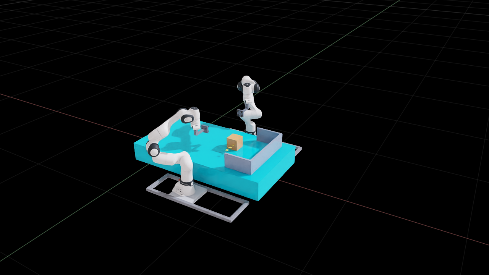

# Task28 Stage A：Cube_01 末端放置、释放和退避

基线 `219d6fbf7eff8f7438098d0b3e3aac0f388917ba`，分支 `side-suction-palletizing`。使用原始 Task27 场景、双 FR3、Surface Gripper、live torque QP 和 opt-in G3 负载前馈；实验范围为 Stage A。

## v6 末端失败的原因

对 v6 最后 3 秒负载状态重新分析：参考已经停止，TCP 期望速度/加速度均为零；实际物体仍在约 10–15 mm 高度残差附近振荡，闭合误差很小。最后一帧期望物体 `(0.770008, 0.060001, 0.259951) m`，实际 `(0.773632, 0.059585, 0.273442) m`。最后 3 秒物体跟踪误差均值为 `13.105 mm`，共同加速度残差无穷范数均值为 `0.221 m/s²`。全程 QP optimal 不能证明这些软目标被满足。

1. **软目标互相牵制。** 负载关节姿态权重 `1e4` 并非仅作用于任务零空间；G3 总力矩目标权重 `1000` 同样惩罚为位置收敛所需的附加加速力矩。冻结 v6 最后一帧的实际 q/dq、质量、Jacobian、偏置、目标和硬约束，只把末端姿态/力矩软权重改为 `100/100`，共同加速度残差从 `0.248291` 降为 `0.053946 m/s²`，相对残差从 `0.068544` 降为 `0.018521`。共同权重仍为 `3e4`。
2. **角度反馈坐标不一致。** 旧 `_rotation_error` 返回 `log(R_actualᵀ R_desired)`，随后直接与世界系几何 Jacobian 和角速度组合。倒置的侧吸工具会把偏航修正方向反转。v7 单独降低权重后，原本由强姿态项压住的偏航发散，最终触发关节预测约束。回归以绕 X 翻转 180° 的真实工具方向和 +0.1 rad 世界偏航构造反例：旧代码返回 +0.1，正确世界系修正应为 −0.1。
3. **支撑观测初始化过晚。** v6 在初始已落桌状态同样读零接触力；接触报告需要在物理初始化前启用。v8 正向检查已读到 `7.848 N`（0.8 kg × 9.81），绑定为一对 Cube/Table 碰撞形状。v7 新增的几何诊断还错误地把未缩放的 size=1 和局部 BBox 当世界尺寸；现在计入缩放并用世界轴对齐范围，读回 Cube 尺寸 `0.120 m`、桌面顶面 `0.200 m`。

完整 qref/q/dq、对象与双 TCP 位姿、期望速度/加速度、QP 权重和残差、G3 候选、载荷补偿、施加力矩、竖直速度和接触数据保存在 [v6 最后 3 秒](../../offline/task28_task27_integration/evidence/task28_reference_placement_v6/terminal_3s.jsonl)。[v6 诊断与冻结重放](../../offline/task28_task27_integration/evidence/task28_reference_placement_v6/placement_release_metrics.json)提供数值。

## 最小控制修正

- 冻结对象抓取变换和对象中心轨迹生成方式保持原样。角度反馈改用世界系 `log(R_desired R_actualᵀ)`，与所选 Jacobian 一致。
- 仅在目标已到目的区、下降轨迹停止且两侧仍 CLOSED 时进入末端收敛。使用真实 Cube 的世界位置、线速度、姿态和角速度；平移加速度限于 ±0.15 m/s²，角加速度限于 ±0.3 rad/s²，积分偏置限于 ±0.25 m/s²。共同权重保持 `3e4`，末端姿态/力矩软权重上限 `100/100`。G3 载荷和内部力前馈保持启用。
- 在物理初始化前启用 Cube/Table 接触报告，保留数值力回读，并独立记录由实测倾角计算的最低角点到桌面间隙。几何回退明确标记 `geometry_settled_no_force`，不会写成正接触力。
- 释放条件明确为支撑力或 ≤1.5 mm 底面间隙，加实测速度 <1 mm/s，连续 3 帧；执行器另要求中心高度偏差 ≤2 mm。XY 精度单独报告，不再用旧 0.25 mm XY 门槛阻止建立竖直支撑。这是公开改变的**释放条件**，并不等于亚毫米精度验收通过。
- 原始同时释放必须确认两侧 OPEN；按原退避路径执行后再次确认支撑和 OPEN，才允许 `STAGE_A_ONLY PASS`。原有扭矩、扭矩变化率、关节位置/速度/加速度硬约束全部保留，无 Cube 位姿写入或位置驱动补偿。

## GUI 实验与验收

v9 在 GUI 中实际完成 `APPROACH → ATTACH → LIFT → TRANSPORT → DESCENT → SUPPORT → RELEASE → RETREAT`。执行器正常退出，`status=COMPLETED`，无超时、无 torque latched error，`position_arm_write_count=0`。`STAGE_A_ONLY PASS` 表示物理周期完成；**旧 0.25 mm XY 精度门槛仍未通过**。没有执行 Stage B、REGRASP/PUSH 或其它 Cube。

| 验收项 | v6 | v9 实测 |
|---|---|---|
| A. 期望双臂参考闭合 | qref FK 峰值 0.000180 mm | qref FK 峰值 **0.000177 mm**，2321 个负载样本中 >0.150 mm 的样本为 0；由单对象生成的双 TCP 目标直接闭合误差峰值 4.58e−13 mm |
| B. 实际双 TCP 抓取闭合 | 平移峰值 0.0699 mm | 平移峰值 **0.1238 mm**、旋转峰值 0.00218 rad；比 v6 峰值增大，不宣称这一指标改善 |
| C. 实际 Cube 轨迹跟踪 | 全程峰值 16.040 mm，末 3 秒均值 13.105 mm | 全程峰值 **20.385 mm**，末 3 秒均值 9.694 mm；最后 CLOSED 帧跟踪误差 **0.637 mm**、姿态误差 0.000225 rad。末端有过渡振荡，未宣称全程峰值改善 |
| D. 最终 XYZ 误差 | `(3.632, −0.415, 13.442)` mm，XY 3.655 mm | **`(−0.622053, −0.055370, +0.000020)` mm**，XY 范数 **0.624513 mm**；最终中心 `(0.769377947, 0.059944630, 0.260000020) m` |
| E. 释放高度到最终落稳高度 | 未释放 | 最后双 CLOSED 帧到最终落稳中心高度差 **0.003040 mm** |
| F. 桌面支撑 | 末端 gap 约 12.3 mm，无接触；初始力源也误报零 | 释放前最后 CLOSED 帧 gap **−0.000226 mm**、Fz **2.275 N**、vz **+0.173 mm/s**；首个双 OPEN 帧 Fz **7.837 N**；退避完成后 Fz **7.848 N**、gap −0.000092 mm、速度范数约 **0.136 mm/s**。均为实际 PhysX 形状接触力，不依赖几何回退宣称接触 |
| G. QP 与力矩 | 7353 optimal | **9475 optimal**，0 infeasible；左右最大施加力矩 **35.322 / 35.927 N·m**；实测关节速度峰值 0.275 rad/s、QP 加速度峰值 11.127 rad/s² |
| H. 释放、前馈关闭与退避 | 未完成 | 两侧原始 Surface Gripper 均 OPEN；释放后的所有帧 G3 接触负载模型和 payload 补偿均关闭；退避末端左右关节误差 **0.003° / 0.006°**；执行器 exit=0，`STAGE_A_ONLY PASS` |

最终 Cube 世界姿态（相对单位姿态，XYZ 欧拉角）为 `(0.000096°, −0.000011°, 0.016648°)`；姿态总转角约 `0.016648°`。轨迹记录旧字段 `orientation_xyzw` 实际保存 SingleRigidPrim 的 **wxyz** 顺序，分析器明确按 wxyz 转换；新紧凑证据命名为 `cube_quaternion_wxyz`。

力矩绝对值硬上限仍为每臂 `(87,87,87,87,12,12,12) N·m`，变化率上限仍为 `(2400,600,240,2400,240,240,240) N·m/s`。14 个关节各自峰值见指标 JSON；最大变化率约 1512.374 N·m/s，发生于允许 2400 的关节，所有关节各自满足限制。QP 预测的加速度硬上限仍为 20 rad/s²，速度/位置预测约束没有移除。G3 内部力为 1 N 目标与模型候选估计，不能当成独立 D6 内力测量。

末 3 秒共同加速度残差均值由 v6 的 `0.2209` 降至 `0.01652 m/s²`。下降轨迹结束后，执行器额外等待约 31.9 秒墙钟时间，控制器在这段时间内继续真实运动到桌面，并非只等待原关节轨迹。释放后至退避完成约 37.1 秒仿真时间内，Cube 始终由桌面支撑。

证据：

- [v9 指标和验收断言](../../offline/task28_task27_integration/evidence/task28_reference_placement_v9/placement_release_metrics.json)、[summary](../../offline/task28_task27_integration/evidence/task28_reference_placement_v9/summary.json)、[执行器日志](../../offline/task28_task27_integration/evidence/task28_reference_placement_v9/task27_executor.log)、[参考一致性](../../offline/task28_task27_integration/evidence/task28_reference_placement_v9/reference_consistency.json)。
- [v9 释放前末 3 秒详细证据](../../offline/task28_task27_integration/evidence/task28_reference_placement_v9/terminal_3s.jsonl)、[全周期 10 Hz 紧凑时序](../../offline/task28_task27_integration/evidence/task28_reference_placement_v9/placement_release_series.jsonl)、[v6 对照时序](../../offline/task28_task27_integration/evidence/task28_reference_placement_v6/placement_release_series.jsonl)。
- [前后对比图](../../offline/task28_task27_integration/evidence/task28_reference_placement_v9/placement_release_comparison.png)、[GUI 初始化](../../offline/task28_task27_integration/evidence/task28_reference_placement_v9/scene_loaded.png)、[GUI 释放落稳并退避后的实际场景](../../offline/task28_task27_integration/evidence/task28_reference_placement_v9/final.png)。

清理阶段另有现存 ROS/MoveIt 退出异常：[moveit.log](../../offline/task28_task27_integration/evidence/task28_reference_placement_v9/moveit.log)在任务完成、停止发布场景后记录 `move_group` 析构时 segmentation fault（exit −11），Joint State bridge 收到 KeyboardInterrupt。summary 的 `moveit_exit=0` 是 launch 进程的退出码，不能用来宣称所有子进程干净退出。该异常发生在物理周期和截图完成后的清理阶段，本轮没有扩展到修复 ROS/MoveIt 库的退出逻辑。



## 尝试记录

- v7：降低末端软权重后显露角度反馈方向问题，7520 optimal 后 1 infeasible；未释放。[失败指标](../../offline/task28_task27_integration/evidence/task28_reference_placement_v7/placement_release_metrics.json)和 [summary](../../offline/task28_task27_integration/evidence/task28_reference_placement_v7/summary.json)保留。
- v8：正向验证接触源、尺寸和世界桌面高度；运行启动时编译尚未结束，执行器仍映射旧二进制，因此在抓取前主动停止并重置；不计为完整验证。
- v9：使用编译后的新执行器，完整 Stage-A-only 物理周期通过。

## 复现和回归

```bash
source /opt/ros/humble/setup.bash
source ros_ws/install/setup.bash
cmake --build ros_ws/build/fr3_dual_palletize --target task27_five_cube_center_insert -j4

DISPLAY=:1 XDG_SESSION_TYPE=x11 OMNI_KIT_ACCEPT_EULA=YES ROS_DOMAIN_ID=96 \
/home/ubuntu2004/isaacsim-4.5.0/python.sh isaac/scripts/task28_task27_one_pass.py \
  --mode integrated --live-qp --max-batches 1 --stage-a-only \
  --consistent-object-reference --assume-internal-contact-load \
  --internal-force-target-n 1 --record-joint-reactions \
  --internal-force-weight 1000 --internal-force-kp 0.5 \
  --local-sweep-limit-m 2.0 --execution-time-scale 16 \
  --timeout-s 1200 --run-id task28_reference_placement_v9

PYTHONPATH=offline/task28_g1_1:. python3 -m pytest -q \
  offline/task28_task27_live_qp/tests offline/task28_g3_stage_a/tests

PYTHONPATH=offline/task28_g1_1:. python3 offline/task28_g3_stage_a/analyze_placement_release.py \
  offline/task28_task27_integration/evidence/task28_reference_placement_v9 \
  --before offline/task28_task27_integration/evidence/task28_reference_placement_v6 \
  --require-complete
```

`--run-id` 目录必须不存在；复跑请更换 ID。原始大 trace 和中间运行保留在本地，提交包含紧凑末端证据、指标、执行日志和 GUI 图。

聚焦回归 [**46 passed**](../../offline/task28_task27_integration/evidence/task28_reference_placement_v9/regression.log)（包含角度坐标系反例和缩放/倾角底面间隙回归），`py_compile` 与代码/报告的 `git diff --check` 通过，C++ Task27 目标编译通过。原始日志保留包括行尾空格在内的输出。物理验收脚本对旧 v6 的 `--require-complete` 实测失败，对 v9 实测通过；参考一致性断言通过。未重复跑多轮稳健性实验；实际闭合峰值、轨迹峰值及未达到 0.25 mm XY 的限制如上保留。
