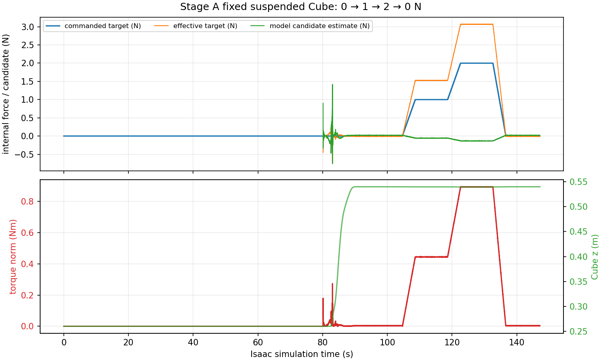

# TASK28 Stage A / G3：固定悬停内部力验证

基线：`b64eb6940d82b31ea97fc1a2aeb0f5d23be83e23`  
运行提交：`0fb617e`

## 结论

在原 Task27 GUI Isaac Sim 场景中，Cube_01 完成双侧吸附和 `COMMON_LIFT`，随后保持悬停姿态执行了 `0 → 1 → 2 → 0 N` 的平滑内部力目标序列。该运行完成，执行器退出码为 0，live torque QP 共求解 8,829 次，状态全部为 `QP_OPTIMAL`。

本次证明了仿真内部力目标会进入双臂 QP 并改变关节力矩分配；没有证明真实接触力被观测或闭环跟踪。运行时 Surface Gripper/D6 反力接口仍为 `valid=false`，所以最终分类为 **`G3_TORQUE_ALLOCATION_ONLY`**。

## 实验边界和入口

实验只复用原有场景入口：

```text
isaac/scripts/task27_five_cube_center_insert_scene.py
```

没有修改 USD、FR3 资产、L 型工具、Surface Gripper、Cube 几何或物理参数。执行器新增 Task27-only 参数 `stage_a_g3_hold:=true`，在原有 `COMMON_LIFT` 成功且两侧吸盘仍为 `CLOSED` 后退出；Isaac runner 再调用既有 `set_internal_force_target()`，完成固定姿态序列。位置驱动写入计数为 0。

运行摘要中的场景哈希仍绑定原始 Task26 scene/bridge；GUI 证明文件为 `scene_loaded.png` 和 `final.png`。

## 固定悬停结果

每段使用 2 s 线性过渡、5 s 稳态保持，稳态统计排除了过渡尾部。目标力沿运行时测得的左右 TCP 抓取轴施加反向双侧接触候选，映射为：

```text
tau_robot_internal = -stack(J_left.T, J_right.T) @ w_contacts_on_cube
```

| 段 | 目标 (N) | 稳态帧 | effective target 均值 (N) | 模型候选估计均值 (N) | 内部目标力矩范数均值 (N·m) | QP 内部力残差 ∞ 均值 (N·m) |
|---:|---:|---:|---:|---:|---:|---:|
| 0 N | 0 | 809 | −0.010 | +0.0208 | 0.0030 | 关闭 |
| 1 N | 1 | 583 | 1.527 | −0.0566 | 0.4439 | 0.1999 |
| 2 N | 2 | 584 | 3.065 | −0.1327 | 0.8921 | 0.4012 |
| 回到 0 N | 0 | 576 | −0.010 | +0.0208 | 0.0031 | 0.0087 |

1 N 和 2 N 目标增大时，内部机器人目标力矩范数随之增大；这支持“目标进入 QP 并改变力矩分配”。候选估计对正目标保持负号，且与目标数值不一致；这支持“当前观测器只是模型残差候选”，不支持接触力闭环已经校准。该符号现象被记录为观测结果，未直接推断其根因。

QP 约束审计显示：全部稳态段 `QP_OPTIMAL`；加速度盒、力矩盒和动力学残差均为 0；没有记录 torque saturation 或 torque-rate active。相对 TCP 平移误差峰值为 `0.1072 mm`。固定序列期间 Cube 从约 `(0.499952, −0.000005, 0.540160) m` 到 `(0.499952, −0.000002, 0.540108) m`，相对初始最大位移约 `2.073 mm`，因此悬停姿态存在可测漂移。



机器证据：

- [summary.json](../../offline/task28_task27_integration/evidence/task28_stagea_g3_fixed_0_1_2_0_v3/summary.json)
- [metrics.json](../../offline/task28_task27_integration/evidence/task28_stagea_g3_fixed_0_1_2_0_v3/metrics.json)
- [task27_torque_bridge.jsonl.gz](../../offline/task28_task27_integration/evidence/task28_stagea_g3_fixed_0_1_2_0_v3/task27_torque_bridge.jsonl.gz)
- [task27_executor.log](../../offline/task28_task27_integration/evidence/task28_stagea_g3_fixed_0_1_2_0_v3/task27_executor.log)
- [moveit.log](../../offline/task28_task27_integration/evidence/task28_stagea_g3_fixed_0_1_2_0_v3/moveit.log)

## 观测器和物理边界

关节 effort 是 Isaac PhysX 应用命令的回读，不是 FR3 `tau_J` 传感器。候选残差使用运行时 `M(q)qdd+c(q,dq)+g(q)-tau_applied`、冻结 Task27 TCP Jacobian 和 Cube Ground Truth 位姿/速度/质量/惯量。Cube 的质量和运动学净 wrench 可以说明物体发生了怎样的运动，不能唯一分解左右接触力。

运行时记录的 `surface_gripper_d6_runtime` 左右均为 `valid=false`，没有独立接触 wrench oracle。因此没有把 `estimated_internal_force_N`、`contact_wrench_on_cube_*` 或 QP target 当作物理接触真值。当前仍缺少左右六维约束反力、符号零偏校准和接触力闭环验证。

## 失败回执

- `task28_stagea_g3_fixed_0_1_2_0_v1`：GUI 启动时 ROS2 Bridge 库路径不足，未进入场景。
- `task28_stagea_g3_fixed_0_1_2_0_v2`：GUI 和 MoveIt 已启动，但旧的 20 mm local sweep envelope 在执行器启动前触发 `LIVE_QP_LOCAL_SWEEP_LIMIT`，未进入抓取；该次不纳入力验证。
- `task28_stagea_g3_fixed_0_1_2_0_v3`：按既有 Stage-A 运行使用 `--local-sweep-limit-m 2.0` 后完成固定序列。

## 复现

```bash
DISPLAY=:1 XDG_SESSION_TYPE=x11 OMNI_KIT_ACCEPT_EULA=YES \
RMW_IMPLEMENTATION=rmw_fastrtps_cpp \
LD_LIBRARY_PATH=/opt/ros/humble/lib:/opt/ros/humble/lib/x86_64-linux-gnu:$LD_LIBRARY_PATH:/home/ubuntu2004/isaacsim-4.5.0/exts/isaacsim.ros2.bridge/humble/lib \
/home/ubuntu2004/isaacsim-4.5.0/python.sh \
isaac/scripts/task28_task27_one_pass.py --mode integrated --live-qp \
  --max-batches 1 --fixed-suspended-force-sequence \
  --fixed-force-transition-s 2 --fixed-force-hold-s 5 \
  --internal-force-weight 1000 --internal-force-kp 0.5 \
  --local-sweep-limit-m 2.0 --execution-time-scale 16 \
  --timeout-s 900 --run-id task28_stagea_g3_fixed_0_1_2_0_v3
```

验证结果：

```text
colcon build --packages-select fr3_dual_palletize --symlink-install  PASS
python3 -m py_compile isaac/scripts/task28_task27_one_pass.py \
  isaac/scripts/task28_task27_torque_bridge.py  PASS
PYTHONPATH=offline/task28_g1_1:. python3 -m pytest -q \
  offline/task28_g3_stage_a/tests offline/task28_p2_1/tests \
  offline/task28_p2_2/tests offline/task28_p2_4/tests \
  offline/task28_p5_qp_6_r8/tests offline/task28_task27_live_qp/tests \
  offline/task28_t0/tests  PASS: 150 passed
```

没有启动 Stage B、REGRASP/PUSH、五 Cube continuation、真实机器人或 ROS 控制命令；原始 Cube 接近路径的 `CONTINUOUS_SAFETY_NOT_ESTABLISHED` 状态保持不变。

下一步应先接入可独立读取的 Isaac 接触约束 wrench，并用它校准上述候选估计的符号、零偏和幅值，再考虑把 `G3_TORQUE_ALLOCATION_ONLY` 提升为模型候选观测验证。不要把本次结果当作真实吸附或真实 FR3 力控证据。
