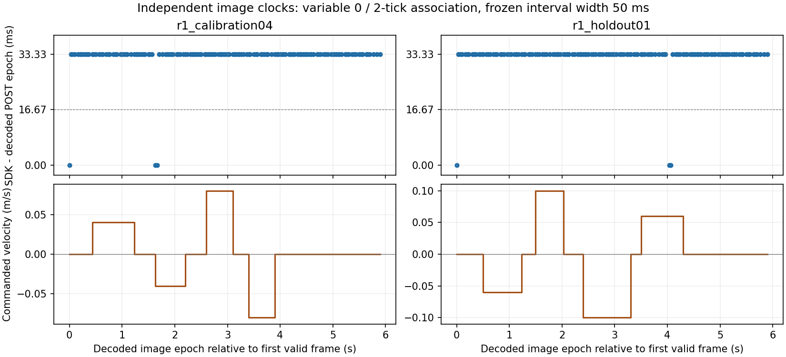

# R3-P2A-R1：Image content time 与 SDK render time

**最终判定：PARTIAL。** 已用图像中的独立时间码复现并量化时差，正确调用本机
RationalTime API，完成先冻结校准、后采集独立留出的验证。普通 SDK/Fabric 时间的
保守测量区间为 **[T−33.333 ms, T+16.667 ms]**，宽 **50.000 ms**；
中点最坏误差界 **±25.000 ms**，未达到不超过一个 60 Hz tick 的目标。
没有用 Cube GT 拟合时间偏移，没有把统一减 33.333 ms 宣称为修复。

起始 HEAD：`607a9ee5feb4e997bb5d91379a19cafa9705f72d`。
分支：`research/stage-b-r3-multisensor-plan`。遵循根目录 AGENTS.md；停止于 R1。
旧 P0/P1/P2A 文件、Task26/27 控制器及成功判据均未修改。

## 1. 本机实现与实际 API

本机 Isaac Sim 4.5.0；下列已安装文件的绝对路径和 SHA256 保存于
`evidence/r1_api_inventory/installed_source_audit.json`。

| 层级 | 安装源码与核查结果 |
|---|---|
| Physics | PhysX pre/post-step subscriptions，60 Hz。post 累加实际 dt，与 CoreNodes `get_sim_time()` 逐步一致。实测 tick 16.666667536 ms；不是 host wall clock。 |
| Camera | `isaacsim.sensors.camera/.../camera.py:462–480`：解析 NEW_FRAME 的 render-product 路径，执行 SDG graph，读 ReferenceTime numerator 为 `rendering_frame`，经 `get_sim_time_at_swh_frame(numerator)` 映射为 `rendering_time`，随后读 RGB/自定义 depth annotator。 |
| ReferenceTime | `omni.replicator.core` 1.11.35 的 `annotators_default.py:1783` 注册 `OgnRefTime`；输入来自 PostProcessDispatcher，`render_product_idxs=()`，是共享 dispatcher 时间来源。不能仅因 Camera 过滤了 RP 就推断它已与像素状态独立核对。 |
| Render graph | `omni.syntheticdata` 0.6.10 的 `SyntheticData.py:376`：PostProcessDispatcher 是 ON_DEMAND `SdOnNewFrame`；PostProcessDispatch 接 `SdOnNewRenderProductFrame`。安装节点文档描述 NEW_FRAME 后执行，输出 rational numerator/denominator。运行时记录 `/Render/PostProcess/SDGPipeline/PostProcessDispatcher` 的这两个输出。 |
| Fabric | 安装 `kit/dev/fabric/include/omni/fabric/core/RationalTime.h:73` 定义实际 C++ `omni::fabric::RationalTime`，成员是 int64 numerator、uint64 denominator。它是历史 buffer 的有理时间键，不能把 n/d 直接当 physics 秒。 |
| CoreNodes | `exts/isaacsim.core.nodes/include/CoreNodes.h` 接收 `const omni::fabric::RationalTime&`；旧 SWH-frame 函数在该头文件已标注 deprecated。本机未提供插件内部 time-history 映射和 Hydra/Fabric 提交的完整 C++ 实现，未声称审查了这些不可见内部代码。 |

本机 Python `omni.fabric` **未导出 RationalTime**；`omni.fabric._fabric`、
`._bindings` 不存在，检查 usdrt/已载入模块也未找到对应 Python 类。
`r1_api_inventory/python_exports.json` 保存枚举，calibration01 保存实际 ImportError。
不能把后续 SDK 版本的 tuple/二参数 overload 套到此安装。

`native/r1_fabric.cpp` 只为**安装头文件里的同一个 C++ 类型**增加 Python binding；
没有实现/替换 `get_sim_time_at_time()`。使用系统已安装 g++/pybind11 headers，
`-fabi-version=11` 匹配本机 CoreNodes 的 pybind ABI。构建命令、返回码、源文件及
头文件 SHA 在 `r1_api_inventory/native_build_manifest.json`；二进制不入 Git。
实际执行：

```python
rt = RationalTime(int(ref['referenceTimeNumerator']), int(ref['referenceTimeDenominator']))
fabric_sim_time = camera._core_nodes_interface.get_sim_time_at_time(rt)
```

432 次最终采集的 **新 API − SDK rendering_time 最大差为 0 秒**；
ReferenceTime 与运行时 dispatcher 输出 432/432 一致，SDK 时间也等于该 acquisition
callback 记录的 CoreNodes 当前时间。例如 calibration04 的 capture 39：ref=174/30，
其商 5.8 并非仿真秒；两种 SDK 映射均为 3.950000206 s，但图中 POST 是 step235，
对应 physics 3.916666871 s。正确类型调用本身没有消除内容时差。

## 2. 独立视觉时钟与几何修正

在原 Task27 Stage-B 场景放置不参与碰撞的 camera-facing 时间码，保留原 camera
eye/target、K、分辨率及原机器人/货墙/桌面布局。时间码位于 Cube 投影外，Cube
按桌面 x 方向施加 kinematic 受控刺激，z=0.26 m、identity quaternion；不执行
Task27 任务或新增机器人运动命令。

三组 16-bit 码各有 data 和 complement 两行，共 96 格：

- **APP**：写 Cube 命令同一主循环 epoch，记录该时刻最后完成的 physics step。
- **PRE**：PhysX pre-step 写入即将执行的 step 编号。
- **POST**：PhysX post-step 写入刚完成的 step 编号，并记录 physics history。

每个位同时以亮/暗 RGB 和 0.89/0.85 m optical-depth 两种方式编码。CPU 解码器
只读原始像素的格子中心，不接收期望 step、Cube pose 或 renderer metadata；
检查 16 个 complement 对的对比度、depth 差和范围，再比较 RGB/depth 独立解码结果。
所有 USD 位写入都有立即读回断言；calibration04/holdout01 分别核对 5350/5334 次
变化写入。立即读回只证明 USD 写入成功，不等于证明 Fabric 同步完成。

动态试验前依次显示 `0,65535,43690,21845,4660,32769`，每个保持六次 update，
末三次用于独立 pattern 检查。两次运行共 **36/36 settled pattern captures** 的
三组 RGB/depth 码均精确等于给定值；最终全部 **432/432 RGB-D patches** 三组码均
相互配对。动态序列按 physics clock 推进；所见 PRE=POST，APP 比 POST 早两步，
279/279 个有效独立动态帧均如此。

发现并修正的附带问题：UsdGeom.Camera 新建时默认 clippingRange 是
**[1.0, 1000000.0] m**。此前 0.85/0.89 m 码落在近裁剪面内，calibration03
虽完整导出 216 帧，但 0/18 pattern checks、0/216 RGB-D 码配对，不能用于校准。
calibration04 显式设为 **[0.01,100] m** 后可解码；运行 readback 在 manifest。
这没有移动相机、改变 K/T 或改原控制器。该发现不追溯认证旧 P2A 图像；旧 P2A
的 PARTIAL、30 个 UNCERTAIN 时间戳及既有 pose 统计全部保留。

原始证据是未叠字、未重采样的 RGBA PNG 和 float depth NPZ ROI，记录 crop 坐标及
layout；每 30 次采集保留完整 RGB。图中编码是真实 scene geometry/material 的渲染
结果，非保存后叠加文字。depth 只保留时钟 ROI，未声称提供全部场景 dense-depth
逐像素同步证明；同一时钟空间支持了这次 RGB/depth 对应验证。
时钟是 USD authored visual prim，并不单独证明每个 PhysX-owned Cube/robot transform
都通过完全相同的 Fabric snapshot 路径；本轮区间直接约束的是可见编码场景状态。
普通 Cube 测量仍需保留此限制，不能据此认证全场景的精确 capture timestamp。

## 3. 校准与独立留出

两次都重建场景、90 次 warmup、36 次 pattern control、180 次 dynamic update，
总 physics history 各 9.850000514 s。动态部分各约 6 s。

| 项目 | calibration04 | holdout01 |
|---|---:|---:|
| 起点 x / 速度 (m, m/s) | 0.80；±0.04、±0.08 | 0.84；±0.06、±0.10 |
| 静止、正/负速、启停 | 全部覆盖 | 全部覆盖，次序/时长不同 |
| 总 raw RGB/depth captures | 216 | 216 |
| dynamic captures | 180 | 180 |
| 相同 SDK frame 的重复读取 | 36 (20.00%) | 43 (23.89%) |
| 去重 dynamic frames | 144 | 137 |
| 仍含最后 pattern、无法对应 dynamic history | 1 | 1 |
| 有效独立 dynamic frames | **143** | **136** |
| SDK/Fabric − 图中 POST epoch = 0 tick | 3 | 3 |
| SDK/Fabric − 图中 POST epoch = 2 ticks | 140 | 133 |
| 同一冻结区间覆盖视觉量化区间 | 143/143 | **136/136** |

每个相同 SDK frame 的重复读取均核对 RGB/depth hash 与 SDK/reference metadata 一致；
不把重复图片当作新的独立样本。两个初始 stale-pattern frame 明确拒绝；未只选匀速
或删去 0-delay 帧。逐速度及 stop/start phase 数量在 summary 和逐帧 CSV 中。
校准零延迟样本为 captures 37、86、87；留出为 37、158、159，包含运动期样本。

先从 calibration04 的图像时钟冻结 `config/r1_time_binding_frozen.json`，再启动
holdout01。冻结 SHA256：
`54a2f54fe2dd1a17acba1947b3ffc1b7bd03fe5b395e996c666b309a01b31fbf`。
holdout capture manifest 已记录该 hash；校准 manifest hash、创建时间和有效帧数均
在冻结文件。没有用留出重新拟合。两个 capture/config/安装 Camera 的 fingerprint
相同：`34a697054f61b61119ffe215c26be160c78b0718541a501cf046eb4a273cbff6`。

Cube oracle 在预测文件保存后才被解析，只检查刺激/桌面范围。CPU 回归还验证了在
评分时完全移除 oracle，时间预测和 PARTIAL 结论不变。calibration/holdout 实际
Cube x 范围分别 [0.800000012,0.847999990]、[0.763000011,0.852999985] m；z 恒
0.259999990 m，roll/pitch/yaw 恒零。命令与随后两步 PhysX pose 的最大距离分别
3.132e-8、3.121e-8 m。它们只验证受控刺激确实发生，未进入时间校准或视觉解码。
运动是每主循环更新的离散 kinematic 阶梯，不是真实匀速曝光/运动模糊模型。

## 4. 区间、误差与判定

令 h=一 physics tick、Tn=图中 POST n 对应 physics epoch、T=映射后的 Fabric/SDK
时间。图像码不能区分两个相邻 physics events 之间的时刻，保守保留 **[Tn,Tn+h]**
的量化区间。该区间是编码 scene-state epoch 的界限，不是假设相机曝光时刻已知。
校准观察 D=T−Tn 的完整取值为 {0,2h}，故冻结 offset envelope 为
`[min(D)−h,max(D)] = [−h,2h]`，预测 interval 为：

**[T−2h,T+h]，宽 3h=50.000003 ms，半宽 25.000001 ms。**

| 时间指标 | calibration04 | holdout01 |
|---|---:|---:|
| 原始 SDK−POST epoch median/P95/max (ms) | 33.333 / 33.333 / 33.333 | 33.333 / 33.333 / 33.333 |
| 原始 offset 完整范围 (ms) | 0–33.333 | 0–33.333 |
| 冻结中点 vs 视觉区间中点 median/P95/max (ms) | 16.667 / 16.667 / 16.667 | 16.667 / 16.667 / 16.667 |
| 冻结中点到视觉区间任一端点最坏误差界 (ms) | **25.000** | **25.000** |
| 独立解码图像自身的 epoch interval 宽度 (ms) | 16.667 | 16.667 |
| SDK/Fabric 映射最大差 (ms) | 0 | 0 |

不能只报中点误差 16.667 ms 而忽略区间端点：这样会把尚未知道的 sub-tick 相位
当作已测量的真值。也不能以 273/279 个样本常见的 33.333 ms 为固定补偿而忽略
6 个零延迟样本。单帧时钟可识别 instrumented scene epoch，普通无时钟图像并不能
因此自动获得同等信息。此处只给出两段试验支持的经验 envelope，不是任意未来负载
下的最大管线延迟保证，故整体保持 PARTIAL。



## 5. 原因定位到什么程度

| 候选解释 | 本轮证据与结论 |
|---|---|
| 稳定常数偏移 | **否**，同一配置及每个独立序列内均有 0/2-tick 两种关联。 |
| RationalTime 类型/除法错误 | 正确安装 C++ 类型已实际调用；新/旧映射一致。单纯换 API 名称不能修复像素关联。直接用 n/d 则是时间定义错误。 |
| 主循环命令时间等于 scene-state 时间 | **否**，279/279 帧的 APP 比 PRE/POST 早两步。命令写入、完成 physics step、callback 当前时间不可混用。 |
| 可变管线/metadata 与像素状态关联 | **有独立证据**：SDK/core callback epoch 与解码 epoch 有 0 或 2 tick 差；重复相同帧的到达也可再晚一步主循环。 |
| USD→Fabric 传播 vs Hydra buffer/共享 dispatcher 关联 | **尚不能唯一分解**。USD readback 正确、PRE/POST 一致、RGB/depth 一致，但未记录 Fabric 每个 cell 的历史值和 renderer snapshot fence。不能把本轮证据称为已证明某一个内部组件有 bug。 |

因此定性结论是**可变的管线时间关联差异**，不是一个可认证的稳定补偿值；内部
USD→Fabric 与 render/readback/metadata 的责任边界仍未完全解决。近裁剪面问题是
独立的可见性错误，已经修复，不能用它解释修复后仍存在的 0/2-tick 差异。

## 6. capture / arrival / writer 与新接口

逐帧原始 observations 和 correspondence CSV 分开保留：

- `sdk_time_s` / `fabric_sim_time_s`：reference-history 映射时间，不是已确认捕获时间。
- `callback_wall_s`：Camera 父 callback 完成 annotator 读取后的单调 host 时间，非
  event-entry、GPU exposure 或 physics 时间。
- `arrival_wall_s`：主循环 clone/crop 完成、开始 writer 前的 host 时间。
  `arrival_physics_time_s` 是此时 physics clock；重复旧帧会继续增长。
- `writer_start_wall_s` / `writer_complete_wall_s`：PNG/NPZ/代表图写入边界；不据此
  生成 sensor timestamp。host 秒与 sim 秒不能直接相减。

有效 unique frame 的 arrival−SDK 仿真时间差 median/P95/max 均 33.333 ms；包含
重复读取的全部 dynamic captures 则为 **33.333/66.667/66.667 ms**（两段相同）。
有效 unique arrival−图中 epoch 为 66.667 ms。host callback-completion→arrival
P95 分别 38.105/39.453 ms，writer duration P95 8.115/7.264 ms，最大
30.614/60.549 ms；这些是运行/存储负载，不是图像内容时间修正量。

`r1_time_code.timestamp_interface()` 为 R1 新接口，不修改旧 P2A 导出：
仅匹配冻结 fingerprint、finite time 且调用方显式确认 `time_binding_ready` 时给出
`measurement_time_interval_s`、`candidate_midpoint_s`、`uncertainty_half_width_s`。
状态为 `EMPIRICAL_INTERVAL_CONFIG_SPECIFIC`；**measurement_time_s 仍 null，
online_fusion_eligible 仍 false**。不匹配或 warmup/transition 无法核对时保持
UNCERTAIN/null。ready 是本次实验经独立图像码核对的 qualification，不可从普通 SDK
frame_id 非零就自动置 true。

两个最终 `timestamp_interface.jsonl` 含全部去重 dynamic frames（144/137），各一帧
明确 UNCERTAIN，其余附独立码区间和经验 envelope。calibration/holdout 结果写在
summary，不把 frozen-calibration 文件回写为 PASS。没有对旧 30 个时间戳做补偿。

## 7. 失败保留、复现与停止条件

| 尝试 | 结果/保存证据 |
|---|---|
| calibration01 | 导入未导出的 Python RationalTime 失败，0 帧；failure、源码 snapshot、Isaac log。 |
| r1_api_inventory | 单次安装 API 枚举；无动态试验，输出 exports/probe source/log。 |
| calibration02 | 本机 C++ binding 已可调用；36 个 pattern patches 后旧 ArUco helper 调到 Isaac cv2 不存在的 `DetectorParameters_create`；保存 failure、源码、日志、raw patches。该次异常前尚未落盘逐帧 JSONL，未补造 metadata。R1 不需要 ArUco，移除此 timing-only 入口的调用，旧 R2 helper 未修改。 |
| calibration03 | 完整但时钟被近裁剪面裁掉；216 组原始 ROI、metadata/history/oracle、source/config snapshot、日志、INCONCLUSIVE 分析全部保留，不进入校准。 |
| calibration04 | 第一次有效校准；216 组、PARTIAL。 |
| holdout01 | 冻结后独立重建、不同轨迹；216 组、PARTIAL。 |

`R1_EXPERIMENT_MANIFEST.json` 是入口；各 run manifest 含 camera K/T、RP、graph、
ROI/layout、配置/源码/data/patch hash。最终 capture script/config byte-for-byte 与
各自 snapshot 一致；capture 当时的 helper snapshot 也按原 manifest SHA 保留。
随后 helper 只改离线 decoder diagnostics/时间区间接口，`code_bits()` producer 未改。
精确重演历史指纹应使用对应 capture/config/helper snapshot；新环境/不同 SDK、
clipping、RP、更新模式、负载均需重新校准，不可套用这个冻结文件。

CPU：**56 passed**，包括 R3、R2-B、独立 FK 回归；覆盖坏码/非有限 depth、不配对、
fingerprint/ready/finite-time 拒绝、variable-delay envelope、已提交 holdout 重放和
无 oracle 的预测路径。命令与真实输出在 `evidence/r1_cpu_tests.txt`。两个有效 Isaac
run 均有 completion manifest、errors=[]，未以退出码 0 代替成功证据。
另从 Git staged index 单独导出必要源码、冻结文件和 raw holdout，在工作树外重放，
完整 summary JSON 与已提交分析逐项一致；记录于 `evidence/r1_index_replay.json`。

完整命令见 README 的 R1 段。重放仅需已提交 ROI/JSONL，不依赖 physical07 原始大文件。
不在本轮进行 P2B/在线融合、attachment classifier、RL、技能切换、硬件或控制器重构。
后续若要求 PASS，应先在同一桌面范围把 render-product 的实际 Fabric snapshot
时间与像素绑定或增加可保留的独立时钟，使**冻结后的独立留出最坏界 ≤16.667 ms**；
并再次验证 RGB/depth 的相同绑定。当前 50 ms envelope 不满足该进入条件。
