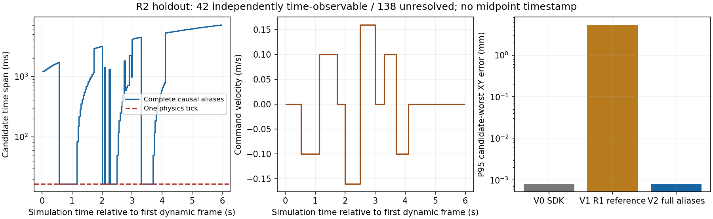

# R3-P2A-R2：同帧 Cube 场景状态与渲染时间绑定

**最终判定：PARTIAL。** 独立留出 180 个唯一动态帧中，176 帧可输出冻结的两个
相邻物理步的时钟先验，但必须保留完整历史别名。42 帧具有独立可辨识的 Cube
运动时间证据；在这 42 帧上，候选
到参考状态集合的最坏距离 median/P95/max 均为 **16.667/16.667/16.667 ms**。
另 **138 帧**因静止、重复姿态或视觉拒绝，不能独立验证唯一物理 epoch。
134 个接口含其他历史别名，候选跨度 median/P95/max 为
**1366.667/6858.334/7150.000 ms**，不能以局部一 tick 先验冒充全帧保证。
全 180 帧的 `measurement_time_s` 和 `corresponding_physics_step` 均保持 null。
**没有以候选中点制造一个精确时间，也没有统一减去 33.333 ms。**

起始分支/HEAD 经核对为 `research/stage-b-r3-multisensor-plan` /
`52209eca08afceacce3de293d338a7183b56b804`，初始工作树干净。已读根 AGENTS.md、
完整 R1 报告、manifest 和校准/留出 summary。使用同一研究工作树，不改变其他工作树。
历史 P0/P1/P2A/R1 的报告、冻结模型、raw 和失败均保留，原 Task26/27 行为不变。

## 1. 实验预算与冻结顺序

仅启动 **3 次 Isaac**：一次主校准、一次针对性校准重试、一次独立留出，已停止。

| 实验 | 用途与结果 |
|---|---|
| `r2_calibration01` | 主校准，216 组 raw RGB-D 完整保存。Fabric 探针误查了无后缀 translate；离线首次 depth 反投影使用 integer pixel，XY 偏差约 0.833 mm。没有从它冻结时间模型。 |
| `r2_calibration02` | 唯一针对性重试：查询 Cube 实际 `xformOp:translate:task26_pose` 属性；没有改变运动、相机或控制器。216 组，用于冻结场景候选模型。 |
| `r2_holdout01` | 冻结后新建场景，改变起点、速度、顺序、时长；216 组，作为唯一最终留出。没有据此重新拟合。 |

共同配置 `config/r2_scene_time_experiment.json` 和两份 split 冻结配置在第一次采集前
写入。正式候选模型在 calibration02 的像素预测之后、读取 Cube oracle 之前冻结。
holdout manifest 在采集时记录其 SHA256：
`fc578cdb042ccf7a70060a105a7b220f78c1a9ad1c73e3cf33b9b0f33d3729c9`。

最终 capture/config 在校准重试和留出间未修改；安装 Camera、capture/config、K/T 的
共同 fingerprint 为 `7c4d63599e0ef1258699c495d551d95d5b4a931ad2d71813284d7202c47488bd`。
每次 manifest 保存 capture/config 快照、hash、实际 K/T、RP、clock layout 和数据 hash。

## 2. 场景、观测与独立通道

复用 R1 的实际 C++ RationalTime binding、APP/PRE/POST emissive 时间码、原 Task27
桌面/货墙/双臂几何。相机 eye/target、K、world-from-camera **与 R1 逐元素一致**，
near/far 继续显式为 .01/100 m；没有移动相机。RGB 与 float depth 来自同一 Camera
render product/NEW_FRAME，原样保存包含**时钟和整个 Cube**的 ROI
`[320,150,900,510]`，每 30 次另存完整 RGB。不是保存后叠码。

Cube 是受控 kinematic 桌面刺激，z=.26 m，固定 roll/pitch，yaw 由图像估计；
每主循环更新一次位置，60 Hz PhysX 中通常连续两步保持同一 pose。
校准起点 x=.82，速度 ±.06、±.12 m/s；留出起点 .86，速度 ±.10、±.16 m/s。
两组均包含静止、启停及三次不经过停顿的反转。受控速度是分段轨迹的命令速度，
实际 pose 是离散阶梯，不能把它当作连续曝光或自由动力学匀速试验。

| 记录 | 生产路径和作用 |
|---|---|
| `observations.jsonl` | frame_id、SDK/Fabric mapped time、ReferenceTime n/d、dispatcher n/d、callback entry/completion、arrival、writer、RGB/depth hash；无 Cube GT。 |
| `physics_history.jsonl` | pre/post clock producer 及每步积分时间/CoreNodes 时间；供像素时钟编号查询，不包含 Cube pose。 |
| `stimulus_commands.jsonl` | 实际写入命令的物理步、时间、分段速度和位置；独立因果刺激日志，不是读取 PhysX pose 得到。 |
| `pixel_predictions.jsonl` | 仅由 RGB、depth、K/T、静态几何生成 Cube 估计；先落盘。 |
| `oracle.jsonl` | 隔离的 PhysX Cube pose/quaternion/kinematic 标志，只在评分时解析。 |
| `oracle_scene_probes.jsonl` | 隔离记录 pre/post、命令后、camera callback、app.update 后的 PhysX、USD、USDRT 当前属性；不输入像素估计或时间候选标定。 |

oracle 明确断言 `cube.is_physics_handle_valid()`。安装 4.5
`isaacsim.core.prims/.../rigid_prim.py:368` 的 live 分支调用
`self._physics_view.get_transforms()`，不是 XformPrim 的 USD fallback。
这核查了 PhysX producer 的独立性，避免把 USD 的同一个值换名为 GT。
新增安装源码 hash 在 `evidence/r2_installed_source_audit.json`；R1 已完成的 SDK、
ReferenceTime、RationalTime 和 graph 审计直接复用，没有再做广泛 SDK 搜索。

## 3. Cube 像素估计与 pixel-center 修正

保留原 P1 planar ArUco 估计和其冻结参数，使用它初始化本轮独立 RGB-D box fit。
depth 通过 K/T 反投影，只取已知桌面之上的可见竖直 Cube 表面，拟合 x/y/yaw；
已知 Cube size=.12 m、table height=.20 m，固定中心高度 .26 m。鲁棒拟合要求两个
表面带来足够 Jacobian rank；单面、无 marker、P1 support contradiction 均拒绝。
估计函数不接受 clock、命令位置、PhysX/Fabric pose 或 oracle。

首次 integer pixel 反投影出现约 .833 mm 偏差后，使用**已知时钟几何**核查采样约定，
而非用 Cube GT 拟合坐标偏移：位于光轴主列 u=640、投影宽 16 px 的时钟格子，
108 次独立 depth-face 检查的 index bounds 全为 `[632,647]`，中心 index=639.5。
这支持 RTX depth 在 index+.5 取样。修正并冻结为 `(u+.5,v+.5)`；原始诊断预测、
整数像素复现 helper 和完整 108 条检查均保留于 `r2_calibration01_pixels/`。
没有改变相机 K/T，也没有改变历史 P1 模型。

留出中，unchanged P1 RGB 的 XY median/P95/max 为
**1.096/1.896/2.566 mm**；RGB-D box fit 为
**0.000717/0.000809/0.000833 mm**。后者是理想 RTX depth、已知盒体几何和精确
仿真 K/T 下的结果，约为亚微米量级；**不是普通 RGB 精度、真实深度相机精度或
Task27 摆放精度证明**。运行时 median/P95/max 为 25.305/30.333/34.197 ms
（离线 CPU，未放入 capture callback）。

## 4. 冻结的场景候选模型

校准只使用独立 Cube 像素估计、图中 POST 编号及已记录的受控命令。
对 POST=n 周围的命令阶梯状态，采用预定 .25 mm 空间一致性容差；只将最多两个
可辨识状态的运动帧用于校准。82 帧均支持相同候选：**n−1 和 n**。这是两步持有
同一 Cube pose 的状态歧义，不是拟合连续时间补偿。

冻结文件 `config/r2_scene_binding_frozen.json` 保存这些帧、局部时钟先验 union、容差、像素
实现/P1 config hash；`precise_transfer_validated=false`。先写入像素预测、冻结文件、
`time_binding_interface.jsonl`，再打开 oracle 评分。CPU 测试在 oracle 入口主动中断，
确认预测和候选已完整生成，并与正常评分结果一致。

V2 只有在 fingerprint 相符、三个 RGB/depth 码配对、PRE=POST、历史编号可用，且
像素 Cube 与候选命令状态一致时才给出候选。它不适用于未知自由运动、接触后偏移、
抓取或原任务中没有已知受控刺激的状态。**候选先验跨度一个 tick，并不意味着
所有帧的真实测量时间已获独立验证。**

最终全历史检查发现，局部时钟窗口会隐藏反转后重访的位置。因此正式输出另外
枚举 warmup 后到 callback entry 为止的全部因果命令历史中与像素一致的状态；
不读取 Cube oracle，不重新拟合冻结参数，并排除尚未发生的未来状态。`candidates`
是完整集合，`clock_conditioned_candidates` 单独保留冻结的 n−1/n。原局部窗口下
74 个留出可辨识样本只是条件诊断，完整保留于 `r2_holdout01_local_window_diagnostic/`，
不能作为最终独立时间结论。此处跨度也仅限已记录历史，不证明记录前的场景 epoch。

## 5. 独立留出与 V0/V1/V2 同帧比较

| 指标 | calibration02 | holdout01 |
|---|---:|---:|
| raw / unique dynamic / duplicate dynamic | 216 / 180 / 0 | 216 / 180 / 0 |
| RGB/depth 三组时钟全部配对 | 216/216 | 216/216 |
| settled pattern controls 正确 | 18/18 | 18/18 |
| Cube pose PRESENT | 178/180 | 177/180 |
| Cube 支持的候选集合接口 | 177/180 | **176/180** |
| 完整因果历史中独立可辨识的 Cube 时间参考 | 24 | **42** |
| 时间参考不可辨识/拒绝 | 156 | **138** |
| SDK−POST 可用时钟的 tick histogram | 0:179 | 0:179 |
| 候选与评分参考至少一个状态相交 | 177/177 | **176/176** |
| 唯一点时间导出 | 0 | **0** |

三个时间方法使用完全相同的 **176 个留出图像和同一个 RGB-D Cube 估计**：

- **V0**：原 SDK rendering_time 对应单个物理状态。
- **V1**：原冻结 R1 数值区间 `[T−33.333,T+16.667] ms`。注意 R2 fingerprint 与
  R1 不同，严格 R1 接口应拒绝全部 180 帧；本表 V1 仅为明确标识的数值参考，
  **不是绕过 R1 guard 重新认证**。它有多个可能物理状态，不能给它捏造一个单点。
- **V2**：完整因果历史中的 Cube 场景候选；冻结的 `[POST−1,POST]` 局部先验
  另列，不借它们隐藏其他相同姿态的历史状态。

时间参考仅在隔离评分侧由 Cube 像素与完整 PhysX history 的空间一致性建立，
截止独立记录的 callback entry physics step，容差仍为冻结 .25 mm。只接受完整
因果历史中连续且最多两个状态的 plateau；静止、反转重访或多个 disjoint groups
不作精确时间 benchmark。没有根据留出选择新 offset、扩大容差或限缩历史窗口。

| 留出指标（median / P95 / max） | V0 SDK | V1 R1 数值区间参考 | V2 完整场景候选 |
|---|---:|---:|---:|
| 时间集合到参考集合的最近距离，ms（42 帧） | 0 / 0 / 0 | 0 / 0 / 0 | 0 / 0 / 0 |
| 任一候选到任一参考状态的最坏距离，ms（42 帧） | **16.667 / 16.667 / 16.667** | **33.333 / 33.333 / 33.333** | **16.667 / 16.667 / 16.667** |
| 表示本身的时间跨度，ms | 单点，未证明为真实 epoch | **50.000** | **16.667–7150.000** |
| 同帧 XY 错误下界，mm（176 帧） | .000717 / .000809 / .000833 | .000717 / .000809 / .000833 | .000717 / .000809 / .000833 |
| 同帧 XY 错误上界，mm（176 帧） | .000717 / .000809 / .000833 | **3.000 / 5.333 / 5.333** | .000717 / .000809 / .000834 |

集合错误按该表示中所有物理状态的误差范围报告，**不是把区间中点当成真值**。
V1 的大上界来自其覆盖了多个不同位置，不是视觉估计器突然变差。
V0 与 V2 在本轮同帧定位结果相同；**没有证据宣称 V2 比本轮 V0 更准确**。
新增证据是 Cube 像素与物理状态的独立对应及诚实的候选表示。
这些离散 scene-state 错误也不等于相机曝光或 GPU raster 时间已经测得。

## 6. 启停、反转与保留失败

留出六个运动段（速度 −.10,+.10,−.16,+.16,+.10,−.10）分别有
18/18/15/15/12/12 个唯一帧，其中 17/1/12/0/12/0 个可独立检验时间。
静止 phase 0/3/6/9/10 共 89 帧，均不被 Cube pose 单独当作精确时钟。
另有 48 个运动帧因历史重访、过渡或视觉拒绝不进入精确 benchmark，
其中包含三帧 P1 support 拒绝；加 89 个静止帧和初始 stale-code 帧，共 138 帧。

`transition_diagnostics.json` 对九个启停/反转事件各取 APP epoch ±4 ticks 的五帧
窗口。三次反转窗口分别有 3/2/2 个帧可独立定时；可辨识帧的 V2 最坏界为 16.667 ms，
其余歧义完整保留。窗口会重叠，不把它们重新计为独立样本。

代表拒绝：capture36/frame175 仍含上一 pattern，clock 不属于动态 history；
capture97/frame236、122/frame261、124/frame263 被原 P1 support check 拒绝。
raw 图、预测和 reason 在 `representative_failures.json` 及原始目录，未删除困难帧。

留出 raw marker 与 depth box 投影的一致性 mean-corner residual 的 median/P95/max
为 .893/1.206/1.410 px。时钟三组 RGB/depth 码完全一致，Cube 几何也兼容；但
SDK 没有单独 RGB/depth exposure ID，这不等于全视场逐像素同步证书。
42 帧的精细时间参考主要依赖 depth box geometry；RGB marker 的毫米级误差不足以
独立证明所有运动帧的 RGB Cube 也有一 tick 精确绑定。RGB/depth 的时钟一致性与
Cube 投影兼容是支持证据，不能替代这项尚缺的证明。

## 7. 0 / 2-tick 差异定位与尚未解决的部分

R1 实际 0/2 tick、重复帧及 50 ms envelope 保持原结论。本轮新增探针和更大 RGB-D
writer 后，calibration02/holdout 各 179 个可用 clock 均为 **0 tick**，没有重复
dynamic SDK frame；新 RationalTime API 与 SDK time 最大差仍为 0 秒。
本轮 writer median 约 24.3 ms，而 R1 约 6.5 ms，还改变了 trace 开销。
**探针与负载改变了被观测的管线条件**，不能把这种行为变化称为原 SDK 已修复。
预算已用尽，没有再做多因素 renderer A/B 或追加第四次模拟。

| 候选原因 | 本轮结论 |
|---|---|
| stale/duplicate | 本轮 0 个重复 dynamic frame，同帧 hash 有检查；初始 stale pattern 仍明确拒绝。R1 的重复证据不撤销。 |
| physics/render update ordering | 直接观测到命令写入后的 USD/USDRT authored 值可领先 PhysX；post-step 后两者重合。校准/留出 post-step 最大 translation 差仅 3.10e-8/3.12e-8 m。 |
| 当前 USD/Fabric 值就是图中状态 | **否**。camera callback 的当前 authored 值也可能是下一条命令，而图中 Cube 匹配前一组已完成物理状态。不能将 getter 当前值冒充 renderer snapshot。 |
| USD→Fabric 独立传播延迟 | 只能读取 USDRT authored translate；world_position/world_matrix/local_matrix 均不可用。read-through 属性不是独立历史快照，不能据此唯一定位传播延迟。 |
| Hydra buffer / RP callback / SDK metadata | 与 R1→R2 的观测条件/排队变化相容，但未取得 render-latched Fabric history/fence，**不能分解并归责某个组件**。 |
| 固定减两 tick | 本轮将明显错误；两个独立序列均观测为零，而 R1 有两种模式。不得固定补偿。 |

4.5 的 `usdrt.Rt.Xformable` 属性方法经过安装 stub 核查，实际记录可用性；
两组最终各 432 个 post-step probes 的 authored translate 可用，world attrs 0/432。
这是有界的 API/数据可用性结论，不是“Fabric 与 physics 已全链路同步”。

callback entry/completion、主循环 clone/crop 后 arrival、writer 开始/完成均分开
保存。arrival−SDK 的仿真时间差在本轮 median/P95/max 均为 33.333 ms；留出 writer
median/P95/max 为 24.321/31.676/49.913 ms（host 秒）。没有把 host writer 时间当
capture 时间，也没有混减 host 和 simulation clocks。

## 8. 接口、复现、P2B 准入

低层 `r2_scene_binding.scene_time_interface()` 只生成冻结的时钟条件先验，不能
直接当成完整场景绑定。正式 evaluator 将其存为 `clock_conditioned_candidates`，再
导出完整历史 `candidates=[{physics_step,time_s,...},...]`、frame_id、timestamp_source、
timing_status；未解决时不产生唯一 time/step。所有行还保留 R1 的两个 metadata 假设 `SDK` / `SDK−2 ticks`，
它们与 V2 新的 Cube 场景候选分字段保存，防止静止时把旧假设偷偷合并或删除。
接口要求显式 Cube 与受控刺激一致，缺少此条件不能仅凭时间码宣称绑定。
`online_fusion_eligible=false`，没有在线融合、attachment/contact classifier 或控制写入。

CPU **60 passed**：包括原 R3/R2-B/独立 FK、两表面/单面可观性、时钟已知几何
pixel-center 核查、显式双候选与拒绝路径、真实留出 oracle 入口中断测试。
命令/输出见 `evidence/r2_cpu_tests.txt`。复现命令见 README；仅需已提交的 raw ROI、
JSONL、冻结文件，不依赖 physical07 大文件。三个 run 的 completion、errors=[]、
capture/config 快照和失败/诊断都保留；退出码没有被当作精确同步证明。

| P2B 用途 | 准入结论 |
|---|---|
| A. Offline fusion experiments | **有限就绪**：可做本批数据的时间候选/视觉离线重放；尚未具备完整 FK/vision 融合准入。本轮没有同步 q/dq/FK，不能挪用另一次 R1 run 的机器人状态冒充配对数据。 |
| B. Shadow evaluation | **原任务 runtime shadow 未就绪**；仅可离线 shadow 重放。本模型依赖时间码和已知 kinematic 刺激，未验证原任务无时间码/无受控刺激时的输入。 |
| C. Online fusion | **未就绪**。仍有时间不可观性、观测条件变化以及 Fabric snapshot 边界未解决。 |

建议下一项为 **P2B-0：补齐同步 q/dq/FK 与 RGB-D 双候选时间的数据契约，仅做离线
重放对比**，保留原控制器，明确拒绝不可辨识帧；不要直接进入在线融合。
R2 在此停止，不开展该后续任务、Stage A、离桌/侧翻、RL、技能切换或硬件工作。

另从 Git staged index 只导出必要源码、冻结模型和 raw holdout，在工作树外重放；
稳定数值、全部候选集合及 Cube XYZ 一致，计时性能字段不要求逐字相同。
记录在 `evidence/r2_index_replay.json`。
